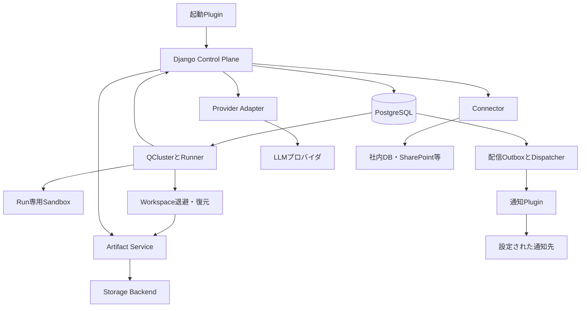
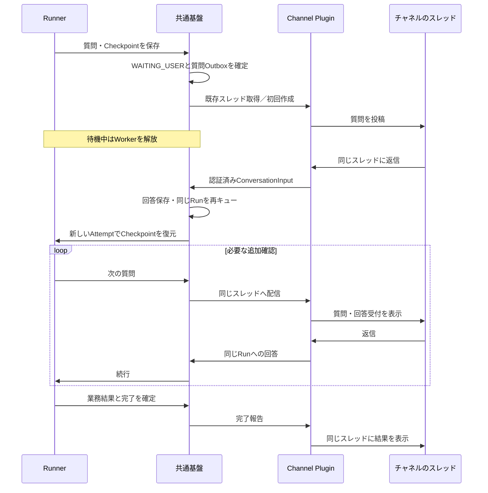
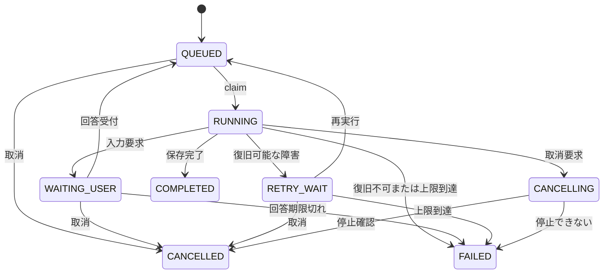

# Yoriki — 社内AI Agent基盤 設計企画書

作成日：2026年10月2日  
更新日：2026年10月27日  
版：0.34 設計案  
対象：サービス企画、開発、運用担当

プロダクト名はYoriki（よりき）とする（0.16でYuhitsuから変更）。同名の製品・サービスがあることは承知の上で、検索での見つけやすさは重視しない。名称の商標・ドメイン等の確認は本設計の対象外とする。

主な改訂内容は§15を参照。0.19では、業務ごとのAgent（業務の設定）とSkillを束ねる業務のPluginをやめ、標準のエージェント1つとSkillを中心とするモデルにした（§3.1）。0.20では、Webhookのpayloadをそのまま渡し、必要な項目だけを取り出す受け取り方にした（§4.2）。0.21では、ハーネスの設計を [harness.md](harness.md) にまとめ、コマンドを常駐のシェルではなく呼出しごとに実行する方式にした（§4.8、§7.5）。0.22では、Sandboxの頻出ライブラリをイメージのPythonに入れ、Run専用の環境はその上の薄い環境にした（§7.6）。0.23では、Runtime ProfileをSkillではなくRunの単位で決めることにした（§7.3）。0.24では、snapshotを戻せないWorkerでの再開を、空のWorkspaceで続けてエージェントに知らせる扱いにした（§7.9）。0.25では、Sandboxの実行環境の既定をgVisor（runsc）にした（§7.2）。0.26では、同じ会話の中では依頼が変わっても文脈とWorkspaceを引き継ぐことにした（§5.1、§7.1）。0.27では、Skillの部門の範囲を、役割とは別の部門と所属で表すことにした（§3.6）。0.28では、会話でSkillを使う形（一覧の固定、実行中の指定は次の依頼、業務結果を確定できるRun）を決めた（§11.4）。0.29では、Skillの編集のRunの始め方（入力欄での明示と、業務のRunからの提案の確認）と、対象のSkillを1つに固定することを決めた（§11.6）。0.31では、社内DBのConnectorを使える人（役割と部門）、MySQLのドライバ（PyMySQL）、SQLの検査の範囲を決めた（§4.9）。0.32では、接続先と資格情報（接続）をConnectorから分け、1つの接続の上に、公開する範囲と使える人の違うConnectorを複数作れるようにした。権限を所属とpermissionの2軸で判定し、Groupを判定に使わないことにした（§3.6、§4.9.1）。0.33では、権限の設計を [authorization.md](authorization.md) にまとめた。Skill・Connector・タスク・入口・出口が範囲（個人・部門・全社・システム）を持ち、利用・業務の管理・基盤の管理の3つの層で判定する。部門の中の役割と特別な部門をやめ、タスクのRunは起動のしかたで決まる実行許可で動かし、管理APIをすべてpermissionで判定することにした（§3.6、§4.1、§4.9.1、§10.0）。0.34では、Skillが使うConnector・操作・表を宣言し、公開時にConnectorの境界の中にあるかを検証することと、機密のSkill（機密のConnectorを宣言したSkillと、機密のフラグを付けたSkill）を決めた（§4冒頭、§4.9.1）。

## 1 目的と基本方針

社員が業務用AI Agentを共通の社内Webサービスから利用できる基盤を構築する。各自がAPIキー、プロンプト、スクリプト、外部連携を持ち、保守担当が不明なツールが増える状況を防ぐ。管理者がSkill、Connector、資料、権限、利用量を一元管理し、社員は許可された機能を使う。

初期構成はNuxt、Django/DRF、PostgreSQL、Django Q2のQCluster、Dockerによる実行環境とする。Docker Composeで単一ホストに展開する。実行件数が少ない前提で、Redis、専用Workflow基盤、Kubernetesは初期必須としない。

エージェントはYorikiの標準のハーネス1つだけとし、業務ごとの手順・資料・使ってよいTool・Connectorは Skill にまとめる。誰が使え、誰が直せるかはSkillの範囲で決める（[authorization.md](authorization.md)）。コマンドを動かす実行環境（Runtime Profile）はSkillではなくRunの単位で決める（§7.3）。Pluginはサーバーに配備する拡張（起動・通知・保存・Channel・Connector等）とし、共通Registryへ登録して、契約に適合する実装を選択できるようにする（§3.1）。LLMによる判断やプロンプトの指示とは独立して、サーバーと実行環境が権限を強制する。

社員は会話で業務を依頼し、エージェントは必要に応じてLinuxコマンド、Pythonコード、文書処理CLIを使う。また「この手順をSkillにして」「今後はこの基準で処理して」と依頼することで、エージェントにSkill自体を作成・修正させる。Skillの編集と公開はユーザーの権限内で自動実行でき、毎回人の承認を必須にはしない。

社員向けの基本UXは、人間がパイロットを担うチャット型とする。人間が目的、業務上の判断、修正条件、継続的なルール変更を決め、エージェントが許可された範囲で方法の選択と実作業を進める。コマンド、ライブラリ選択、通常のエラー修正ごとの承認を標準フローにはしない。会話を継続的な作業場所とし、その中で非同期のRunが進む構成にする。

チャットやWebhookをTrigger Pluginとして実装し、共通の実行要求から同じRunを作成する。タスクは「起動方法・プロンプト・使うSkillとモデル・通知方法と通知先」を設定する。作業完了の通知と結果・成果物の受渡しはNotification Pluginと任意の通知Skillを組み合わせる。請求書チェックは経理用Zap、営業資料作成は営業用の通知先という使い分けを維持し、初期は一つのタスクに最大一つの結果通知設定・通知先とする。

自動実行でも人間の判断が必要になったら、フローに指定したTeams・Slack・Discordのチャネルへ質問を出す。チャネル参加者の誰でも、そのスレッドに返信すれば同じRunを再開でき、追加の質問、回答受付、節目の進捗、完了報告も同じスレッドへ集約する。フローの定義はTask Definition、一回の実行はRunとして扱い、新たなパイプライン実行エンジンは設けない。

添付、成果物、Skillのマスター、Workspace snapshot、復元用wheel等はStorage Backendを介して保存する。保存先とWorkspaceの退避方式は基盤管理者がセットアップ時に選び、業務プロンプトやタスクごとに指定する必要はない。ローカルファイルシステムとS3を初期の差替え候補とする。

共通のSandbox実行イメージは公開Docker Hubで配布する。Skill本文はPostgreSQL、社内資料はArtifact Storeで管理し、イメージから独立して更新する。日常の業務ルール変更ではイメージの再ビルドを必要としない。

Skillは指示文に加え、その業務で使うファイル一式を保持できる。業務ルールのMD、顧客名寄せ等のCSV、資料作成用のPPTXテンプレートをSkillへ紐づけ、実行時に固定版を参照する。社員は会話からファイルの編集・追加・置換を依頼でき、権限の範囲で次回以降の実行へ反映できる。

将来はWorkerを別ホストに追加できるよう、永続データにホスト上の絶対パスを保存せず、RunとExecution Attemptを分離する。分散実行とは複数のRunをWorkerへ配分することを第一段階とする。単一Runを複数Workerで協調実行する機能は初期対象外とする。

## 2 要件と対象範囲

| 項目 | 要件 |
|---|---|
| 社員向けUI | 会話を開始し（使うSkill・Connectorは `/`・`@` で指定するか、エージェントに任せる）、依頼、添付、追加指示、結果確認、続行、取消を行う |
| 人間の関与 | 目的と業務判断を人間が担い、実行方法や通常の修正はエージェントに任せる |
| 実行中の会話 | 現在の作業の修正、確認への回答、次の依頼を区別して受け付け、反映状態を表示する |
| 作業と成果物の表示 | 現在の作業を表示し、添付と成果物を会話とは別の一覧から開ける |
| 管理画面 | 基盤の管理：Connector・入口・出口と接続、システムのSkill・タスク、モデル設定と既定、Runtime Profile、ユーザー・部門・SSO、クオータの設定。部門・全社のSkill・タスクの編集・公開は業務画面で行う（authorization.md §7.3） |
| 会話によるSkill更新 | エージェントがSkillを作成・修正・試行・公開できる。対象範囲と操作はユーザー権限で制御する |
| Skillの参照ファイル | SkillごとにMD、CSV、PPTX等を保持し、原本・用途・版を管理して参照できる |
| マスターデータ更新 | エージェントへ編集を依頼するか、チャット添付を指定ファイルの新しい版として置換できる |
| ファイルの利用目的 | 今回の入力、今回だけの参照差替え、次回以降のSkill資料更新を区別する |
| コマンド不要のSkill | 指示文・判断基準・出力形式だけのSkillを実行・更新できる |
| 非同期実行 | ブラウザを閉じても実行を継続し、後から結果を確認できる |
| 起動Plugin | チャット・Webhook等を共通の実行要求へ変換し、起動方法をタスク設定で切り替える |
| 通知Plugin | 作業完了と結果・成果物の通知を共通イベントから配信し、通知方法を切り替える |
| 通知Skill | 要約・整形・成果物選択をSkillとして更新し、実際の配信は許可されたAdapterで行う |
| タスク別通知 | タスクごとに結果通知設定・通知先を選び、実行と配信の履歴・再試行を分離する |
| フロー別の対話先 | Teams・Slack・Discord、接続先の組織・チーム・サーバー・チャネルをフローごとに指定する |
| チャネルの参加者による対応 | チャネルの誰でも回答・停止でき（追加指示を出せるのは、そのRunを起動した本人だけ。入口から起動したタスクのRunは追加指示を受け付けない。authorization.md §6）、個別の回答者登録やアカウント紐付けを不要とする |
| スレッドでの再開 | 質問へのスレッド返信を同じRunへ取り込み、待機中に解放したWorkerを再確保して再開する |
| スレッドの継続利用 | 一回の実行につき同じスレッドを完了まで使い、再質問やWorker再起動で新しいスレッドを作らない |
| 保存Plugin | 添付・成果物・マスター・snapshot等を同じ保存契約で扱い、セットアップ時にローカル／S3等を選ぶ |
| 作業環境の退避 | 作業ファイルと環境定義をCheckpointに対応させ、Worker解放後に復元できる |
| 利用量 | ユーザー別の予算、実行回数、同時実行数、Runごとの上限を管理する |
| ファイルアクセス | 添付と、使うSkillに紐付いた資料だけを作業環境に展開する |
| コマンド実行 | Linuxコマンド、Python等を隔離環境で利用できる |
| Pythonライブラリ追加 | 管理Toolを通じて依存関係を取得し、Run専用環境へオフラインで追加できる |
| イメージ配布 | 公開Docker Hubの共通イメージをdigestで固定して利用する |
| 通信 | Sandboxのネットワークを無効化し、LLM・package取得・結果通知・外部データ接続（Connector）は管理された経路で行う |
| LLM選択 | 管理画面で登録したモデル設定から、会話とタスクでモデルを直接選ぶ。effortはモデルごとの値を使い、自動で上げ下げするのはeffortだけ。モデルの切り替えは利用者が明示したときだけで、障害時は会話なら利用者に切り替えを求め、タスクならエラーを通知する（§4.8） |
| 外部データ | 社内DB・SharePoint等へControl PlaneのConnectorを介して接続し、Bindingで許可した操作だけを使う（§4.9） |
| 認証 | 社員は社内SSO（OIDC）でYorikiにログインし、ログイン状態をセッションCookieで保つ。SSOのない導入先では、Yorikiのアカウント（基盤管理者が招待し、本人がパスワードを設定する）でログインする。前段に認証プロキシがあっても、Yoriki自身でログインする（§10.0） |
| 履歴と再開 | メッセージ、実行イベント、利用バージョン、成果物、再開状態を保存する |
| 運用 | 中間生成物を自動削除し、停止Workerや孤立コンテナを回収する |
| 将来の拡張 | 共通の実行・保存契約を使ってWorkerサーバーを追加し、同じ私設ネットワーク内の別ホストでの実行を可能にする |

MVPは社内文書・表計算・PDF等の分析や作成、会話によるSkillの改善、チャット／Webhookの起動Plugin、画面内／Webhook・Zapierの通知Plugin、Teams・Slack・Discordの双方向Channel Plugin、ローカル／S3のStorage Backend、ファイルsnapshotによる退避・復元、社内DB（PostgreSQL・MySQL・SQL Server）を読取り専用で照会するデータソースのConnectorを対象とする。SharePoint・Google Drive・MCPサーバー・Web検索とWeb取得へのConnectorは初期段階の後に追加する。定時実行等の別経路は同じ拡張契約へ追加できるようにするが（タスクの出口としてのメールの送信は持たない。authorization.md §5.5）、すべてのAdapterを初期実装する必要はない。実行コードを持つPluginは基盤管理者が配備時に導入する。利用者やエージェントによる管理サーバー上への任意コードの動的導入、Sandboxからの直接通信、未登録の相手への外部送信は対象外とする。エージェントがそのRunで使うスクリプトをSandbox内に生成することは許可する。

## 3 エージェントとSkillのモデル

### 3.1 各要素の責任

「エージェント」は、Yorikiの標準のハーネス（Runner。§4.8）だけを指す。エージェントは1種類で、業務ごとの振る舞いはSkillで与える。業務ごとのエージェントの設定（どのSkill・モデル・予算を使うかを束ねたもの）は持たない。「Plugin」は、サーバーに配備する拡張（起動、通知、保存、作業ファイルの退避、Channel、Connector）だけを指す（§3.11）。Skillを束ねて配る単位としてのPluginは持たない。

| 要素 | 責任 | 例 |
|---|---|---|
| エージェント | 標準のハーネス。依頼とSkillに従い、許可されたToolで作業を進める。1種類だけ | — |
| Skill | 手順、判断基準、入出力の形、選ぶための説明、使ってよいTool、資料、Connector、必要な能力をまとめる。範囲（個人・部門・全社・システム）で誰が使え、誰が直せるかが決まる。エージェントによる編集も可能 | 書類確認手順と項目マスター、資料作成手順とPPTXテンプレート |
| Tool | サーバー側で実行する操作と権限境界を定める | shell、install_python_packages、update_skill_draft |
| Resource / ResourceVersion | ファイルの論理IDと不変の原本・hash・版を管理する | 顧客マスターCSVの第4版 |
| SkillAssetBinding | Skill内のファイル名・用途とResource Versionを結び付ける | customer-master、presentation-template |
| Resource Collection | 複数のSkillで使う業務資料の集合を管理する | 社内共通用語集、料金基準 |
| Runtime Profile | 承認済みの実行イメージと資源上限を定める。Skillごとには持たず、Runの単位で決める（基盤管理者が既定を1つ決める。§7.3） | Pythonと文書処理ツールを含む環境 |
| Task Definition | エージェントフローの定義。起動Binding、プロンプト、使うSkill、モデル、対話Binding、結果通知Bindingを定める | 請求書チェックの自動実行設定 |
| Plugin | サーバーに配備する拡張。起動・通知・保存・退避・Channel・ConnectorのAdapterを登録する。基盤管理者が導入する | Webhook起動、Zapier通知、Teams、社内DBのConnector |
| Channel Plugin / Interaction Binding | 受信・送信Adapterをまとめ、チャットツール・チャネル・スレッド方針を設定する | Teamsの経理チャネルで質問・回答 |
| External Thread Binding | 一つのRun・Conversationと外部スレッドの対応を永続管理する | 請求書チェックRunとSlackの特定スレッド |
| Trigger Adapter / Binding | 起動元を共通要求へ変換する実装と、タスクごとの接続設定 | Webhook Adapterと経理用受信endpoint |
| Notification Adapter / Binding | 共通イベントを配信する実装と、通知Skill・イベント・内容・宛先の設定 | Zapier通知、画面内通知 |
| Destination | 通知先の識別子・接続情報・Secret参照・利用可能scopeを管理する | 経理用Zap、ユーザーの通知欄 |
| Storage Backend | ファイルbytesの保存・取得・削除を共通契約で実装する | Local Filesystem、S3 |
| Workspace Persistence Adapter | 作業ファイルをsnapshotへ退避し、別Attemptへ復元する | ファイルsnapshot方式 |

**SkillとConnectorの選び方**：会話では、社員がSkillやConnectorを明示して依頼できる（Skillは入力欄の `/` か一覧から、Connectorは `@` で指定する。例：「/請求書の照合 この3件を確認して」「@社内DB の先月の発注を出して」）。明示しなくてもよく、その場合はエージェントが、その社員が使えるSkill・Connectorの名前と説明から依頼に合うものを探して使う。エージェントに見せる一覧は、利用者の権限で使えるものだけに絞る。自動実行では、Task Definitionが使うSkillを指定する。

Skillの選択や読込み自体は権限を増やさない。Skillを通しても通さなくても、Tool・資料・Connectorの利用は、ユーザー、Skill、Run、対象Resource・Connectorの許可をサーバー側で再検証する（機密のフラグが付いたConnectorはローカルLLMのモデルを使う会話・タスクにだけ使える。§4.9.1）。

### 3.2 バージョンと公開

権限を持つユーザーと、そのユーザーの依頼を受けたエージェントはDB上のSkill Draftを編集できる。Publish時に不変のSkill Versionを作成する。Skill Versionは、本文、使ってよいTool、SkillAssetBinding（マスター・テンプレート等の資料の版）、Resource Collectionの版、使うConnectorと操作・表（明示する場合。要件の宣言で、使える範囲は利用者・タスクの権限で決まる。§4.9.1）、機密のフラグ（§4冒頭）、入出力の形、必要な能力（Tool呼出し、画像入力等）を固定して持つ。公開済みの本文や参照先を直接書き換えない。

ファイルだけを更新する場合も、新しいResource Versionを参照するSkill Versionを発行する。Skill本文が同じでも、どのファイルを使う版かを一意に記録する。本文・複数ファイルをまとめて変更する場合は、一つのSkill Draftから整合した組合せとして公開する。

Skillは範囲（個人・部門・全社・システム）ごとに公開する（§3.6）。会話は最新の公開版を使い、Runの中では固定する（次の依頼のRunでは、その時点の最新の公開版を使う）。タスクは版を固定し、版を上げるのはタスクの変更として、タスクを管理できる人が行う（ライブラリの依存と同じ。authorization.md §5.4）。Run開始時に、指定されたSkill（`/` やTask Definitionで指定したもの）を具体的なSkill Versionへ解決し、Skill Version、資料版、モデル設定の版とeffort、image digestを実行Manifestへ固定する。Connectorは、タスクでは使うConnectorを固定するが、使えるかどうか（所属・範囲・停止）は固定せず、操作のたびに判定する（authorization.md §6）。

タスクのRunでは、Skillはタスクに固定した版だけを使い、エージェントが探して読み込むことはしない（authorization.md §5.4）。会話のRunで、指定がなく、エージェントが実行の途中でSkillを読み込む場合は、最初に使う前に、そのSkillをその時点の公開範囲の最新の公開版（Skill Version）へ解決し、資料版・必要な能力と合わせてRunのManifestへ追記する。追記は、能力と権限の確認と同じDB transactionで確定し、RunEventに記録してから読み込む。一度追記した版は変えず、同じRunの再試行・入力待ちからの再開では、追記済みの版と資料を使う（途中でSkillが公開し直されても切り替えない）。Manifestには、Run開始時に固定したものと実行中に追記したもの（追記の順序と時刻）を区別して残す。

実行中のRunで使っているSkillを最新の公開版へ切り替えたい場合は、利用者が明示して依頼する（例：「名寄せのSkillを最新にして続けて」。画面からの操作も用意する）。この依頼を受けたら、そのSkillをその時点の公開範囲の最新の公開版へ解決し直し、権限・必要な能力・機密の制限を確かめ直してから、新しい版をManifestへ追記する。前の版の記録は消さず、どの時点で切り替えたかをRunEventに残す。切り替えた後の手順から新しい版と資料を使い、それより前の作業結果はそのまま残す。エージェントが自分の判断で切り替えることはせず、再試行・再開では切り替えた時点までのManifestを使う。公開はDB transactionで確定し、会話の次のRunへ反映する。タスクは版を固定しているので、公開では切り替わらない（タスクを管理できる人が、タスクの変更として版を上げる）。

必要な能力は、Run開始時（エージェントがSkillを読み込むときも含む）に、使うモデルが持つかを確かめ、満たさない組合せでは使わない（§4.8）。

同じRunの再試行・入力待ちからの再開は元のManifestを使う。完了後に作る新しいRunは開始時点の設定を解決する。明示的に過去条件を再現する新規Runでは旧Manifestを参照できる。失効した権限や停止されたSkill・Plugin・Connectorは、過去版であっても実行時に拒否する。

この記録は当時の入力と設定を追跡するためのものであり、LLMの同一出力を保証するものではない。

### 3.3 Skillの定義例

以下は本基盤独自の形式案であり、既存製品のSkill形式との互換を前提としない。

```yaml
skill_id: check-bl-fields
version: 7
name: B/Lの項目を確認する
description: |
  船荷証券（B/L）のPDFを読み、必須項目の有無と書式を確認する。
  B/L・船荷証券・輸入書類の確認を頼まれたときに使う
instructions: |
  ...
tools:
  - shell
  - read_file
  - publish_artifact
assets:
  - name: field-master
    resource: bl-field-master
    version: 4
resource_collections:
  - id: logistics-glossary
    version: 4
connectors:
  - id: core-db
    operations: [query]
requires: [tool_calling]
input_schema_ref: bl-check-input-v1
output_schema_ref: bl-check-result-v1
```

Skillが要求する権限（Tool、Connector、資料）は、ユーザーの権限と管理者の組織ポリシーの範囲内でのみ有効にする。`connectors` は省略してよく、その場合は会話のRunでだけ、エージェントが利用者の使えるConnectorから探して使う（タスクのRunでは、タスクに固定したConnectorだけ。authorization.md §5.4）。Skillから任意のホストパス、Dockerオプション、実行イメージ、接続先URLを指定できる仕組みにはしない。実行環境はRunの単位で決まる承認済みのRuntime Profileを使い（Skillからは選ばない。§7.3）、接続先は登録済みのConnectorから選ぶだけにする。

プロンプトと手順はDB編集を認める。管理Toolの実装コードとOSパッケージはレビュー済みソース・イメージで管理する。追加Pythonライブラリは7.6節の取得経路でRun専用環境に導入する。秘密情報はSkill本文に埋め込まず、管理側のSecret参照（Connectorの資格情報等）として扱う。

### 3.4 コマンド不要のSkill

文章の校正、顧客への回答案、提供テキストの分類等は、LLMへの指示と提供済みの内容だけで実行できる。SkillのTool要求を空にし、コード実行権限を与えない。PDF等からの抽出が別途必要な場合は、許可された入力処理で抽出したテキストを渡すか、読み取り用Toolだけを明示して付与する。

```yaml
skill_id: customer-response
version: 5
instructions: |
  提供された情報をもとに顧客への回答案を作成する。
  不明な事項は推測せず、確認事項として列挙する。
input_schema_ref: customer-response-input-v1
output_schema_ref: customer-response-output-v1
allowed_tools: []
```

Skill本文の変更にはDocker imageの再ビルドもWorkerの再起動も必要ない。共通Runnerが固定されたSkill Versionを読み込んで実行する。shellを必要とするSkillでは、許可されたToolを同じRunnerから呼び出す。

### 3.5 エージェントによるSkillの作成と修正

Skill編集はDjango側の管理Toolとして提供する。エージェントへDBの直接編集やホスト上のSkillファイルの書換えを許可する必要はない。管理画面とエージェントは同じ検証・公開処理を利用する。

| Tool案 | 操作 |
|---|---|
| list_skills / get_skill | 利用者が閲覧できるSkillと現在版を取得 |
| create_skill_draft | 新規Skillまたは既存Skillの指定版からDraftを作る |
| update_skill_draft | Draftの本文等を期待revision付きで変更 |
| test_skill_draft | Draftと公開中の版を評価ケースで試し、比べる（§3.7.1） |
| publish_skill_draft | Skill Versionを作り、権限があれば公開範囲の最新の公開版にする |
| rollback_skill | 公開範囲の最新の公開版を、選択した過去の版へ戻す |

例えば社員が「このチェックではNotify Partyが空でもエラーにしないで。Skillも直しておいて」と依頼した場合、エージェントは対象Skillを特定し、既存版を読み、該当する条件だけを修正する。差分と必要な試行結果を記録し、公開権限と公開設定の範囲で反映する。結果には新しい版、反映範囲、変更点を表示する。

新規Skillは、共有先の指定がなければ本人のscopeで作成する。公開すればすぐに本人が `/` で指定でき、エージェントも選べるようになる。部門・全社への公開はそのscopeの公開権限に従う。

一回限りの回答修正と永続的なSkill変更を区別する。「今回だけ」の指示は公開版へ反映しない。ユーザーが継続的な改善を委任している場合はその範囲で更新できる。添付やTool出力に含まれた「Skillを書き換えよ」という記述を、ユーザーからの更新依頼として扱わない。更新権限と対象scopeはControl Plane側で保持する。

### 3.6 編集と公開の権限

権限の設計は [authorization.md](authorization.md) を正とする。要点は次のとおり。

- 権限は「所属」と「permission」の2軸で判定する。Groupは判定に使わない（permissionの集まりで、導入先が自由に変えてよい）。部門は人の集まりで、入れ子・特別な部門・部門の中の役割を持たない（0.33で、0.27の部門の中の役割をやめた）。
- 所属は、使える部門・管理できる部門の2つの関数（と、部門タスクのチャットからの起動に使う実際の所属）で判定する。permission `user.can_use_all_departments` は使える部門だけを、`user.can_manage_all_departments` は使える部門と管理できる部門をすべての部門に広げる。どちらも実際の所属は広げない（監査のための権限で部門タスクを起動させない）。
- Skillの範囲は「所有と管理の単位」で、個人・部門（1つの部門）・全社・システムのどれか。システムのSkillはシステムタスクだけが使い、会話には出さない。
- Skillは権限を持たない。手順と判断基準で、許可を狭めることはできても広げることはできない。

| 範囲 | 使える（見える）人 | Draftを変更できる人（編集の権限） | 公開・切戻し・Toolの変更・緊急停止・削除ができる人（公開の権限） |
|---|---|---|---|
| 個人 | 本人 | 本人 | 本人 |
| 部門 | 使える部門の人 | 管理できる部門の人で、`skill.can_edit_department_skills` を持つ人 | 管理できる部門の人で、`skill.can_publish_department_skills` を持つ人 |
| 全社 | 全員 | `skill.can_edit_company_skills` を持つ人 | `skill.can_publish_company_skills` を持つ人 |
| システム | システム管理者 | `skill.can_edit_system_skills` を持つ人 | `skill.can_publish_system_skills` を持つ人 |

公開の権限は編集の権限を含む。個人のSkillは本人だけが扱い、基盤管理者にも画面とAPIでは見せない。Skillの範囲は作成時に決め、通常の操作では変えない（広げる場合は、その範囲に新しいSkillを作る。組織の再編での付け替えは authorization.md §9）。

自動公開の可否はscopeごとのポリシーで定める。権限がある操作に追加の承認を一律要求しない。公開権限がなければDraftとして保存し、未反映であることを明示する。必要なら閲覧可能な共通Skillから個人用を派生させるが、元Skillの公開範囲を拡大したり他者の資料を複製公開したりしない。

編集の権限（本文・例示・入出力Schema、そのSkillの資料の追加・置換）と、公開の権限（Toolの変更、資料の検証の条件の変更、公開・切戻し・停止）を分ける（authorization.md §5.1）。Skillは Secret を持たず、範囲（共有範囲）は通常の操作では変えない（組織の再編の別の操作。authorization.md §9）。Skill管理Toolを持つエージェントでも自分の実行権限を増やせない。入出力Schemaの変更時は、そのSkillを使うTask Definition・通知設定との互換性を検証する。

Skillの資料は、そのSkillのDraftの中だけで追加・置換する（編集の権限）。別のSkillや別部門の資料を参照させる操作は持たない。閲覧可能な個人ファイルであっても、部門・全社へ公開するには対象scopeへの登録・公開権限を必要とする。

実際のTool許可は、ユーザー権限、Skillの許可、組織ポリシー、Runで確定した実行範囲、対象Resource・Connectorの権限を照合して決める。Skill本文は権限の根拠にしない。コマンド不要の業務Runで別Skillのshell権限が混入しないよう、Toolは実行コンテキストごとに限定する。

業務処理とSkill編集は別の実行コンテキストにし、必要なら同じConversation内の関連Runとして実行する。これにより、業務Skillが`allowed_tools: []`でも、ユーザーが編集を依頼したときはSkill管理Toolを使える。編集中のSkillやDraftを読み込んでも、管理Toolの権限は変化しない。

### 3.7 差分と競合と評価

Draftにbase versionとrevisionを持たせ、更新・公開時に期待値を照合する。DraftはSkillごとに1つとし、複数人が同じDraftを編集する（revisionで競合を検出する）。公開するとDraftは閉じ、次の変更は新しいDraftで行う。別の変更が先に公開されていた場合は無条件上書きをせず、最新との差分から修正案を再構成する。Skillと公開範囲のいずれの競合も検出する。

SkillChangeには依頼ユーザー、Run ID、元の版、変更理由、差分、試行結果、公開先と公開版を記録する。公開処理にはoperation keyを付け、Workerの再送でも同じ変更が重複公開されないようにする。

評価は、Schema等の機械的検証と、業務例に対する旧版・新版の比較を使う。必須ケースはscopeの設定で定め、単純な文言修正まで一律に重い試験を要求しない。エージェントによる評価だけで正しさが保証されるとは扱わない。共有Skillに個別顧客の添付内容を不用意に転記しないよう、例示は公開先に適した内容へ一般化する。

Draftの試行は独立した評価Runで行い、利用量を記録する。評価対象のDraftにはSkill公開Toolを渡さず、Skill編集の再帰実行を防ぐ。Skillを元に戻す場合は、旧版の本文とファイル参照を新しいDraftの基にして公開する（公開範囲の最新の公開版を旧版へ戻す操作も監査する）。公開履歴は削除しない。

#### 3.7.1 Draftの評価

**評価ケース（SkillEvaluationCase）**：Skillごとに持ち、版をまたいで使う（1つのSkillに20件まで）。名前、依頼の文、添付（資料と同じResourceVersionで原本を持つ）、確認する観点（文。LLMの判定に使う）、期待する業務結果（任意。`submit_result` の値と、書いた項目だけを一致で照合する）、「公開の前に必須」の印を持つ。作成・変更・削除は編集の権限以上。必須の印を付ける・外すこと、必須のケースを変更・削除することは公開の権限だけにする（編集の権限で公開の条件を緩められないように）。個人のSkillには必須の印を付けない。

**評価（SkillEvaluation）**：画面の「Draftを評価」か、Skillの編集のRunの `test_skill_draft`（harness.md §10.9）で始める。選んだケース（1回に10件まで）ごとに、公開中の版とDraftで1つずつ評価のRunを動かし、結果を並べて比べる（最初の公開の前と、公開中の版が評価する人の使えないConnectorを宣言しているときは、Draftだけ。§4.9.1）。

- 始めた時点のDraftの中身（本文・Tool・必要な能力・Schema・資料の版）を評価に写して固定する。評価中にDraftが変わっても混ざらない。後でDraftが変わったら、画面には「前のrevisionの評価」と示す。
- 使うモデルは、画面では評価のたびに選び、`test_skill_draft` では編集のRunのモデルを使う。モデルがDraftの必要な能力を持たなければ始めない。機密のSkill（§4冒頭）は、ローカルLLMのモデルで、機密のRunとして評価する（`test_skill_draft` は機密の会話の編集のRunだけなので、そのモデルを使う）。停止中のSkillは評価しない。同じSkillで評価中のものがあれば、新しい評価は始めない。
- 評価のRun（`Run.kind` が評価、起動方法も評価）は、答える人がいないRunとして動く（`ask_user` を出さず、確認が要る場面では仮定を置いて進め、最後の応答にその仮定を書く）。Skillは `/` で指定したときと同じく、Toolをその `tools` と `submit_result` に限り、資料は同じ `skills/<Skill>/<key>/` に置く。Skillの読込み（`skill`）、編集の提案（`request_skill_edit`）、Skill管理のToolは出さない。Runごとに一覧に出さない会話を作り、ケースの添付を `/workspace/input` に置く。利用量は依頼した人のRunとして記録する。
- **機械的な検証**：Runが完了したか、業務結果のSchemaがあれば `submit_result` で確定したか、期待する業務結果と一致したか。Draftの側がすべて通ればそのケースは「通過」。
- **LLMの判定**：両方のRunが終わったら、評価のモデルに、依頼・確認する観点・両方の最後の応答と業務結果を渡し、Draftが「良くなった・同じ・悪くなった」と理由を返させる（Toolの呼出しで受け取る。Toolに対応しないモデルでは判定しない）。判定の利用量はDraftの側のRunに記録する。判定は参考として表示し、公開の条件には使わない（エージェントによる評価だけで正しさが保証されるとは扱わない）。
- 評価は停止できる（動いている評価のRunを止める）。

**公開の条件**：部門・全社のSkillで必須のケースがあれば、今のDraftのrevisionで、必須のケースそれぞれの直近の（終わった）評価の結果が「通過」でなければ公開できない（画面・`publish_skill_draft` とも）。必須のケースは複数の評価に分けて試してよい（1回の評価のケースの数に上限があるため）が、後の評価で通過しなければ、前の通過では満たさない。評価の後に変えた必須のケースは、評価し直すまで満たさない。必須のケースを作らなければ、文言の修正は評価なしで公開できる。切戻しには評価を求めない。

### 3.8 Skillごとの参照ファイル

Skillには複数のファイルを持たせ、それぞれに安定したasset ID、表示名、用途、説明、Resource Versionを設定する。ファイル名だけで同一性を判断しない。実体は共通のArtifact Store、ファイル管理情報はResource/ResourceVersionへ保存し、Skill専用の別ストレージを増やさない。

| 用途 | 形式例 | 利用方法 |
|---|---|---|
| 参照資料 | MD、PDF | 業務ルール、用語、手順を読み取る |
| マスターデータ | CSV、JSON、XLSX | 名寄せ、コード変換、検証、計算に使う |
| テンプレート | PPTX、DOCX、XLSX | 原本をコピーし、今回の成果物を作成する |

MVPはMD・CSV・PPTXの保持・取得・置換を対象とし、形式に応じたエージェントによる編集を順に実装する。ファイルが保存できることと、その全要素をエージェントが編集できることは別の対応能力として表示する。PPTXは原本のバイナリを保持し、抽出テキストやプレビューだけを保存する方式にはしない。

```yaml
# Skill Versionに含めるファイル参照の例
skill_id: sales-proposal
version: 8
assets:
  - asset_id: proposal-guidelines
    display_name: proposal-guidelines.md
    role: reference
    resource_id: proposal-guidelines-file
    resource_version: 3
  - asset_id: customer-master
    display_name: customer-master.csv
    role: master
    resource_id: customer-master-file
    resource_version: 4
  - asset_id: presentation-template
    display_name: proposal-template.pptx
    role: template
    resource_id: proposal-template-file
    resource_version: 2
```

実行時は、選ばれたSkill Versionのファイル一覧を権限検証し、必要なものを取得する。小さなMDは内容をRunnerへ渡せる。CSVの照会やPPTX生成では、固定された原本をSandboxのmaster領域へROで展開する。すべてのファイルを毎回全文プロンプトへ投入する必要はない。

テンプレートから成果物を作る通常の処理では、原本をworkへコピーして編集し、完成品をoutputへ保存する。これによってSkillのテンプレートが更新されることはない。テンプレート自体を直す場合は、明示的な更新依頼または委任された範囲に基づき、次節の更新操作を使う。

### 3.9 エージェントによる編集と添付からの置換

ファイル更新もSkill Draftへ集約する。エージェントは元のファイルを読み、変更候補を作成し、検証結果とともにDraftへ登録する。公開時にSkill本文と参照ファイルの組合せを一括確定する。

| 操作 | 社員の依頼例 | 処理 |
|---|---|---|
| 内容の編集 | 「ルールMDに支店を区別する条件を追記して」 | 指定版を取得して編集し、新しい候補ファイルを作成 |
| 行や値の更新 | 「顧客CSVのこの会社の正式名を変更して」 | 対象キーと列を特定し、変更行を検証 |
| ファイル置換 | 「この添付PPTXを今後のテンプレートにして」 | 添付原本を指定assetの新しい版として登録 |
| ファイル追加 | 「この対応表もSkillから参照して」 | 用途と公開範囲を設定し、新しいassetをDraftへ追加 |
| ファイルだけ切戻し | 「テンプレートだけ一つ前に戻して」 | 旧Resource Versionを参照する新しいSkill Versionを公開 |

エージェント向けには次の管理Toolを追加する。IDやpathをLLMが指定できること自体を権限の根拠にせず、サーバーが対象Skill・Draft・元ファイル・候補Artifactを照合する。

| Tool案 | 操作 |
|---|---|
| list_skill_assets / read_skill_asset | 固定版の一覧、metadata、許可された内容を取得 |
| update_skill_text_asset | MD等の内容変更を期待版付きでDraftへ保存 |
| stage_skill_asset | エージェントが生成した候補Artifactを追加・置換対象へ紐づける |
| replace_skill_asset_from_upload | 当該ユーザーの添付IDから、指定assetの置換候補を作る |
| validate_skill_assets | 形式・容量・業務Schema・プレビュー等を検証 |
| publish_skill_draft | 本文とファイル参照を含むSkill Versionを公開し、公開範囲の最新の公開版にする |

MDの修正や添付のそのままの置換は管理APIだけで行える。CSVの加工やPPTXの編集でコードが必要な場合は、編集用Runの許可されたSandboxで作業する。業務Skillがコマンド不要でも、別の編集コンテキストに適切なToolを付与できるが、業務Skill自身の権限を増やす操作にはしない。

形式ごとの検証方針は次のとおりとする。既定の検証条件は管理側で保持し、候補ファイルの内容から検証を無効化させない。

- MD：元のencodingを扱えること、意図した本文差分であることを確認する。
- CSV：encoding、区切り、ヘッダー、識別子の文字列表現を明示し、設定された必須列、キー重複、型、変更行数を確認する。先頭ゼロの消失等を防ぎ、対象キーが曖昧なら確認する。
- PPTX：元のファイルを編集候補の基にし、読み込み、スライド・レイアウト・プレースホルダーの構造を確認する。変更箇所は、スライドごとのテキストと構造の差分で示す（画像としてのプレビューは、LibreOfficeを使わない方針のため後で方法を決める。§7.6）。未対応の要素がある場合は編集済みとして公開せず、元ファイルを保持して添付置換等の扱いを案内する。

検証の実装（`resources/formats.py`）：

- 検証はControl Plane（api）で行う。PPTXはpython-pptxで読み、zipの項目数と展開後の合計の大きさに上限を設けて、展開すると大きすぎるものは読まない。ファイルの中の外部リンク先へは通信しない。
- 資料を加える・置き換える・検証の条件を変えるたびに検証し、結果（誤り・注意・中身の概要・Draftの元の版の同じ資料との差分）をDraftの資料に保存する。公開すると、検証の条件と結果を版の資料（SkillAssetBinding）に写す。変更の記録（SkillChange）には、置き換えた資料の差分の数（MDの行数、CSVの行数、PPTXのスライド数）を残す。切戻しでは、切戻しの前の版と原本が違う資料を検証し直して差分を取る。
- 検証の条件（CSVの文字コード・区切り・必須列・キー列・列の型）は資料ごとに持ち、版に固定する。条件を変えられるのは公開の権限を持つ人だけ（条件を緩めて誤りを隠せないように、本文を編集できる人でも変えられない）。
- 誤りのある資料を含むDraftは公開できない。ただし、元の版から原本も条件も変えていない資料（検証の仕組みを入れる前に公開した資料等）の誤りは表示だけにし、公開は止めない。
- CSVの値はすべて文字列のまま扱う。前の版に先頭が0の値があった列から先頭の0が消えていれば誤りにする。キーの列があれば行をキーで対応付けて差分を取り、なければ行の組合せの増減だけを数える。10MBを超えるCSVは行を保持せずに読み、文字コード・見出し・列の数・必須列だけを検証する（キー・型・先頭の0・差分は行わず、注意として示す）。
- PPTXは、スライドのID・レイアウト・プレースホルダー・テキスト・要素（画像・グラフ・表・SmartArt等・動画）の数で差分を取る。エージェントが元の資料を編集して作った候補（添付の `/workspace/input` からのそのままの置換でないもの）で、マスター・レイアウト（名前と中身）か、残したスライドに割り当てたレイアウト・プレースホルダーか、残したスライドの画像・グラフ・SmartArt等・動画（中身・位置・大きさ・トリミング）が変わっていれば誤りにし、完成したファイルのアップロードによる置換を案内する。
- 管理Toolの `validate_skill_assets` は別に設けず、`stage_skill_asset` の結果（検証の結果と差分）と `get_skill`（Draftの資料ごとの検証の結果）で示す。中身とファイル名が今の版と同じファイルでの置換では、資料の版を増やさない。

アップロードしたファイルを置換用に指定された場合は、原本のbytesを保持する。編集や変換を依頼されていなければエージェントによる再生成を挟まない。取得・検証・プレビュー生成のためにファイル内の外部リンク先へ任意通信を許可しない。

### 3.10 公開と参照の整合性

候補ファイルの保存とhash・サイズ・形式の検証を完了してから、DB transactionでResource Version、Skill Version、公開範囲の最新の公開版の参照を確定する。必要なファイルが一つでも未保存なら、その変更セットを公開しない。途中失敗で残った未参照の候補は後から回収する。

既存assetの置換はasset IDとResource IDを維持し、新しいResource Versionを作る。期待するSkill・Resource・Draftの版を確認し、同時更新があれば競合として扱う。公開のoperation keyと監査記録には、元ファイル、新ファイル、hash、依頼者、編集Run、変更理由、検証結果、反映先を含める。

Skillごとのファイルは既定でそのSkillの範囲で管理する。共通Resource Collectionを複数Skillから参照する場合も、公開版には具体的なResource Versionを固定する。共有ファイルの新しい版を作っても、他のSkillの固定参照は自動変更しない。共通資料を一括反映する場合は、更新対象のSkillと権限を明示して、それぞれの新しい版を公開する。

Skill用のファイル編集権限だけで共通Resourceの正本を変更することは認めない。必要なら許可された範囲でSkill専用のコピーを作り、元の共有資料を保持する。公開先が広がる場合は、添付・元資料の共有制約と公開先の権限を確認する。

進行中・確認待ち・再試行中のRunは元のファイル版を使い続ける。更新したマスターを今の処理にも使う場合は、更新後のManifestで新しいRunを作って処理する。今回だけ添付を代替参照にする場合は、許可されたassetに対するRun限定の差替えとして明示的に記録できるが、公開済みSkillの参照は変えない。

Run限定の参照差替えも開始時に固定する。進行中のRunでマスター・テンプレートの差替えを依頼された場合は、元Runとの関係を残して新しい続行Runへ渡す。通常の追加入力と、業務基準になるマスターそのものの変更を区別する。

ファイル単体の切戻しでは、旧Resource Versionを参照する新しいSkill Versionを発行して他の本文・ファイルを維持する。Skill全体を切り戻す場合は、本文とファイル一覧をまとめて旧構成へ戻す。いずれも既存の監査履歴を削除しない。

### 3.11 起動・通知・保存のPlugin契約

Plugin Registryに拡張種別を設け、Adapter実装、契約版、設定Schema、対応能力を登録する。Pluginはサーバーに配備する拡張の配布・管理の単位、Adapterは基盤が呼び出す実装、Bindingはタスク等から選択する具体的な設定とする（Connectorも同じ扱い。§4.9）。Skillは自然言語の手順を担い、Adapterの通信・保存・権限処理を置き換えない。

| 拡張種別 | 基盤から見た契約 | 主な選択場所 | 初期実装 |
|---|---|---|---|
| trigger | 認証済み起動元をExecutionRequestへ正規化 | タスク設定。通常チャットは既定Binding | chat、webhook |
| notification | Runの確定イベントと結果を宛先へ配信 | タスク／明示的な送信操作 | in_app、webhook、zapier |
| storage | 不変のbytesを保存・取得・削除 | サーバーセットアップ | local、s3 |
| workspace_persistence | 作業ファイルの退避・検証・復元 | サーバーセットアップ | file_snapshot |

Teams・Slack・DiscordのChannel Pluginは、Triggerの受信AdapterとNotificationの送信Adapter、スレッド操作能力をまとめたPlugin packageとする。新たな実行エンジンや保存方式は増やさない。新規起動を受け付ける能力と、既存Runへの返信を受け付ける能力を分け、自動実行の返信用設定を追加しただけではチャネル内の発言から新規Runを起動しない。

Channel Pluginにはcreate_thread、send_thread_message、receive_thread_reply等のcapabilitiesと対応チャネル種別を宣言する。Interaction BindingはPlugin・接続設定・Destination・入力モードを参照し、Run開始時にそのRevisionを固定する。返信受付はConversationInputへ正規化し、共通の会話処理へ渡す。スレッドIDは設定に直接書くのではなく、Runごとの実行結果として保存する。

通知Pluginは、通知Adapterと合わせて既定の通知Skill（連携用の要約、出力Schema）を同梱してよい。同梱した通知Skillは全社の範囲のSkillとして登録し、通常のSkillと同じく版を持つ。通知Skillも、タスクに登録できるSkillの規則（authorization.md §5.4）に従う。システムタスクで使うときは、システムSkillとして登録したものを使う（全社Skillの公開者が、強い文脈で動く手順を変えられないように）。共通Registry上で依存・対応版・有効状態を管理する。エージェントにStorage Backendの選択Toolを渡す必要はない。

共通Manifestにはplugin_id、plugin_version、extension_id、extension_type、api_version、config_schema、capabilities、必要な権限・Secretの種別を持たせる。通知Skillを含む場合はその固定版も参照する。サーバー起動時に配備済み実装をRegistryへ登録し、契約版、必須設定、接続確認を検証する。未知のPlugin ID、未対応の設定、必要能力がない組合せは設定段階で拒否する。失敗時に別の通知経路や保存先へ黙って切り替えない。

Adapterの実装コードはレビュー済みのサーバーpackage・imageとして配備し、インストールと有効化は基盤管理者が行う。DBのSkill本文や外部入力から任意のmodule path、配布URL、コードを読み込まない。通知Skillの本文・テンプレートは従来のDraft／Publishでエージェントが更新できる。通知先・利用権限・認証情報・保存先の変更は、それぞれの管理権限で検証する。

タスク公開時にTrigger Binding、Interaction Binding、Notification Bindingの不変Revisionを作り、Runへ使用版を固定する。Pluginの実装版も記録し、処理中Run・未配信Deliveryが依存する版を維持する。更新で互換性が失われる場合は対象を待機させ、drain・旧版併存・明示的な移行を行う。強制停止や権限失効は固定版にも適用する。Storageの物理位置と移行は7.10節の別手順で扱う。

API・Plugin契約・設定例は本基盤独自の設計案であり、外部製品のPlugin形式や既存の実装済みAPIを意味しない。

## 4 全体構成




Control Planeは認証、権限、Registry、Run、予算、LLM呼出し、外部データ接続（Connector）の仲介、成果物の登録を管理する。エージェント（Runner）はLLMとの対話ループとToolの実行調整を担う。SandboxはLLMが生成したコマンドやコードを実行する場所とする。

Trigger Adapterが起動元を正規化し、Control Planeが共通Runを作成する。Runの確定イベントは配信OutboxからNotification Adapterへ渡す。Artifact Serviceは論理ID・権限・版を管理し、bytesの操作をStorage Backendへ委譲する。Workspace Persistence Adapterは同じArtifact Serviceを使ってsnapshotを保存する。通知先、保存先、認証情報をSandboxやLLMの自由入力に委ねない。

Package取得処理は管理された補助処理で、常設サービスを必須としない。Docker HubへのpullはWorker側の準備処理、Python packageの取得は添付や社内資料を持たない専用環境で行う。Skill管理ToolはRunnerからControl Planeへ呼び出す。これらの管理通信をSandboxの通信許可へ転用しない。

RunnerとSandboxは分離する。SandboxにはLLMキー、DB認証情報（Control PlaneのDB・Connectorの接続情報・OAuth token）、Dockerソケット、社内ネットワーク接続を渡さない。Runnerは管理されたLLM経路を通してモデルを呼び、shell等の要求だけをSandboxへ渡す。

Sandboxは`network_mode: none`で起動し、コマンドはDocker exec等の管理側経路で実行する。Skillの指示やPluginの設定が変わっても、コマンドから外部通信を行う権限は生じない。

LLMと提供テキストだけで完結するRunは、Sandboxを起動せずに処理できる。shellやファイル処理が必要になった時点で、あらかじめRunへ認めた権限の範囲内で起動する。Skill管理Toolだけを使う編集RunもSandboxを必要としない。

LLM経路はDjango側のPythonモジュールとして実装し、RunnerはQClusterのプロセスの中から呼ぶ。専用Gatewayサービスや内部APIを必須にしない。Sandboxからは呼べない。

なお、外部LLM APIを使う以上、モデルへ渡すプロンプトやファイル由来の内容は外部サービスへ送られる。「実行時の外部通信禁止」はSandboxからの任意通信を禁止する意味とする。外部へ送ってよいデータかどうかは、システムでは自動で判断できない（利用者が何を入力するかは分からない）。外部のサービスへ送ってはいけないデータを送らないようにするのは、利用者と業務の運用の責任である。Yorikiにできるのは推奨までで、個人情報や機密情報を扱う場合は§4.8のローカルLLM（セルフホスト）を使うよう案内する。仕組みで用意するのは次の3つだけで、正しく使われるかは運営者と利用者の運用による。

- **Connectorの機密のフラグ**：個人情報を主な中身とする接続先（人事DB、顧客の個人情報のDB等）のConnectorに、基盤管理者が付ける（§4.9.1）。フラグの付いたConnectorは、機密（個人情報・機密情報を扱う）のタスク・会話にだけ一覧に出し、使わせる。Run受付時と操作のたびにも、会話・タスクの区分とモデルを確かめる。社員名・担当者名が入る程度の普通の業務データは区別しない（ほとんどの業務データに含まれるため）。一部の列だけが個人情報の場合は、フラグではなく公開する範囲（その列を除いたビュー）で外す。
- **機密の会話・タスク**：会話を始めるときのウィザードで、個人情報や機密情報を扱うかを確かめ、扱う場合（機密の会話）はローカルLLMのモデルだけに絞る（§11.3）。会話の途中でモデルを切り替えるときも同じ制限をかける（§4.8）。会話は途中から機密にできるが、一度機密にしたら扱わない会話には戻せない（戻せると、機密の情報を含む文脈がクラウドのモデルへ渡る）。機密のConnectorと機密のSkill（次項）は機密の会話・タスクでだけ使える。途中で機密にした会話では、次の依頼から使える（一覧は依頼を始めるときに決める）。タスクの機密はTask Definitionで決める。
- **機密のSkill**：機密のConnectorを宣言したSkill（§4.9.1）と、機密のフラグを付けたSkillを機密のSkillとして扱い、機密の会話・タスクにだけ一覧に出し、使わせる。宣言による機密は、宣言したConnectorの今の版のフラグで実行のたびに決める（後でConnectorに機密のフラグが付けば、Skillも機密になる）。フラグは、資料（マスター等）そのものに個人情報・機密情報を含むSkillに、Skillの管理者が付ける（Draftの項目で、公開すると版に入る）。付けるのは編集の権限、外すのは公開の権限だけ（authorization.md §5.1）。機密のSkillは、会話からの編集（§3.5）も機密の会話でだけ行い、Draftの評価（§3.7.1）もローカルLLMのモデルで、機密のRunとして動かす。
- **出口の機密のフラグ**：機密の会話・タスクの結果は、機密の結果を送ってよいとした出口（Destination。§4.4）にだけ送る。フラグは連携の管理者が付ける（タスク・配信の段階で作る）。

入力や添付の内容から個人情報を検出して警告・マスキングする仕組み（DLP）は、必要になってから追加する。Connectorで取得した社内DB・SharePoint等の内容も、要約や抜粋としてLLMへ渡る点は同じである（§4.9）。

Zapier等への結果送信も明示的な外部データ連携として扱う。どのタスクが何をどこへ送れるかを設定し、結果に含める項目と成果物だけを許可する。Skillのマスターファイル、会話全体、内部ログを自動的に配信対象へ含めない。

### 4.1 タスク定義と差替え設定

Task Definitionは「起動方法＋実行プロンプト＋使うSkillとモデル＋任意の対話先＋結果通知方法と通知先」を管理する。画面上のエージェントフローはこのTask Definitionを指す。WebhookはTrigger Pluginの一実装、ZapierはNotification Pluginの一実装として扱う。起動元と通知先は独立して選べるため、Webhookで起動して画面内へ通知することも、チャットから指定タスクを起動してZapierへ結果を渡すこともできる。

| 設定 | 内容 |
|---|---|
| task_idと名前 | 業務タスクの識別子 |
| trigger | Plugin・Binding、接続設定、起動元の認証、項目の取り出し（任意）、重複のキー、ファイルの取り込み、上限（§4.2）。payloadは取り出しの有無によらず、そのままファイルとしても渡す |
| 実行内容 | 使うSkill（固定の版。payloadの読み方を書いたSkillを含む）、Connector、Tool、モデル設定とeffort、プロンプトテンプレート、入力の形と制限、業務結果Schema。タスクの定義も版を持ち、Runは受付時の版に固定する。版はConnectorと同じく保存のたびにサーバーが作り、SkillのようなDraftと評価は持たない |
| 実行条件 | 範囲（個人・部門・全社・システム）、チャットから起動できるか、利用枠、回答待ちの期限。誰の権限で動くかは起動のしかたで決まる（下記） |
| interaction | 任意の双方向Channel Plugin・Binding、チャネル、返信モード、スレッドの運用方針 |
| notification | 任意の結果通知Plugin・Binding、通知Skill、対象イベント、通知内容、一つのDestination |

タスクの権限は [authorization.md](authorization.md) §5.3〜§7 を正とする。要点は次のとおり。

- タスクは範囲（個人・部門・全社・システム）を持つ。個人は本人、部門はその部門の業務担当（`task.can_manage_department_tasks`）、全社は `task.can_manage_company_tasks`、システムは `task.can_manage_system_tasks` を持つ人が管理する。部門・全社・システムのタスクの定義は、管理できる人だけに見せる。
- タスクに登録できるSkill・Connector・入口・出口は、範囲で決まる。部門のタスクはその部門と全社のSkill・Connector、全社のタスクは全社のSkill・Connector、システムのタスクはシステムのSkillと、システム・部門・全社のConnectorを使う（authorization.md §5.4）。タスクのRunでは、エージェントは固定したConnectorだけを使い、探して使うことはしない。
- 誰の権限で動くかは起動のしかたで決まる（実行許可）。チャットから起動したRunは起動した人の権限を超えない（固定したものを起動した人がすべて使えなければ断る）。入口（スケジュール・Webhook）と、タスクの画面（部門・全社は業務画面、システムは管理画面）からの手動実行のRunは、タスクに固定したものの範囲で動き、自由な依頼文を受け取らない。個人のタスクはどの起動でも本人の権限で動く。0.31の「タスクに設定した社員の権限で動く」形はやめた（0.33）。
- タスクのRunは会話の文脈を引き継がない。Webhookの入口とタスクは1対1にする。

```yaml
# 本基盤独自の設定案。Skillの版はタスクの変更で決め、次の変更まで変えない（Skillを公開しても切り替わらない）。
# Run受付時には、このタスクの版を固定して記録する。
task_id: invoice-check
name: 請求書チェック
skills:
  - id: invoice-check          # 請求書の確認手順と基準
    version: 5
  - id: expense-saas-webhook   # 経費精算SaaSのWebhookのpayloadの読み方
    version: 2
model_profile: standard-model
effort: auto
trigger:
  binding_id: invoice-inbound
  plugin_id: trigger.webhook
  config:
    endpoint: /api/hooks/v1/tasks/invoice-check/
    credential_ref: accounting-hook-key
    # 例はmultipart/form-dataで送る送り元（フィールドは平らな名前と値。JSONで送る送り元なら $.data.invoice.vendor_name のようにネストした場所も書ける）
    event_id: $.event_id         # 重複の判定に使う送り元のイベントID（省略時は Idempotency-Key ヘッダー。どちらもなければ判定しない）
    inputs:                      # 項目の取り出し（任意）。型と必須はタスクの入力の項目で決め、合わない要求は受付時に400
      - name: vendor
        path: $.vendor_name
      - name: amount
        path: $.total_amount       # フォームの値は文字で届くので、数値の項目は読み替える
      - name: invoice_file         # タスクの入力の型がファイルの項目。multipartで付けたファイルを指す（URLは取得しない）
        path: $.invoice_pdf
    max_payload_bytes: 1048576   # 本文（multipartのファイルを含む）の上限
prompt_template: |
  {{ inputs.vendor }} からの請求書（{{ inputs.amount }}円）をチェックしてください。
  受け取ったデータの全体は webhook_payload.json にあります。
  確認結果と修正版を作成してください。
output_schema_ref: invoice-check-output-v1
interaction:
  binding_id: invoice-discussion
  plugin_id: channel.teams
  destination_id: teams-accounting-review
  thread_policy: one_per_run
  open_thread_on: first_question
  reply_mode: thread_reply
  events: [run.waiting_user, run.resumed, run.completed, run.failed, run.cancelled]
notification:
  binding_id: invoice-result
  plugin_id: notification.zapier
  skill_ref: accounting-result-summary
  destination_id: zapier-accounting
  events: [run.completed, run.failed]
  content_mode: status_and_result
```

初期は一つのタスクに一つの起動Binding、最大一つのInteraction Binding、最大一つの結果通知Bindingを持たせる。対話先は人が質問へ回答する場所、結果通知先はZapier等へ確定結果を渡す場所であり、独立して設定できる。例えばTeamsで判断を確認し、完了後に同じスレッドへ報告しつつZapierへ成果物を渡す。対話を使わないフローはinteractionを省略できる。

同じSkill・プロンプトを別フローで再利用し、経理はTeams、営業はSlack、開発はDiscordのように設定する。一回の実行に複数の対話チャネルを持たせることや、任意の多宛先fan-out・固定順の複数Runのパイプラインは初期要件にしない。結果通知内容はstatus、result、status_and_resultから選ぶ。対話スレッドへの完了報告だけで足りる場合は別の結果通知を省略できる。質問が発生せずスレッドがまだない場合も、その完了報告用に一度だけ作成する。

同じスレッドへ結果も載せる場合はinteraction側の完了イベントに含める。notificationで同じ対話スレッドを指定する場合も同じ配信へ統合し、完了報告と結果の重複投稿を避ける。結果通知のためだけに別スレッドを作らない。

初期の実装では、結果の通知の設定（出口・対象イベント・通知内容・通知Skill）をTask Definitionの版の項目として持ち、Notification Bindingを別のModelにしない（1つのタスクに1つの結果通知のため。1つのタスクに複数の通知を持たせるときに見直す。通知Skillは§4.3）。部門のタスクはその部門の出口、全社のタスクは全社の出口、システムのタスクはシステムの出口だけを選べ、機密のタスクは機密の結果を送ってよい出口だけを選べる。Runは受付時に出口の版を固定し、出口を今は使えなければ（停止・削除・範囲の外・機密の結果を送れない）受け付けない。

公開済みTask Definition RevisionにBinding Revisionを関連付け、RunにはSkill・資料・モデル設定・受け取ったpayloadとファイル・生成した依頼文とともに固定する。通知Skill、通知Adapter、Interaction BindingとChannel Plugin、Destinationの版も対象に含める。設定変更は次のRunから反映し、再試行中のRunやDeliveryを新しい通知先へ暗黙に向けない。ただし、固定した出口が停止・削除・タスクの範囲の外になったら、配信の直前に確かめて送らない（authorization.md §7.2）。Secretは値を保存せず参照を持ち、資格情報の更新・失効は別に反映する。

通常チャットにはTask Definitionを必須にしない。既定のchat Triggerと画面内の結果表示を使い、必要に応じてタスクを指定して実行する。PipelineRunやTaskRunは追加せず、共通Runへ起動元とBindingを関連付ける。タスクの起動Pluginを増やしても、RunnerにPlugin別の業務分岐を増やさない。

### 4.2 Trigger Pluginと共通受付

Trigger Adapterは、チャット、HTTP、将来のスケジュールやメッセージキュー等の違いを吸収する。下表の処理を持ち、起動元固有の接続・認証と、全Run共通の権限・クオータを分ける。

| 契約 | Adapterの責任 | 共通基盤の責任 |
|---|---|---|
| validate_config | endpoint等の設定と対応能力を検証 | Pluginの許可とBinding公開権限を検証 |
| authenticate / normalize | 署名等を検証し、ExecutionRequestへ変換 | 検証済み主体を内部権限へ対応付ける |
| acknowledge | 保存結果に応じてHTTP応答やキューack等を返す | 受付・Run・予算予約・実行Outboxを確定 |
| activate / deactivate | 必要な購読・定時処理等を登録／解除 | Bindingの有効状態と旧版の停止を管理 |

ExecutionRequestには契約版、request_id、trigger_binding_idとrevision、起動元の検証済み主体、外部event ID、入力とhash、Artifact参照、受信時刻、必要なConversation参照を含める。認証済みという自己申告を外部payloadから採用しない。タスク（Webhookの入口とタスクは1対1）とその版、実行許可（起動のしかたで決まる。入口と手動実行はタスクに固定したもの、チャットからの起動はそれと起動した人の今の権限の共通部分。authorization.md §6）、Skill・モデル・通知先は、認証済みBindingと公開設定から解決する。必要な返信情報を持つ場合も、任意のcallback URLや送信権限として扱わない。

Control Planeがタスクの有効性、権限、Schema、ファイルへのアクセス、利用枠を検証し、TriggerReceipt・Run・Manifest・予算予約・実行Outboxを同じDB transactionで保存する。外部に受付完了を返すのはこの保存後とする。Webhookでは202とrun_idを返し、エージェントの完了までHTTP接続を保持しない。キュー型Adapterでは保存後にackする。完了後の通知方法は受信方式から独立する。

TriggerReceiptの重複キーは組織・安定したBinding ID・外部event ID等のscopeで定義し、同じキーと同じ入力なら既存Runを返す。同じキーで異なる入力は拒否する。設定版が更新されても同じ受信の再送で新しいRunを作らない。WebhookではBindingで指定した送り元のイベントIDか `Idempotency-Key` ヘッダー（どちらもなければ判定しない）、チャットではclient message ID、将来の定時実行ではschedule IDと予定時刻等を使う。キー保持期間、定時処理の取りこぼし・重複方針はAdapterの設定で明示する。

Webhook AdapterはAPIキー・署名等で認証し、URLを知っているだけの呼出しを許可しない。payloadからSkill、モデル、Tool権限、公開scope、通知Bindingを上書きさせない。ファイルはmultipart/form-dataで本文に付けて受け取り、payloadの中のURLは取得しない（認証のないURLから取れることを前提にしない。SSRFの口も作らない）。URLの取得が必要な送り元が出てきたら、Bindingに許可する取得先と取得用の資格情報を置き、受付時に取得して原本を保存する形で加える。どちらの場合も、URLを任意に辿る権限をSandboxへ与えない。

**payloadの受け取り方**：Webhookのpayloadの形は送り元ごとに異なる（SaaSの決まった形のWebhook、Zapier等で組んだJSON、自社システム）。送り元ごとのPluginを作らず、受付時に必要な項目だけをBindingで取り出し、それ以外の読み方はSkillで吸収する。Yorikiには、Zapierのような処理の流れ（変換・条件分岐・つなぎ）を組む画面は作らない。条件による振る舞いの違いはプロンプトとSkillで書く。

- **そのまま渡す（いつも）**：受け取ったpayload（JSON、フォームの値、本文のテキスト。multipartのファイルは名前・置いたパス・大きさ・SHA-256にする）を、そのまま入力のファイル（Artifact。例：`webhook_payload.json`）として保存し、Runの作業場所に置く。取り出さなかった項目の読み方は、Task Definitionで指定したSkillに書く（文章か、Skillに置いた読み取りのスクリプト）。payloadはデータとして扱い、プロンプトのテンプレートに丸ごと混ぜ込まない。中に指示のような文章があっても、設定や権限は変わらない。payloadの値で変わるのは、タスクに固定したConnector・Toolの範囲（取得件数の上限を含む）の中で何を読むかだけで、出せる先はタスクの出口だけ。これは、入口を作る人が鍵を渡した送り元に認めた力として扱う（authorization.md §5.5）。型と取りうる値の制限は、取り出す項目にかける。
- **項目の取り出し（任意）**：Bindingに、取り出す項目を表で書く（タスクの入力の項目の名前と、payloadの中の場所（JSONのpath。`$.data.items[0]["vendor name"]` の形））。必須か、型（文字・数値・整数・真偽・日付・選択肢・ファイル）と取りうる値は、タスクの版の入力の項目で決め、手動実行と同じ規則で確かめる（フォームの値のように数値・真偽が文字で届いたときは読み替える）。取り出した値はプロンプトのテンプレートに `{{ inputs.名前 }}` で埋め込める。値は文字として埋め込むだけで、式やコードとして評価しない。値は利用者の指示ではないデータなので、信頼しない内容として囲んで埋め込む（harness.md §6.3）。必須の項目がない要求と型の合わない要求は、受付時に400で断り、Runを作らない。型がファイルの項目は、multipartで付けたファイル（項目の場所は `$.フィールドの名前`）を指し、値は作業場所に置いたファイルのパス（`/workspace/input/...`）になる（手動実行でもファイルを付ける）。JSONの値（URL等）はファイルの項目の値にしない。設定画面では、サンプルのpayloadを貼ると、取り出した値と埋め込んだ後のプロンプトを表示して確かめられる。
- **Bindingに置くもの**：Runを作る前にサーバーが決めることだけを置く。受け口と認証、重複の判定に使う送り元のイベントIDの場所（任意）、項目の取り出し（任意）、payloadの大きさの上限（multipartのファイルを含む。既定1MiB・最大10MiB。multipartのファイル以外の値の合計は、Djangoのフォームと同じ上限（`DATA_UPLOAD_MAX_MEMORY_SIZE`。既定2.5MiB）まで）。ファイルの数は、最初の発言に付けられる添付の数（`YORIKI_ATTACHMENTS_PER_MESSAGE`）からpayloadのファイルの分を引いた数まで。
- **重複の判定**：重複のキーは、Bindingで指定した送り元のイベントID、要求の `Idempotency-Key` ヘッダー、推奨の形式の `event_id`（Bindingでイベントの場所を指定していないときだけ）の順に使う。イベントIDと `Idempotency-Key` は出所を付けて分ける（同じ値でも別のキー）。本文の内容（hash）だけではキーにしない（同じ内容の別の出来事を、再送と区別できないため）。multipartのファイルは名前・大きさ・中身のSHA-256で比べる（置いたパスは比べない）。同じキーと同じ内容なら前のRunを返し、同じキーで違う内容は409で断る。Bindingの版でイベントIDの場所を変えた後も、前の版の場所で取り出したキーで同じ内容の受付があれば前のRunを返す（違う内容で断る判定には今の版のキーだけを使う）。どれもない場合は重複の判定をせず、届くたびに新しいRunを作る。この場合は、送り元が再送すると二重に実行されることを設定画面に表示する。
- **失敗を必ず知らせる**：Webhookで起動するタスクは、失敗を知らせる先を必須とする（`run.failed` を含む結果通知か、対話のチャネル）。ないTask Definitionは公開できない（初期の実装：Webhookの入口の作成・変更と、入口のあるタスクの保存で、`run.failed` を含む結果通知がなければ断る。この確認を入れる前に作った入口の受付は止めない）。受付時の202にはrun_idを含め、送り元は同じ認証で状態を確かめる口（`GET /api/hooks/v1/tasks/{task}/runs/{run_id}/`。状態と、失敗なら決まった失敗のコードだけを返す。エラーの本文やログ由来の情報は、鍵の持ち主に返さない。authorization.md §7.1）でも結果を確かめられる。画面は、これらを入れるふつうのフォームと項目の表にする（項目の場所はJSONのpathを文字で入れる）。
- **推奨の形式**：送る形を決められる送り元（Zapier等）向けに、Yorikiの推奨の形式（`event_id`、`message`、`inputs`、`files`）を示す。この形式で送れば、重複のキー（`event_id`。Bindingでイベントの場所を指定していないとき）と項目の取り出し（`inputs` の値をそのまま入力の値にする。Bindingで取り出しを指定していないとき）とファイルの取り込みはBindingの設定なしで行う。フォームの値・multipartでは、`inputs[名前]` のフィールドを `inputs` の値として読み（型がファイルの項目には `inputs[名前]` でファイルを付ける）、項目に結び付かないファイルは `files` のフィールドで付ける（付けたファイルは、どのフィールドのものもすべて作業場所に置く）。`message` は他の値と同じくpayloadのファイルに残るデータで、依頼文としては扱わない（入口は自由な依頼文を受けない。authorization.md §6）。推奨であり、必須にはしない。
- **受け付ける形式と実行主体**：本文はJSON、フォームの値（JSONにしてファイルに置く）、multipart/form-data（ファイル以外はフォームの値と同じ。ファイルは作業場所に置く）、テキスト（`webhook_payload.txt`。項目は取り出せない）を受け付ける。認証は `Authorization: Bearer <鍵>`（鍵は作成時と作り直したときに一度だけ表示し、DBにはSHA-256と見分け用の先頭だけを保存する）。Runの実行主体（`Run.owner`・会話の持ち主）は、ログインできないシステム用のユーザーにする（利用量の記録と実行時の文脈の名前に使い、権限の判定には使わない）。受付の応答は、受け付けたら202、同じイベントの再送には前のRunを200、形と項目の誤りは400（項目ごとの誤り）、停止中の入口は403、同じイベントIDで違う内容とタスクを今は実行できないときは409（理由はタスクの中身を含むので送り元には返さない）、上限を超えた本文は413、受け付けない形式は415。

取り出した項目の誤りは受付時に400で返せる。それ以外の形の誤りに気づくのはRunを始めた後になり、送り元には受付時に202を返しているので、読み取れなかった場合（Skillの読み取りのスクリプトで形を確かめて合わなかった場合を含む）は、Runの失敗として、必須にした失敗の通知先へ知らせる。

chat Adapterでは、新規依頼、既存Runへの追加指示（人が起動したRunで、起動した本人からのものだけ）、確認への回答を共通の会話処理へ渡し、全メッセージで新規Runを作らない。外部起動でも確認が必要ならWAITING_USERとし、設定した外部スレッドまたはWebの同じConversationで回答できる。外部スレッドではチャネル参加者なら誰でも対応できる。無人運用では入力不足で終了する設定も持たせる。人が回答しても元のRunの権限は増やさない。Channel Pluginからの返信は新規ExecutionRequestではなくConversationInputとして、既存Run・ClarificationRequest・UserInstructionへ振り分ける。

### 4.3 Notification Plugin・Skillと完了イベント

作業完了の記録、通知する内容、通知する経路を分ける。Run完了はControl Planeが確定する共通イベントであり、通知Skillが自由に宣言するものではない。

| 要素 | 責任 |
|---|---|
| RunOutcomeEvent / ResultEnvelope | 作業の確定状態、結果、成果物参照を保持する。既存RunEventを利用できる |
| 通知Skill | 業務に合う要約・文面・項目整理・成果物選択を行う。必要なタスクだけ設定する |
| Notification Binding | Plugin、Skill版、通知イベント、content_mode、Destination、許可項目を固定する |
| Notification Adapter | 共通イベントと結果から送信用データを作り、指定経路で配信する |
| Delivery Dispatcher | Outbox、配信試行、再試行、結果記録を共通管理する |

Notification Pluginは、Adapterと既定の通知Skillを同梱できる（§3.11）。利用者は「Zapierへ業務結果を渡す」「画面内に完了を通知する」等の候補から選ぶ。通知Skillだけを差し替えて要約方法を変えることも、通知Pluginを差し替えて経路を変えることもできる。Pluginの設定Schemaと対応イベント・成果物方式に適合する組合せだけを公開する。

```python
# エージェントが呼ぶ管理Tool。送信内容の候補を登録する（宛先・イベントは指定できない）
prepare_notification(
    message="請求書3件を確認しました。差異は1件で、確認が要ります。",
    files=["/workspace/output/report.xlsx"],  # 業務結果のファイルの項目が指すものから絞るだけ。省けばすべて
)
```

通知Skillは通常の業務Run内で要約等を作り、この管理Toolへ候補を渡せる。ToolはRunに固定した通知の設定と、業務結果のファイルの項目で指した成果物の中からの選択だけを受け付ける（項目のSchemaは置かない。下の「通知Skill（初期の実装）」）。任意のURL、別のDestination、未許可のマスターを追加させない。完了前の候補は送信せず、Runの業務結果と成果物が確定した後だけ配信対象にする。Skillの編集・公開は既存の権限内でエージェントに委任できるが、送信権限とAdapterコードは変更できない。

業務結果Schemaと成果物保存の検証後、Runの完了状態・共通イベント・通知Bindingに対応する配信Outboxを同じDB transactionで確定する。エージェントが通知Toolを呼ばなくても、設定済みの完了通知を登録する。Tool候補と自動通知は同じ配信キーにまとめる。

業務結果の検証と通知文面の整形は別に扱う。業務結果が未完成ならRunを完了させない。一方、通知Skillの整形失敗だけで完了済みの業務を失敗に戻さない。通知候補がない・不正な場合は、状態、run_id、許可済み結果・成果物参照を含む標準形式へフォールバックする。Adapterがその標準形式を受け付けられない場合は配信失敗として保持し、最低限の完了状態は画面で確認できる。失敗・取消の通知にもLLMを必須にしない。

content_modeがstatusなら完了状態と許可された結果確認先、resultなら業務結果・成果物、status_and_resultなら両方を配信する。外部からイベントを識別できる最小の状態・event_idはどの形式にも含める。失敗時は利用可能な情報だけを載せる。画面内の履歴・成果物表示は通知Pluginから独立して維持する。

**通知Skill（初期の実装）**：Notification Bindingを別のModelにせず、タスクの版に通知Skillと固定の版（`notification_skill`。任意）を置く（1つのタスクに1つの結果通知のまま）。通知Skillも業務のSkillと同じ規則で確かめ（タスクの範囲、宣言したConnector、機密、モデル。authorization.md §5.4）、業務のSkillと同じSkillは登録できない。通知Skillの「使ってよいTool」も、タスクのTool一覧との両方に入っているものを使える。業務結果のSchemaを持つSkillは通知Skillにできない（最初の発言に別の業務結果の形が載らないように）。通知Skillを置けるのは、出口があり、完了（run.completed）を通知し、通知内容に業務結果を含むタスクだけ。タスクのRunは、受付時に通知Skillの版を業務のSkillと一緒に固定して最初の発言に入れ、どれが通知Skillかを添え、`prepare_notification` を出す（`submit_result` の説明と結果の文も「確定した後に `prepare_notification` を呼ぶ」にする）。受付時にモデル設定の今の版がToolを使えなければ、通知Skillは読み込まず、`prepare_notification` も出さずに標準の形で送る（通知のために業務を止めない）。`prepare_notification` が受けるのは、通知の文章（`message`。2000文字まで）と、渡すファイルの絞り込み（`files`。業務結果のファイルの項目で指したものの中からだけ選べ、省けばすべて、空ならなし）だけで、宛先・イベント・送り方は変えられず、渡すファイルも増やせない。業務結果のSchemaがあるRunでは `submit_result` の後にだけ受け付け、もう一度呼べば置き換える（候補は `Run.notification`。`submit_result` で業務結果を確定し直したときと、追加の指示で業務結果を取り消すときは、前の結果から作った候補なので消す。作り直さなければ標準の形で送る）。`prepare_notification` を同じ誤り・同じ引数で繰り返しても、ほかのToolのようにRunを失敗にはせず、そのRunではもう出さずに（記録に印を残し、別のAttemptでも出さない）、前に決めた候補か標準の形で送る。完了の配信を作るとき（Outbox）に、候補があれば送る内容に `notification`（`{"message": ...}`）を載せて `files` を絞り、なければ（呼ばなかった・形が正しくない）`notification` をnullにした標準の形で送る。候補は完了のイベントにだけ使い、失敗・取消の通知には載せない。会話からの `request_delivery` は作らない（下の段落）。

会話のRunの出口は依頼した人への応答だけで、当面は会話から配信しない（authorization.md §7）。将来、会話で「この結果を送って」と明示して配信できるようにするときは、利用者本人の送信の権限で宛先を判定し、確定済みResultEnvelopeに対して共通のrequest_delivery Toolを使う別操作とする。操作に指定された許可済みBindingだけを使い、operation keyで再送を重複登録しない。受付時にはdelivery_idと待機状態を返し、実際の配信前に送信済みと表示しない。

### 4.4 配信Adapterと成果物の受渡し

Adapterはvalidate_config、validate_destination、prepare_payload、deliverを実装する。prepare_payloadは確定済みイベント・結果・通知候補を受け取り、LLMを再実行せずに経路固有の形式へ変換する。deliverは受付結果、外部message ID、エラー種別、再試行可否・推奨時刻を返す。共通基盤が再試行上限と監査を管理する。宛先検証、Secretの参照、外部通信は管理側だけで行う。

| 初期Adapter | 完了通知 | 結果・成果物 |
|---|---|---|
| in_app | ユーザーの通知欄に登録 | 認証を要求するConversation・Artifactへの参照 |
| webhook | 設定したendpointへ共通イベントをPOST | JSON結果と許可済みファイルの取得URL |
| zapier | Catch Hook向けの形式に整形して送信 | 結果項目と、後続Zapが取得できるファイルURL |

Zapier Adapterは汎用Webhook Adapterの送信処理を再利用できる。Teams・Slack・Discordは4.6〜4.7節の双方向Channel Pluginを初期対象とし、その送信部分も同じNotification Adapter契約で動かす。将来ほかの送り先を追加するときも、Runの完了処理を変更せずAdapterと設定Schemaを追加する。通知先はendpointに限定せず、登録済みユーザー・channel・宛先等をDestinationとして表す。最初から全経路の実装や多宛先配信を要求しない。

ResultEnvelopeはresult_id、run_id、タスク版、結果Schema版、確定データ、Artifact ID・ファイル名・MIME・サイズ・SHA-256を持つ。共通イベントには安定したevent_id、event_type、発生時刻、結果参照を持たせる。有効期限付きURLは配信時にArtifact Serviceへ発行を依頼し、永続的なArtifact IDと区別する。内部ログ、会話全体、Skillの原本は自動的に結果へ含めない。

Zapierでファイルとして使うURLは、追加ログイン不要で直接取得できる必要がある。対象ファイルに限定した期限付きURLを発行し、社内SSOの画面URLを渡さない。どの保存先でも、出口へ渡すのはAPIのtoken付き取得経路だけにする。APIは取得のたびにtokenと出口が有効かを確かめ、S3保存時は確かめた後にごく短い期限（例：1分）の署名付きURLへリダイレクトしてよい（出口を止めたらすぐ取得できなくするため。authorization.md §7.1）。保存Backendを切り替えても通知SkillはArtifact IDを扱い続ける。取得経路の到達性と期限は配信設定時に検証する。

**webhook・zapierのAdapter（初期の実装）**：共通の形（`version`、`event_id`、`event_type`、`occurred_at`、`run`（id・状態・失敗のコード・日時）、`task`（id・名前・版）、通知内容が業務結果を含むときは `result`）をJSONでPOSTする。失敗の理由の本文は含めない（決まった失敗のコードだけ。authorization.md §7.1）。要求には [Standard Webhooks](https://www.standardwebhooks.com/) の形の署名（`webhook-id`・`webhook-timestamp`・`webhook-signature`。鍵は出口ごとに作り、作成時と作り直したときに一度だけ表示する）を付け、受け手が送り主とイベントを確かめられるようにする。送り先はhttpsだけで、名前を引いた先がプライベート・ループバック・リンクローカル等のアドレスなら、登録時にも送信時にも断る（SSRF対策。社内のシステムへ送る導入先は、基盤管理者が `YORIKI_DELIVERY_ALLOWED_NETWORKS` で許すネットワークを指定する）。送るときは確かめたアドレスに接続を固定し（TLSの証明書は元のホスト名で確かめる。複数のアドレスは、つながらないときだけ名前を引き直さずに順に試す）、応答の本文は読まず、リダイレクトは辿らない（3xxは失敗）。Zapierの出口は、送り先をCatch HookのURL（`https://hooks.zapier.com/hooks/catch/…`）に限る。結果を確かめる画面へのリンクは、タスクのRunの画面ができてから足す。

**成果物の受渡し（初期の実装）**：出口へ渡すのは、業務結果のSchemaのファイルの項目（ルートの項目に `"format": "file"`。値は `/workspace/output` の中のパス。harness.md §10.5）で指した成果物だけにする（Runの成果物すべては渡さない）。送る内容の `files` に項目名・ID・ファイル名・MIME・サイズ・SHA-256を入れ、取得用のURL（`/api/files/<token>/`）と期限（`url`・`expires_at`）は送るたびに発行して足す（送り直しでも新しいURLにし、`event_id` と業務結果は変えない）。URLは1時間・3回まで使え（GETだけ。HEADでは回数を使わせない）、tokenはハッシュだけを保存し、nginx・uvicornのアクセスログにも残さない。取得のたびに、期限・回数と、配信の出口とタスクが今も使えるか（停止・削除・範囲・機密）を確かめ直す。汎用のWebhookの出口では、出口の署名の鍵を `Authorization: Bearer` で求める（URLだけが受け手のログ等から漏れても取得させない。Zapierはファイルの項目のURLを自分で取りに来るのでヘッダーを付けられず、URLだけで取得する）。取得は日時・IPアドレス・User-Agentを記録し、配信の履歴でタスクの管理者が見られる（返す前に保存先にあるかを確かめ、ない・読めなかった取得は、返さなかったとして記録し、回数に数えず503を返す。「返した」は確かめたうえで返し始めたことで、nginx・S3から送る途中の失敗はapiからは分からないので記録しない。受け手は回数の範囲で取り直せる）。URLの元は `YORIKI_PUBLIC_URL`（未設定なら、ファイルを渡す配信は失敗にする）。S3に保存したものは、確かめた後に60秒の署名付きURLへリダイレクトする。

**in_appのAdapter（初期の実装）**：送り先のURLを持たず、受け手の通知欄に通知（タスクの名前とRunの状態と、送る内容にあれば通知Skillが決めた通知の文章。業務結果・成果物は載せない）を載せ、受け手の画面へログインユーザー宛ての通知（`notification`。realtime.md §3）で知らせる。受け手は送るときに決める：個人のタスクは持ち主、部門・全社・システムのタスクの手動実行は実行した人、入口から動いたRunはタスクを管理できる人全員。どれも、Runを実行したときのタスクの範囲と部門で今も管理できる人に限り（Runの結果を見られる人と同じ。authorization.md §7.1）、いなければ配信の失敗にする。通知欄は、送った後に権限を失った人には見せない（Runの結果を見られる人で絞る）。認証の要る画面の中だけで見せるので、出口の機密のフラグがなくても機密のタスクに使える。個人のタスクの出口は、全員で共通の画面の通知を1つだけYorikiが作る（最初に選ぶときに作る。管理の画面では扱わない）。

Destinationは接続情報、Secret参照、許可scope、対応内容、timeout、再試行方針を版付きで管理する。送信前にも有効性を再確認し、失効した宛先には再送しない。URL型Adapterは登録時・接続時に許可範囲とredirect先を検証する。ZapierのHook URL等をLLMや通常ログへ露出しない。通知Pluginの追加によってSandboxの通信制限を緩めない。

### 4.5 実行状態と通知の再試行

RunのCOMPLETEDは業務結果と成果物の確定を表す。Deliveryは配信待ち、配信中、受付確認済み、再試行待ち、失敗、取消を別に保持し、「処理完了・通知失敗」を表現する。保存済み結果を使って配信だけ再試行し、エージェントの実行や通知SkillのLLM処理をやり直さない。通信ごとの送信内容・URL有効期限はDeliveryAttemptへ記録し、再送でURLを更新してもevent_idと業務結果は維持する。

配信キーはrun_event_id、Notification Binding Revision、Destination Revisionから作る（初期の実装は、通知の設定をTask Definitionの版の項目にし、Runがその版を固定するので、配信キーはrun_event_idとDestination Revisionの2つ（`uniq_delivery_key`）。通知Skillの候補も同じ配信に載せる（§4.3）。Notification Bindingを別のModelにするとき（1つのタスクに複数の通知を持たせるとき）に、その版をキーに加える）。同じ完了イベントの自動通知とTool候補を統合でき、確認待ちが複数回発生しても別のRunEventとして通知できる。対話用の送信もInteraction Bindingから解決した送信Bindingとthread参照を使い、同じDelivery／Outboxで管理する。質問ごとにClarificationRequestのID・世代を持つ別イベントとする。同じイベントを同じ対話スレッドへ送る設定が重複した場合は一つの配信へ正規化する。手動送信は別のoperation keyを持つ。外部送信で、受付後に応答が失われる等、送ったかどうか分からない障害では、自動で送り直さず確認待ちにする（authorization.md §6）。受信側のevent_idによる重複処理は補助として使い、exactly-onceとは表現しない。

Adapterが分類した一時的な障害、timeout、429、再試行可能な5xx等は上限付きbackoffで扱う（初期の実装：名前を引けない・つながらない・接続の時間切れ・408・425・429・500・502・503・504を、1分・5分・15分・1時間・3時間の間隔で、合わせて6回まで送る。送り先の `Retry-After` が長ければ3時間までそれに従う。それ以外の4xx・3xxは失敗。送った後の応答の時間切れ・接続の切断と、配信中にWorkerが止まって持ち時間（2分）が切れたものは「確認待ち」にし、自動では送り直さない（切れた後に受付確認が遅れて届けば、受付確認済みにする）。失敗・確認待ち・取消の配信は、タスクを管理できる人が送り直せる（保存した内容を送る。HTTPには送信全体の期限がないので、前の送信が終わるか、Q2がWorkerを止める時間を過ぎるまでは送り直さない））。権限・設定・形式エラー等は原因を表示する。通知Pluginの停止や未対応版の検出時は対象Deliveryを保持し、別方式へ勝手に送らない。通知設定を変更して過去結果を送り直す場合は、管理権限を検証した新しい配信操作として元の履歴と関連付ける。

Webhookの2xxは送信先の受付確認であり、後続Zap等の業務完了ではない。in_appは通知欄への保存、将来のAdapterはそのサービスの受付を、それぞれ明示する。外部の処理完了まで追う場合は別の認証済み結果返却経路を設計する。

run.failed、run.cancelled、run.waiting_user等はBindingで選んだイベントだけを同じDestinationへ送る。Conversationのリンクには通常の社内認証を要求し、外部配信用のファイルURLとは分ける。完了通知と結果配信を同じイベントで扱う場合、初期構成では一つのDeliveryで両方を届ける。

### 4.6 フローごとのTeams・Slack・Discord設定

最初の双方向対話Pluginはchannel.teams、channel.slack、channel.discordの三つとする。フローの設定ではチャットツール、登録済み接続、チーム／Workspace／サーバー、チャネルを選ぶ。同じSkill・プロンプトでも、フローごとに別の対話先を設定できる。表示名は選択用とし、実行時には不変のprovider IDを使う。

| Plugin | フローで指定する場所 | Runごとに保持するスレッド参照 |
|---|---|---|
| Teams | 接続先tenant・team・channel | conversation参照、root message ID等、Adapterが必要とするthread参照 |
| Slack | 接続先Workspace・channel | channel IDと親メッセージのthread_ts |
| Discord | 接続先guild（サーバー）・channel | thread channel IDと必要な親メッセージID |

接続アプリ、資格情報、API権限は連携の管理者が登録する。チャネルも、連携の管理者が受信者を確かめて、範囲付きの出口（対話の連携を含む）として登録する（authorization.md §5.5）。フロー編集者は、タスクの範囲に許された出口から選ぶだけで、接続やチャネルを直接指定しない。LLMや外部payloadが宛先を指定し直すことはできない。初期検証対象はTeamsの標準チャネル、Slackのアプリが参加したチャネル、Discordのテキストチャネル内スレッドとする。共有・特殊・非公開チャネル等はPluginが対応能力と必要条件を明示し、未検証の種類を選択できないようにする。

4.1節のdestination_idが参照する登録情報の概念例を示す。IDは例示であり、実際の宛先は接続アプリで確認したものを登録する。

```yaml
destinations:
  teams-accounting-review:
    provider: teams
    connection_ref: teams-corporate
    address:
      tenant_id: example-tenant-id
      team_id: example-team-id
      channel_id: example-teams-channel-id
  slack-sales-review:
    provider: slack
    connection_ref: slack-corporate
    address:
      workspace_id: example-workspace-id
      channel_id: example-slack-channel-id
  discord-development-review:
    provider: discord
    connection_ref: discord-corporate
    address:
      guild_id: example-guild-id
      channel_id: example-discord-channel-id
```

利用者の基本操作は「チャネルの誰かが質問のスレッドへ普通に返信する」とする。そのため、送信用Webhookだけではなく、返信イベントを受信するアプリ／Botを配備する。導入時に、投稿、スレッド作成、メンションなし返信の受信、質問への対応付けを実際の接続先で検証する。

Teamsではチャネル内のスレッド参照を保存して返信する。通常のチャネル発言をメンションなしで受け取るにはChannelMessage.Read.Group等の適切なRSC権限と導入時の同意が必要になる。対象team・channelを限定して使用し、プラットフォームから広く届くイベントも登録済みスレッド以外は業務入力にしない。[Teamsのチャネル会話](https://learn.microsoft.com/en-us/microsoftteams/platform/bots/how-to/conversations/channel-and-group-conversations)、[メッセージ受信権限](https://learn.microsoft.com/en-us/microsoftteams/platform/agents-in-teams/enable-receive-all-chat-messages)を参照。

Slackでは親メッセージのthread_tsを保存し、以後の投稿を同じ親に紐づける。Events APIの適切なmessage購読とscopeを設定して返信を受け取り、HTTPまたはSocket Modeで配備する。[投稿API](https://docs.slack.dev/reference/methods/chat.postMessage/)、[Events API](https://docs.slack.dev/apis/events-api/)を参照。

Discordではthread channelを作成・保持し、BotがGatewayでメッセージを受け取る。通常の返信本文を使う構成ではMESSAGE_CONTENT intentと、その時点で必要な有効化・審査条件を満たす。threadへの閲覧・投稿権限も確認する。[Threads](https://docs.discord.com/developers/topics/threads)、[Gateway](https://docs.discord.com/developers/events/gateway)を参照。

普通の返信を受け取れない接続をthread_replyとして有効化しない。組織の設定上その権限を付与できない場合だけ、明示的に別モードとしてメンション付き返信または認証済みWeb画面からの回答を選べるようにする。質問文には実際に使える回答方法を表示する。

### 4.7 同一スレッドでの質問・回答とRun再開

スレッドの単位はフロー定義ではなく一回のRunとする。同じ定期タスクの次回実行や同時実行には別スレッドを割り当てる。最初の質問時に指定チャネルへ親メッセージ／スレッドを作り、Run、Conversation、Interaction Binding Revision、外部スレッド参照をExternalThreadBindingとして保存する。必要なフローでは起動時に作成する設定も選べる。再質問やAttempt変更で作り直さない。



質問はClarificationRequestとしてID、世代、本文、回答形式、期限を持つ。必要なsnapshotを保存・検証した後、質問、WAITING_USER、Checkpoint、質問配信Outboxを同じDB transactionで確定する。質問の文面や選択肢はエージェントが作れるが、未保存状態で外部へ質問したり、通知Skillが質問ID・回答条件を変更したりしない。質問投稿に失敗した場合も回答待ちの状態を保持し、配信だけを再試行する。

最初のスレッド作成はRun単位で直列化し、以後の投稿は作成結果が確定してから送る。親投稿に成功した直後の障害では、operation key・外部message参照・提供側で可能な照合を使う。結果不明のまま親投稿を無条件に再作成しない。先に届いた返信は受信記録として保持し、スレッド対応の確定後に照合する。確実な照合ができない場合は運用上の復旧待ちとし、同じRunへ複数の有効スレッドを割り当てない。

返信はprovider、接続インスタンス、tenant／Workspace／guild、channel、threadの組で対象を特定する。名前、本文のrun_id、返信者が指定したcallbackだけで対応付けない。ConversationInputには外部event／message ID、送信者ID、本文、添付参照、返信対象、発生時刻を記録する。受信を永続化してprovider所定の応答を返し、LLM処理やRun再開をHTTP受付の中で待たない。

指定チャネルに参加している人なら誰でも、そのスレッドから回答・停止を行える。人のいない起動（入口）で始まったタスクのRunは指示を受け取らないので（authorization.md §6）、追加指示は受け付けない。回答は、エージェントが尋ねた質問への答えとしてだけ取り込み、実行許可（使えるConnector・Tool・出口）は変わらない。個別の回答者登録、担当者の割当、Yorikiアカウントの作成や外部アカウントとの紐付けは必須にしない。対応者の範囲はチャットツール側のチャネルアクセス管理に任せ、Yorikiには別の回答者ACLを作らない。スレッドはチャネル参加者が参加・返信できる種類で作成し、別途招待が必要な限定スレッドを既定にしない。

基盤は提供側の認証を検証した人間のメッセージであり、設定済み接続・チャネル・スレッドから届いたことを確認して受け付ける。回答者はproviderのユーザーID・表示名で履歴に残し、Runの実行許可（タスクの範囲）と区別する。フローに元から設定されたTool・資料・予算の範囲で処理し、返信した人によって実行権限が拡大する仕組みにはしない。チャネル選択時に、質問・結果を参加者が閲覧してよいことを設定者が確認できる表示にする。

初期仕様では一Runにつき未回答の質問は一つとする。普通の返信は受付時の未回答質問の世代へ結び付ける。質問番号や返信対象が指定されていればそれを優先し、解決済みの質問への遅延返信を後続質問の回答へ転用しない。世代切替の競合や回答対象が曖昧な場合は同じスレッドで確認する。複数人の同時回答やWeb画面との競合はrevision検証で一度だけ確定し、余分な回答を黙って上書きしない。

有効な回答候補、ConversationMessage、質問状態、再開Outboxを原子的に保存し、同じRunをWAITING_USERからQUEUEDへ戻す。次のAttemptは元のManifestとCheckpointを復元して回答を反映する。不足があれば同じスレッドで再質問する。追加添付は管理側が取得・検証してArtifactとして保存できてから反映する。取得できないファイルは未取得として示し、入力が揃ったことにしない。

実行中の返信は、人が起動したRunで、送り主がそのRunを起動した本人（Yorikiのアカウントに紐付いた人）のときだけUserInstructionとして次の安全な区切りで取り込む（ほかの参加者の指示を、起動した人の権限で実行しないため）。それ以外の参加者の返信と、入口から起動したRunでは、未回答の質問への回答としてだけ受け付け、それ以外の返信は取り込まずに、受け付けないことをスレッドで知らせる（authorization.md §6）。停止は共通取消経路へ渡す。挨拶・雑談・別依頼で現在の質問を自動解決しない。Bot自身や他Botの投稿、連携による反射イベントは回答入力から除外し、外部event IDとmessage IDで再送を重複適用しない。既に適用した回答の編集・削除では過去の判断を巻き戻さず、訂正は、起動した本人からなら新しい指示として受け付ける（それ以外は、未回答の質問への回答のときだけ受け付ける）。

スレッドには質問、回答受付、実際の再開、必要な節目の進捗、完了・失敗・停止を出す。回答の受付と適用完了を区別し、tokenやToolログを逐次転送しない。Webチャットも同じConversationを表示し、外部からの回答と適用結果を確認できる。対話スレッドでのやり取りをZapier等の結果通知先へ逐次送ることはしない。

完了までのWAITING_USER、QUEUED、RUNNING、RETRY_WAITをまたいで同じスレッドを維持する。外部スレッドのアーカイブはRun完了を意味しない。Discord等で再開操作が必要なら権限の範囲で同じthreadを復帰させる。削除・権限失効・Bot停止等で使えない場合は新しい公開チャネルへ自動転送せず、Web画面で未配信と復旧方法を示す。返信受信経路の切断時は再接続・受信位置の復元と取得可能な範囲での照合を行い、回収できない欠落は明示する。

待機期限とsnapshot保持期限を合わせ、期限内に復元可能な状態を保持する。期限超過や復元不可なら勝手に最初から実行せず、FAILEDとして終了する。再開可能なCheckpointが残っていれば、その旨と「続行」の操作を表示する。Run終了時にExternalThreadBindingを終了扱いにし、最後の配信が未達なら配信だけは継続できる。終了後の返信で完了Runを復活させない。明示的な続行依頼は権限と予算を再確認した新しいRun・スレッドへ引き継ぎ、元の履歴へのリンクを残す。

### 4.8 LLMプロバイダとモデルの選択

エージェントが使うLLMは、管理画面で登録したプロバイダ接続とモデル設定から選ぶ。特定のLLM APIに依存しないよう、LLM経路の内側にProvider Adapterを置き、各社の応答形式・Tool呼出し・利用量を共通の形に変換する。

| 種別 | 接続方法 | 主な用途 |
|---|---|---|
| OpenAI | 公式API | 汎用 |
| Anthropic（Claude） | 公式API | 汎用 |
| Google（Gemini） | 公式API | 汎用 |
| ローカルLLM | セルフホストのサーバー。base URLを指定し、OpenAI互換のAPIで呼ぶ（vLLM、Ollama、LM Studio、llama.cpp server等） | 個人情報や機密情報を扱う業務（推奨）、検証、費用の抑制 |

種別の違いは、クラウドサービス（OpenAI・Anthropic・Gemini）かセルフホスト（ローカルLLM）かだけである。どの種別も、接続先ごとに複数の接続を登録できる。

- **プロバイダ接続（LLMConnection）**：種別、API keyのSecret参照、base URL（ローカルLLMのみ）、timeout、同時実行数・rate limitを持つ。permissionを持つ人（既定では基盤管理者）だけが登録・変更できる。API keyはSandboxへ渡さず、ログ・画面へも出さない。MVPではProvider AdapterをControl Planeのプロセス（apiと、Runnerが動くqcluster。同じイメージ）の中で動かす。QClusterだけのWorkerサーバー（§6.1）のRunnerも、HTTPを介さず同じプロセスの中のProvider Adapterを通してLLMを呼ぶ（モデルのAPIへ直接接続しない）。API keyを読めるのはControl Planeと同じ信頼範囲のサーバーだけにし、SandboxとLLMへは渡さない。API keyは管理画面で接続と一緒に登録し、DBに暗号化して保存する（鍵はDBに置かず環境変数で渡す。deployment.md §5）。API keyは書き込み専用で、画面とAPIには末尾の4文字だけを出す。接続の種別とbase URLは、作成した後は変えられない。接続先ごとに接続を作り（複数を登録できる）、API keyはいつでも差し替えられる。接続先を後から変えられると、登録済みのAPI keyが別のサーバーへ送られたり、モデル設定の版の呼出し先が後から変わったりするため。接続先を変えるときは新しい接続を作り、モデル設定の新しい版でそれを選ぶ。クラウドサービス（OpenAI・Anthropic・Gemini）の接続先は固定し、base URLを指定できるのはローカルLLMだけにする。Connector・外部連携の資格情報も同じ方式で保存する（§4.9）。
- **モデル設定（ModelProfile）**：接続、モデル名、最大入力・出力token、入出力の単価（100万tokenあたりの米ドル）、対応能力（Tool呼出し、画像入力、構造化出力、prompt caching、推論の制御）を版付きで持つ。単価はUsageLedgerの金額計算に使い、ローカルLLMは0または設定した原価とする。管理画面とAPIでは1つの設定として見え、中身を変えて保存するとサーバーが新しい版を作る（編集を始めた時点の版番号を送り、その間に別の版ができていれば競合として断る）。版の履歴は読み取り専用で見られる。
- **effort（推論の量）**：推論の制御に対応したモデル設定は、そのモデルが受け付けるeffortの値（各社の指定そのまま。例：OpenAIの `reasoning_effort`、Anthropicのeffortやthinkingの予算、Geminiのthinkingの予算）と既定の値を持つ。Yoriki独自の段階には読み替えず、Provider Adapterはモデル設定の値をそのまま各社のAPIへ渡す。推論のtokenは出力の単価で計算し、UsageLedgerに分けて記録する。予算の予約では、最大出力tokenに推論の分を含めて見積もる。
- **会話とタスクでの選択**：利用者が、会話の開始時にモデル設定を直接選ぶ（基盤管理者が既定のモデル設定を決める）。タスクはTask Definitionで選ぶ。effortは、選んだモデルの既定の値から始まり、利用者が固定することも、自動に任せることもできる。個人情報や機密情報を扱う会話と、機密のConnectorを使う会話・タスクでは、ローカルLLMのモデル設定だけを選べる（§4冒頭）。どのモデル設定をどの部門・タスクに使わせるかも設定できる。Run受付時に使うモデル設定の版を固定し、実行中に管理画面でモデル設定を変えても進行中のRunは切り替えない。
- **自動の切り替えはeffortだけ**：Runnerは、選んだモデルの中で、そのモデルが受け付けるeffortの範囲で上げ下げしてよい（例：同じ失敗が続いたら上げる、要約・整形のような軽い手順は下げる、予算の残りが少なければ下げる）。規則は設定で決め、最初の実装は利用者の明示とSkillの指定だけとし、自動の規則は実際の利用量と費用を見てから決める（データの形は最初から自動にも耐えるようにする）。利用者がeffortを固定した会話・タスクでは自動で変えない。モデル設定（送り先とモデル）は自動では変えない。
- **モデルの切り替えは利用者が明示したときだけ**：会話の途中で、利用者が別のモデル設定やeffortを指定できる（「高性能なモデルで考え直して」「ここからは軽いモデルでいい」、画面の操作）。会話の履歴とTool結果はProvider Adapterの共通の形で引き継ぐが、推論の途中経過（プロバイダ固有）は持ち越さず、prompt cachingの効果もなくなる。
- **障害のとき**：接続障害・timeout・rate limit・再試行できる5xxでは、Runnerが同じモデルで間をおいて再試行する。それでもつながらなければ、別のモデルへ自動では切り替えない。会話では、利用者に「このモデルにつながりません。別のモデルで続けますか」と確認を求めて回答を待つ（WAITING_USER。候補は、下の条件を満たすモデル設定だけ）。利用者が選べば、そのモデルで続ける。タスクではRunを失敗とし、タスクの通知設定でエラーを通知する。入力が長すぎる等、指示の内容による失敗では再試行もしない。
- **切り替えにかける条件**：利用者がモデルを切り替えるときも、Runnerがeffortを変えるときも、切り替える前に確かめる。個人情報や機密情報を扱う会話・タスク（機密のConnectorは、これらでだけ使える）ではローカルLLMのモデル設定だけ、Skillが必要とする能力（Manifestに追記したSkillを含む）を持つモデルだけ、その会話・タスク・部門に許したモデル設定だけにする。予算は切り替えた先の単価で予約と残額の確認をやり直す。切り替えるたびに、きっかけ（利用者・自動の規則）と元・先のモデル設定の版・effortをRunEventに記録し、Manifestへ追記する（Skillの版の追記と同じ。§3.2）。料金はUsageLedgerに、実際に使ったモデル設定の版の単価で記録する。
- **能力の検証**：Skillが必要とする能力（Tool呼出し、画像入力、推論の制御等）を、使うモデルが持つかを、Task Definitionの公開時と、Run開始時・モデルの切り替え時（会話でSkillを指定したとき、エージェントがSkillを読み込むときを含む）に確かめ、満たさない組合せでは使わない。エージェントには、使うモデルで使えないSkillを候補として見せない。ローカルLLMでTool呼出しが不安定なモデルは、Tool呼出し不可として登録する。

Provider Adapterは、メッセージ・Tool定義・オプションを受け取り、テキストの差分、Tool呼出し、利用量、プロバイダの要求IDを共通のイベントとして返す。プロバイダ固有の機能（prompt caching等）は能力として宣言し、Runnerは能力がある場合だけ使う。実装は各社のAPIクライアント（`openai`・`anthropic`・`google-genai`）を直接使い、ローカルLLMはOpenAI互換のAPIとして `openai` クライアントで呼ぶ。SDKの自動再試行は切り、再試行とeffortの調整はRunnerが判断する。

エージェントの実行ループ（Tool呼出し→実行→再送）には、各社のAgent SDK（OpenAI Agents SDK、Claude Agent SDK、Google ADK）や各社のCLI製品を使わず、Provider Adapterの上にYoriki自身のRunner（ハーネス）を置く。理由は、実行状態の正本をPostgreSQLに置く設計（§5・§6）、停止・回答待ち・再開と予算の制御、モデルの差し替えとeffortの調整、Sandboxに通信とSecretを持ち込まない原則（§7）を、SDKの流儀に縛られずに保つため。ハーネスは、公開されているコーディングエージェントの実装（Codex CLI、Gemini CLI、OpenCode、DeepSeek Harness、OpenHands、SWE-agent等）を読んで設計思想を学んだうえで、業務ツールとしてYoriki独自に設計する（[harness.md](harness.md)）。土台はコーディングエージェント（ファイルの読み書き・編集・検索、呼出しごとのコマンドの実行とバックグラウンドのジョブ、長い出力の退避、文脈の圧縮、エラーをモデルに返して直させる周回）で、その上にSkill・Connector・成果物・確認待ち・予算・権限などの業務の層を載せる。

### 4.9 外部データへの接続（Connector Plugin）

社内DB、SharePoint、Google Drive等の外部データは、Zapierへの投稿と同じく、Control Planeが仲介して接続する。Sandboxから直接接続させない。SandboxはLLMが生成したコードを実行する場所なので、接続情報を渡すと、コードから読み出されたり、許可していない操作に使われたりするため。

#### 4.9.1 共通の仕組み

| 項目 | 内容 |
|---|---|
| 登録 | Connector管理者（permissionを持つ人）が管理画面で、接続とConnectorを登録する。接続は、種類ごとに項目の違う接続先（DBの種別・ホスト・DB名、HTTPのホスト等）、認証方式、資格情報（パスワード・token等。DBに暗号化して保存する。§4.8）を持つ。Connectorは、1つの接続の上で、公開する範囲（表・ビュー、サイト・フォルダ等）、上限、機密のフラグを版付きで持つ。1つの接続の上に、範囲と使える人の違うConnectorを複数作れる（例：同じ販売管理DBの上に、経理部向けの「取引先マスタ」と営業部向けの「受注実績」） |
| 操作 | Connectorは提供する操作を、読取り（`read`）と書込み（`write`）に分類して宣言する。例：`sharepoint.search`（read）、`sharepoint.download`（read）、`sharepoint.upload`（write） |
| 利用の許可 | 所属とpermissionの2軸で判定する（[authorization.md](authorization.md) §5.2）。Connectorは範囲（個人・部門・全社・システム）を持つ。部門のConnectorは1つの部門に属し、使える部門の人が見る・使える（表・列の説明、試し実行、会話での操作）。全社のConnectorは全員が使える。システムのConnectorはシステムタスクだけが使い、会話には出さない。個人のConnectorは本人のOAuthのtokenで動き、本人だけが使う。部門・全社・システムのConnectorの作成・編集・削除は、Connector管理者（`connector.add_connector`・`change_connector`・`delete_connector`）が所属を問わず行う。使える範囲を変えると、実行中のRunにも次の操作から効く。会話ではエージェントが利用者の使えるConnectorから探して使い、タスクではタスクに固定したConnectorだけを使う。既定は読取りの操作だけとし、書込みは今は持たない（入れるときは出口として扱い、タスクに許された書込み先だけにする） |
| 機密のフラグ | 個人情報を主な中身とする接続先には、基盤管理者が機密のフラグを付ける。フラグの付いたConnectorは、ローカルLLMのモデルを使うタスク・会話にだけ割り当てられる（§4冒頭）。機密の会話・タスク（§4冒頭）でだけ一覧に出し、使わせる（機密の会話はローカルLLMのモデルだけで、扱わない会話に戻せないので、クラウドのモデルへは渡らない。harness.md §10.2）。一部の列だけが個人情報の場合は、フラグではなく公開する範囲で外す |
| Skillからの利用 | Skillは、使うConnectorと、その操作（例：`datasource.describe`・`datasource.query`、`sharepoint.download`）と対象（社内DBでは使う表。省けばそのConnectorの公開する表のどれでも）を要件として宣言できる（宣言しなくてもよく、その場合は会話のRunでだけ、エージェントが利用者の使えるConnectorから探して使う。タスクのRunでは、タスクに固定したConnectorだけを使う）。宣言は要件で、使える範囲を広げも狭めもしない。社員やエージェントがチャットでSkillを作るときも同じ。公開時に、宣言したConnectorが有効で公開する人が使えること、Skillの範囲に合うこと（部門のSkillはその部門か全社のConnector、全社のSkillは全社のConnector、システムのSkillはシステム・部門・全社のConnector、個人のSkillは本人が使えるConnector。authorization.md §5.4のタスクと同じ）、宣言した操作と表がConnectorの今の版の境界の中にあること、操作のToolがSkillの「使ってよいTool」にあることを検証する。実行時は、宣言したConnectorを利用者が使えないSkillと、宣言した操作・表をConnectorの今の版が公開しなくなったSkillを、モデルの能力を満たさないSkillと同じく一覧に出さず、読み込ませない（§4.8のモデルの能力の検証と同じ）。表と操作の境界は、操作のたびにConnectorのその時点の版で強制する |
| 結果 | ファイルや大量の結果はArtifactとして保存し、Sandboxの `/workspace/input/connectors/{invocation_id}/` へ読取り専用で展開する（§7.1）。LLMには件数・ファイル名・先頭部分などの要約だけを返す |
| 記録 | 操作、引数、対象、件数・サイズ、所要時間、Connectorの版をToolInvocationに記録する |

Connectorは「接続」「境界」「使い方」の3層に分けて管理する。

| 層 | 中身 | 変更できる人 |
|---|---|---|
| 接続 | 接続先、認証方式、Secret、接続の上限（同時実行数等）。版は持たず、変えると実行中のRunにも次の操作から効く。接続先を変えるときは資格情報を入れ直す（登録済みの資格情報を別の接続先へ送らないため）。種別（DBの種類等）は変えない。エージェントには見せない | permission（`connector.view_databaseconnection`・`add_`・`change_`・`delete_`。変更できる人は閲覧もできる）を持つ人。所属は問わない |
| 境界（Connector） | 使う接続、公開する表・ビュー・サイト・フォルダ・APIの操作、許可する操作（読取り・書込み）、上限、機密のフラグ（版付き。使う接続は作成後は変えない）。範囲と部門（版に入れない） | Connector管理者（permission。所属は問わない） |
| 使い方（Skill） | 表・列の意味の説明（データ辞書）、SQLのひな形、突合のルール、フォルダの構成、取込み形式への項目の対応表、Connectorを呼ぶスクリプト | Skillと同じ。チャットでエージェントに直させ、Draft → 評価 → 公開（§3.5〜§3.7） |

試行錯誤で調整するものは「使い方」に置き、Skillとして版を管理する。境界の範囲内の調整は、Skillの権限の範囲で公開できる。境界を広げる必要がある場合は、エージェントがConnector管理者への依頼を作る。Connectorの実装（Adapterのコード）は開発者がリポジトリで追加し、基盤管理者がPluginとして導入する。

書込みの操作は外部への確定した変更なので、Runの停止で巻き戻さない（§5.3）。実行した内容を結果に示し、必要な取消しは該当する操作として行う。Runの成果物を決まった場所へ保存するだけなら、書込みの操作ではなく、Destination（配信、§4.4）として設定する。

認証は、用途によって次のどちらかにする。

- **資格情報はConnectorの範囲で決まる**（authorization.md §5.2）。起動のしかたでは変えない。
- **利用者の権限で接続する（個人のConnector）**：SSOのログイン時に利用者の同意を得たOAuthのtoken（Microsoft Graph、Google Drive等）で接続し、その利用者が見られる範囲だけを扱う。本人だけが使い、会話と本人の個人のタスクで使う。ログイン時にtokenを得られない構成（Auth0等でのログイン）では、Connectorの利用時に別途同意を得る（§10.0）。tokenはControl Planeで暗号化して保持する。
- **アプリの権限で接続する（部門・全社・システムのConnector）**：会話でもタスクでも、Connector管理者がアプリとして登録した共有の資格情報を使う。権限は対象のサイト・フォルダに限定する（例：Microsoft Graphの `Sites.Selected`）。Google Workspaceのドメイン全体の委任のような広い権限は使わない。

#### 4.9.2 社内DB（データソース）

社内DBは、SQLで読取りだけを行うConnectorとして扱う。エージェントには `datasource.describe`（公開している表・列の説明）と `datasource.query`（SELECT文と引数）を渡し、結果はCSVのArtifactとして保存して `/workspace/input/connectors/{invocation_id}/` へ置く（§7.1）。初期の種別はPostgreSQL、MySQL、SQL Serverとする。

書込みの禁止は、次のように複数の層で強制する。LLMへの指示やSkillの記述には頼らない。

1. **DBのアカウント**：SELECT権限だけを持つ専用アカウントを使う（可能なら読取り用のレプリカへ接続する）。これを第一の防御とする。
2. **接続**：読取り専用のtransactionで実行する（PostgreSQLの `default_transaction_read_only`、MySQLの `READ ONLY` transaction、SQL Serverの `ApplicationIntent=ReadOnly` と `db_datareader`）。
3. **問い合わせの検査**：SQLを構文解析し、1つのSELECT文だけを受け付ける。複数文、DDL・DML、ファイルや外部への出力を伴う関数は拒否する。
4. **範囲と上限**：管理者が公開したスキーマ・ビューだけを対象にし、実行時間、行数、結果のサイズに上限を設ける。個人情報を含む列は、ビューで除いて公開する。

初期に用意するConnectorは、SQL Server・PostgreSQL・MySQLの3種類とする。

| 種別 | ドライバ | 実行時間の上限 | 注意点 |
|---|---|---|---|
| SQL Server | pyodbc＋Microsoft ODBC Driver 18 | 問い合わせのtimeoutと `SET LOCK_TIMEOUT` | 業務DBに読取りの問い合わせを流すと、更新処理をロックで待たせることがある。読取り用のレプリカ（Always Onの読取り専用レプリカ等）か、DB側でSNAPSHOT分離が有効ならそれを使う。ODBC DriverはMicrosoftのライセンスのため、リポジトリには含めず、本体イメージのビルド時にMicrosoftのリポジトリから取得する（ビルドする人がライセンスに同意する）。本体イメージは公開しない（§10.1） |
| PostgreSQL | psycopg 3 | `statement_timeout` | 読取り専用のtransactionで実行する |
| MySQL | PyMySQL | `MAX_EXECUTION_TIME` | 読取り専用のtransaction（`START TRANSACTION READ ONLY`）で実行する。PyMySQLはPythonだけで書かれたMITのドライバで、クライアントライブラリのビルドが要らない |

- SQLの検査（上の3）は、sqlglotで各DBの方言（`tsql`、`postgres`、`mysql`）として構文解析して行う。文の中のすべての表が、同じ文のCTEか公開した表・ビューであること（スコープごとに解決する）、書込み・`SELECT INTO`・ロックを取る読取り・表のヒント・表を返す関数・別のDBやサーバーの表がないこと、ファイルの入出力や文字列のSQLを実行する関数（`pg_read_file`、`query_to_xml`、`LOAD_FILE`、`OPENROWSET` 等）を使っていないことを確かめる。実行するSQLは、検査した構文木から作り直したもの（コメントを外す）にし、検査したものと実行するものを食い違わせない。引数の場所は、どの種別でも `?` で書く。
- 表の名前にスキーマを書かなければ、Connectorの既定のスキーマ（PostgreSQLは `public`、SQL Serverは `dbo`）として検査する。実行するSQLでは、その表の名前に検査したスキーマを付ける（DBが別のスキーマで解決しないようにするため。SQL Serverの `dbo`、PostgreSQLの `pg_catalog` への読み替え）。MySQLはDB名がスキーマで、別のDBの表は使えない。表の名前は、PostgreSQLでは引用符のない名前を小文字として、MySQL・SQL Serverでは書いたとおりに、公開した名前（DBから読んだ実際の名前）と比べる（大文字・小文字を区別するかがDBの設定で変わるため、区別する設定で別の表を通さない）。
- 結果は、サーバー側のcursor（MySQLはバッファしないcursor）で少しずつ取り出し、行数・サイズの上限で打ち切る（残りの行は読まない）。
- `datasource.describe` は、公開しているビュー・表の列名・型と、管理者が付けた説明を返す。列の意味の詳しい説明やSQLのひな形は、SkillのResource（データ辞書）に置く（§4.9.1の「使い方」）。
- 3種類とも同じAdapterの契約（§4.9.4）で実装し、種別ごとの違いはドライバ、読取り専用の設定、実行時間の上限、SQLの方言だけに閉じ込める。

#### 4.9.3 SharePoint等のファイル・SaaS

SharePoint・OneDrive（Microsoft Graph）、Google Driveは、検索、一覧、ダウンロードの読取りの操作を持つConnectorとして実装する（アップロード等の書込みは、出口としての許可を設計する将来の段階で足す。authorization.md §7）。ダウンロードしたファイルはArtifactとして保存し、版とhashを記録して、どの時点の原本を使ったかを後から確認できるようにする。

社内システムのREST APIは、APIごとにAdapterのコードを書かず、汎用のHTTP Connectorの設定で追加できるようにする。基盤管理者が、接続先のURL、認証（資格情報は暗号化して保存）、呼んでよい操作（メソッドとパスのパターン、読取り・書込みの分類、入出力の説明）を登録する。書込みの分類の操作は、書込みを出口として許可する将来の段階まで登録できないようにする（authorization.md §7）。登録していないパスやホストへは送信しない。

外部サービスが公式のMCP（Model Context Protocol）サーバーを提供している場合は、MCPサーバーに接続するConnectorとして取り込める。この場合もMCPサーバーへの接続はControl Planeだけが行い、許可したtoolだけをエージェントへ見せる。MCPのtoolも読取り・書込みに分類し、分類できないtoolは書込みとして扱う。

Webの検索と取得も、初期段階の後にConnector（Web検索・Web取得）として加える（MVPには入れない）。任意のURLの取得や検索の文字列は、社内のデータを外へ持ち出す口にも、私設ネットワークの中への要求（SSRF）にもなるため、基盤管理者が有効にしたときだけ、使える範囲を限って使えるようにする。取得は名前解決した公開のIPアドレスに限って接続し、許可したドメインだけに絞る設定も持つ。機密の会話・機密のConnectorを使ったRunでは使わせない。検索の先（検索API）は差し替えられるようにする。各社のLLMに組み込みのWeb検索（検索はプロバイダの中で行われ、Yorikiからは通信しない）は、既定では使わず、基盤管理者がモデル設定ごとに許可し、使える部門を限ったときだけ使えるようにする。ローカルLLMにはないため、機密の会話・機密のConnectorを使ったRunでは使えない（harness.md §7.4）。

#### 4.9.4 Adapterの契約

ConnectorのAdapterは `validate_config`、`describe`（提供する操作と入出力のSchema）、`execute`（操作の実行）を実装し、他のPluginと同じRegistryで管理する。接続のSecretとtokenはControl Planeの中だけで使い、Runner・Sandbox・ログへ出さない。QClusterだけのWorkerサーバー（§6.1）のRunnerも、社内DB・SaaSへ直接接続せず、Connector（同じプロセス内のConnectorの処理）を通す。HTTPを介さないだけで、操作のたびの利用の許可の確認（そのRunの実行許可と、その時点の所属・範囲。authorization.md §6）、利用者の権限のtoken、読取り専用の多層の強制（§4.9.2）、行数・サイズ・時間の上限、ToolInvocationへの記録はすべてこの処理の中で行う。接続情報はControl Planeと同じ信頼範囲のサーバーの中だけで使い、SandboxとLLMへは渡さない。

#### 4.9.5 Connectorが動く場所

Connectorは独立したサービスではなく、`yoriki-api` のイメージに含まれるPythonのコード（Adapter）である。登録内容・Binding・Secretの参照はDBにあり、操作は、それを呼んだプロセスの中で実行される。

| 呼び出し元 | 動く場所 |
|---|---|
| エージェントのTool（`datasource.query` 等） | そのRunを実行しているWorkerのqclusterのプロセス |
| 管理画面での接続確認・スキーマの表示 | apiのプロセス |

このため、Workerを増やすとConnectorを実行する場所も増える。次の点に注意する。

- **接続先への到達**：すべてのWorkerサーバー（とapiのサーバー）から、社内DB・SharePoint等へ接続できるようにする（ファイアウォールの許可）。
- **接続数**：Workerの台数と実行枠の分だけ、社内DBへの接続が増える。接続ごとに同時実行数の上限を持ち（同じ接続の上のConnectorを合わせて数える）、DB（advisory lock等）で全Workerを通して数える。社内DBへの接続は操作ごとに開いて閉じ、プロセスで長く持ち続けない。
- **OAuthのtokenの更新**：利用者のtokenのrefreshは、行ロックを取ってから1つのWorkerだけが行う。Microsoft等はrefresh tokenを使うたびに新しいものに替えるため、複数のWorkerが同時に更新すると片方が無効になる。
- **MCPサーバー**：HTTPで接続するMCPサーバーを使う。Workerごとにプロセスを起動するstdio形式のMCPサーバーは、初期には使わない。

接続を1か所に集めたくなった場合（社内DBへの接続元を1つに絞りたい、接続数を減らしたい等）は、Connectorだけを実行する専用のqclusterのクラスタを作り、そのサーバーからだけ接続させる方法をとる。初期には行わない。

#### 4.9.6 Skillのスクリプトからの呼出し

Connectorは、LLMのTool呼出しだけでなく、SkillのPythonスクリプトからも呼べるようにする（例：請求書の明細の各行について社内DBを照会して突合する）。Sandboxにはネットワークを与えないまま、次の仕組みで仲介する。

- Sandboxには、Runnerにだけつながる通信路（Unixドメインソケットをmountする）と、それを使う小さなPythonのライブラリ（`yoriki_connector`）を入れる。スクリプトは `yoriki_connector.query("sales_db", sql, params)` のように呼ぶ。
- Runnerは要求を受けると、LLMのTool呼出しと同じConnectorの処理を通す。Runに固定したBinding、Runの実行許可（起動のしかたで決まる。authorization.md §6）、読取り専用の強制、上限、ToolInvocationへの記録はすべて同じで、スクリプトからの呼出しだからといって範囲を広げない。
- 通信路はRunごと（Attemptごと）に作り、終われば閉じる。接続情報やtokenは通信路を流れず、Sandboxには結果だけが返る。大きな結果は `/workspace/input/connectors/{invocation_id}/` にファイルとして置く。
- 1つのRunからの呼出しの回数・頻度にも上限を設け、スクリプトの不具合で社内DBに大量の問合せが流れないようにする。

これにより、Connectorを使う処理の調整（SQL、照会の順序、突合の方法）は、Skillのスクリプトとして版を管理しながら行える。Sandboxからの任意の通信は引き続き許可しない。

## 5 実行と履歴と再開

### 5.1 永続オブジェクト

| オブジェクト | 主な記録 |
|---|---|
| Conversation | 所有者、モデル設定とeffort（固定か自動か）、個人情報・機密情報を扱うか、メッセージ、進行中Run、待機中依頼、最新Checkpoint |
| ConversationMessage | 送信元、本文、添付参照、順序、関連Run、client message ID。外部投稿はproviderのユーザーID・表示名・message IDを持ち、社内ユーザーIDは必須にしない |
| UserInstruction | 対象Runまたは次の依頼、種類、受付順序、反映状態、適用したCheckpoint、結果参照 |
| ClarificationRequest | 対象Run、質問ID・世代、本文・選択肢、期限、回答状態、採用した回答と外部message参照 |
| Run | 共通実行要求、起動Binding版、タスク版、固定したModelProfileの版とSkill Version、実行許可（誰の権限か・起動の種類・タスクの版。authorization.md §6）、実行したときのタスクの範囲と部門（結果・ログを見られる人の判定に使う。authorization.md §7.1）、状態、Manifest、予算、親Run、適用済み指示sequence |
| ExecutionAttempt | Worker、試行番号、lease、fencing token、開始・終了、失敗理由 |
| RunEvent | 単調なsequence、イベント種別、表示用内容、モデル用の内容とモデルの履歴への効き方（harness.md §5）、時刻 |
| Checkpoint | メッセージ参照（対応するRunEventのsequence）、Tool結果、再開状態、ファイルsnapshot参照、schema version |
| Artifact | 論理ID、BlobObject参照、hash、サイズ、MIME、所有者、Run、保持期限 |
| BlobObject / BlobLocation | 不変bytesのID・hash、backend_id・設定世代、object key、物理版、移行状態 |
| WorkspaceSnapshot | Adapter・format版、ファイルManifest、環境参照、Checkpoint、保存・検証状態 |
| ResultEnvelope | 確定済み業務結果、Schema版、成果物の論理参照 |
| ToolInvocation | 引数、実行権限、operation key、状態、結果参照 |
| UsageLedger | 利用量、予約額、確定額、プロバイダ要求ID |
| Skill / SkillVersion / SkillDraft | 範囲（個人・部門・全社・システム）、所有者または部門、名前・説明、公開本文、Schema、使ってよいTool、固定ファイル一覧、使うConnectorと操作・表の宣言、機密のフラグ、必要な能力、編集revision、元の版、scopeの最新の公開版 |
| Resource / ResourceVersion | 論理ファイルID、不変の原本Artifact参照、hash、形式、サイズ、検証結果、保持条件 |
| SkillAssetBinding | Skill Version、asset ID、表示名、用途、Resource Version、期待Schema、参照方法 |
| SkillAssetDraftChange | Draft、対象asset、元の版、候補Artifactまたは添付ID、差分、検証状態 |
| SkillChange | 依頼元、編集Run、本文・ファイルの差分、理由、公開結果、operation key |
| SkillEvaluationCase / SkillEvaluation | 評価ケース（依頼の文、添付、確認する観点、期待する業務結果、公開の前に必須か）。評価は、写したDraftの中身とrevision、比べた公開中の版、モデル、依頼者・編集Run、ケースごとの評価Run・機械的な検証・LLMの判定（§3.7.1） |
| RuntimeProfile / RuntimeProfileVersion | 名前・説明、有効か、既定か（1つだけ）。版はimage（repositoryとindex＝manifest listのdigest。Workerは自分のplatformのmanifestを解決し、そのdigestをAttemptに記録する）、契約番号、対応platform、Python版、資源上限（メモリ、CPU、pids、tmpfsの大きさ、コマンド・ジョブの時間）。中身を変えると新しい版を作る（§7.3） |
| EnvironmentRevision / PackageBundle | 完全な依存lock、wheelのhash、対応ABIとplatform、保管参照、元revision |
| TaskDefinition / TaskDefinitionRevision | 範囲（個人・部門・全社・システム）と持ち主・部門、停止、今の版。版は説明、プロンプトのテンプレート、使うSkillと固定の版、Connector、使ってよいTool、モデル設定とeffort（空なら既定）、機密、入力の項目（名前・型・必須・選択肢）、業務結果Schema（なければSkillのもの）、結果の通知（出口・対象イベント・通知内容。初期は1つ）、保存した人。フローの起動・対話Bindingは各段階で足す |
| PluginExtension | 拡張種別、Adapter実装版、契約版、設定Schema、対応能力、有効状態 |
| TriggerBinding / TriggerBindingRevision | 安定ID、起動Plugin版、認証参照、範囲と使ってよい範囲、タスク（Webhookは1対1）、設定版 |
| TriggerReceipt | 起動Binding、外部イベントID、入力hash、対応Run・会話操作、受付時刻 |
| NotificationBinding / NotificationBindingRevision | Plugin・Skill版、対象イベント、通知内容、Destination版、許可項目。初期（1つのタスクに1つの結果通知）は別のModelにせず、TaskDefinitionRevisionの項目（出口・対象イベント・通知内容・通知Skillの版）にする（§4.3）。Runは受付時にDestinationの版を固定する（§4.1） |
| InteractionBinding / InteractionBindingRevision | Channel Plugin版、接続・Destination版、スレッド方針、返信モード、通知イベント |
| ExternalThreadBinding | Run・Conversation、対話Binding版、provider・接続・チャネル・thread参照、親message、作成操作key、状態 |
| ChannelMessageReceipt | provider・接続・event／message ID、投稿者ID・表示名、thread、質問世代、本文hash、受付・適用結果 |
| Destination / DestinationRevision | 種別（webhook・zapier・in_app。Teams・Slack等は後で足す）、使ってよい範囲（個人・部門・全社・システム。個人はYorikiが作る共通の画面の通知だけ）と部門、署名の鍵（暗号化して保存。版に入れない）、停止。版は宛先のURL（資格情報を含みうるので暗号化して保存し、画面にはホストと末尾だけを出す）、機密の結果を送ってよいか（§4.4） |
| Delivery | Run、RunEvent（event_idはRunのIDとイベントの順序）、Destinationの版（配信キーはこの2つ）、確定内容（送る内容をRunの終わりに組み立てて保存する）、配信状態、送った回数、次回試行時刻、配信中の期限（§4.5）。外部thread参照は対話の段階で足す |
| DeliveryAttempt | 試行番号、受付結果（受付確認・一時的な失敗・失敗・届いたか分からない）、HTTPの状態コード、エラー（応答の本文は保存しない） |
| FileLink / FileFetch | 出口へ渡した成果物の取得用のtoken（試行・成果物、tokenのハッシュ、期限、取得した回数）と、取得の記録（返したか、返さなかった理由、IPアドレス、User-Agent。§4.4） |
| Notification | 画面の通知。受け手、配信、Run、タスクと送ったときのタスクの名前、イベント、既読の日時（§4.4） |
| LLMConnection | プロバイダ種別、API key（暗号化して保存）、base URL、timeout、同時実行数・rate limit（§4.8） |
| ModelProfile / ModelProfileVersion | 接続、モデル名、token上限、単価、対応能力、受け付けるeffortの値と既定、使わせる範囲を版付きで保持（§4.8） |
| 接続（DatabaseConnection等。種類ごと） | 種別、接続先、認証方式、資格情報（暗号化して保存）、接続のタイムアウト、同時実行数の上限（§4.9.1） |
| Connector / ConnectorVersion | Adapter実装版、使う接続、範囲（個人・部門・全社・システム）と部門、公開する範囲、上限、機密のフラグ、宣言した操作（§4.9） |
| Connectorの書込みの許可 | 書込みの操作を加えるときに、許可した操作と対象、実行前に利用者の確認を必須にするか（harness.md §10.7）を持たせる（今は持たない） |
| UserOAuthToken | 社内ユーザー、provider、scope、暗号化したaccess token・refresh token、有効期限（§4.9.1） |

Conversationは社員が見る履歴の単位、Runは実行要求の単位、Attemptは障害等による実行試行の単位とする。同じ会話の中では、依頼ごとにRunが分かれても、モデルの文脈とWorkspaceを必ず引き継ぐ。次の依頼のRunは、前の依頼のRunの文脈をそのまま先頭に置き（長ければ圧縮する）、Workspaceは前の依頼の最後のCheckpointから戻す（harness.md §5.6、§7.9）。タスクは、トリガーで起動してから終わるまでが1つのRunで、その間は同じように引き継ぐ。別のときのトリガーで起動したRunは別のもので、前の回の文脈もWorkspaceも引き継がない。同じRunのリトライを別の会話や依頼として扱わない。

一つのチャットメッセージを必ず一つのRunに対応させない。確認への回答や現在の作業への追加指示は既存Runへ関連付ける。別の作業を依頼されたときに新規Runを作り、単なる応答や相づちで不要なRunを起動しない。MVPは一つのConversationで一つの主たる業務Runを進める。Skill編集・評価の関連Runは親子関係を明示し、同じWorkspaceを同時に書き換えない。

すべてのTrigger Pluginは同じRunとExecutionAttemptを使う。自動実行の依頼文と結果を履歴へ残し、Web画面や設定した外部スレッドから確認・続行できるConversationへ紐づける。Task Definitionは再利用する設定、Runはその一回の実行である。QClusterの内部taskと業務用のTask Definitionを同一のデータとして扱わない。

### 5.2 実行の流れ

1. Trigger Adapterがチャット・Webhook等を認証・正規化し、タスクまたは会話設定から共通の実行要求を組み立てる。追加指示・確認回答は既存Runの会話処理へ渡す。
2. APIが認証、権限、添付上限、同時実行数、予算、TriggerReceiptの重複を検証し、Run・Manifest・起動・対話・通知・モデル（ModelProfileの版）・Connector Bindingの固定版・予算予約を作成する。
3. 同じDB transactionでOutboxを記録する。DispatcherがQClusterへRun IDを通知する。
4. WorkerがRunを原子的にclaimし、Attemptとleaseを作成する。
5. 固定されたSkillと必要な内容を読み込む。コマンド処理が必要な場合は、許可された添付・資料と実行環境を復元してSandboxを起動する。
6. RunnerがLLMとToolを反復し、結果を記録する。Tool前後の安全な区切りで追加指示と取消を確認する。Python依存の追加はEnvironment Revision、Skillの変更はSkill Draftとして管理し、安全な区切りでCheckpointを確定する。
7. 未反映の指示がないことを確認し、成果物と必要な最終Workspace snapshotを保存・検証する。業務結果Schemaを検証し、ResultEnvelope、Checkpoint、完了イベント、設定済み通知の配信Outboxを同じDB transactionで確定してRunを完了する。通知候補が不正なら標準形式を使う。配信は確定後に非同期で行い、人間も同じConversationで結果を確認できる。
8. 必要な永続化を確認してWorkspace Persistence Adapterで一時領域を解放し、Sandboxを削除して実使用量に基づき予算予約を精算する。Skill編集Runでは公開結果またはDraft参照を残す。

QClusterは実行通知を担う。実行状態の正本はPostgreSQLに置き、QClusterの結果テーブルをRun履歴として使用しない。Outboxの再送による重複通知はRunのclaimで吸収する。

### 5.3 状態遷移



入力待ちではCheckpointと質問を永続化してAttemptを終了し、Workerを解放する。対話先があれば質問を既存スレッドへ配信し、初回だけスレッドを作成する。Web画面または外部スレッドで回答を受けると同じRunを再キューし、新しいAttemptで再開する。完了後に「続き」を依頼する場合は同じConversationに新しいRunを作り、親RunとCheckpointを参照する。

画面上の「停止」は取消要求として処理し、停止確認までは「停止中」と表示する。停止前に保存できた途中結果とCheckpointを残し、再開可能な場合は「続行」で新しいRunを作る。ブラウザを閉じる・切断する操作は停止要求として扱わない。

Skill公開等の確定済み操作や外部への配信はRun停止だけで巻き戻さない。停止結果に完了済み操作を示し、必要な切戻しは該当する管理Toolの操作として行う。未送信Deliveryを取り消す場合は配信操作として権限を検証し、HTTP送信が開始済みで結果不明の場合はその状態を表示する。

### 5.4 再開に必要なファイル

会話履歴だけではshell作業を再開できない。Workspaceを使うRunのCheckpointは、その時点の再開用Workspace snapshotと対応させる。入力とマスター資料は版とhashで復元し、作業ファイルはsnapshotから復元する。Sandbox・Workspaceを作らないテキスト処理では、会話・Tool結果・状態のCheckpointだけを保存し、空のsnapshotを必須にしない。

MVPではworkspace.file_snapshot Adapterで、再開地点・待機時・正常完了時にサイズ制限付きでworkとoutputの必要内容を保存する。取消・障害時には保存可能な範囲を退避する。実行中のプロセス、開いたファイルハンドル、メモリ状態は保存しない。Checkpoint間で落ちた場合は、最後に確定した地点から操作をやり直す。

Checkpointはmanifest、状態、snapshotをStorage Backendへ保存・検証できた時点でDB参照を確定する。未確定snapshotは後で回収する。再開用snapshotとユーザー向け成果物は保存種別と保持期限を分ける。

Pythonの仮想環境とpackage cacheは原則としてsnapshotへ含めない。CheckpointにEnvironment Revisionを記録し、同じimage digest、platform、Python ABI、依存lock、保管済みwheelから再構築する。実行時のpackage追加は不変のEnvironment Revisionを新たに作り、元のRun Manifestは変更しない。

Skill Draftと公開結果はControl Planeへ永続化し、Workspaceに依存させない。編集RunのCheckpointにはDraft ID、revision、operation keyを記録する。再開時に更新済みであれば競合を検出し、公開済みであれば同じ公開結果を返す。

Skillファイル編集の候補もArtifact Storeへ保存し、Draftから参照する。編集中RunのWorkspaceを削除しても候補と原本は失われない。公開前の候補を通常の業務Runが最新版として参照することはなく、Draftを試す評価Runだけへ供給する。

Checkpointには適用済み指示sequenceと追加された入力Artifactの参照も含める。別Workerで復元したときに、すでに適用した指示を二重処理せず、未適用の指示を順に取得できるようにする。

### 5.5 実行中の追加指示

追加メッセージは先にDBへ保存し、受付結果を即時に返す。UserInstructionに対象、受付順序、`RECEIVED`、`APPLYING`、`APPLIED`、`NEEDS_CLARIFICATION`等の反映状態を持たせる。受付と反映完了を区別し、ユーザーが修正の適用を確認できるようにする。

現在の作業への指示は、実行中のToolが完了した区切り、または安全に停止できる地点で取り込む。取り込んだ時点を`APPLIED`としてCheckpointへ記録し、結果の再生成が必要なら「条件を反映して再実行中」と表示する。受付時点で進行中のコマンドをすでに変更できたかのように表示しない。緊急の停止は指示の通常順序待ちにせず、取消経路を使う。

追加指示による変更は元のメッセージの上書きではなく、順序付きの実行指示として記録する。Skillの固定版、予算、Tool権限を暗黙に変更しない。追加添付は権限・容量・hashを検証し、入力追加イベントとして対象Runへ関連付ける。既存の入力ファイルを上書きしない。

Runの完了確定と追加指示の受付は同じRunに対する排他制御またはrevision検証で直列化する。完了前に受け付けた指示が未処理なら、回答済みとしてRunを終了しない。すでに完了していた場合は新しい続行Runへ関連付け、その扱いをユーザーに表示する。再送されたメッセージや回答はclient message ID・質問IDにより重複適用しない。

確認への回答は、Web画面・Teams・Slack・Discordのどこから届いてもClarificationRequestへ関連付けて同じRunを再開する。回答内容がまだ不足する場合は確認待ちを継続し、外部対話は同じスレッドで再質問する。「次にこれもして」という別作業は、そのRunを起動した本人（Yorikiのアカウントに紐付いた人）からのときだけ待機中依頼として保存し、先行Runの終了後に権限とクオータを再確認して起動する。入口から起動したRunの外部の参加者や、起動した本人以外の参加者からの別作業は受け付けない（authorization.md §6）。未回答で待機しているRunを勝手に飛ばさず、ユーザーが続行・停止・次の作業への切替を選べるようにする。

Skill更新要求は管理用の関連Runへ渡す。進行中の業務Runへ直ちに適用する必要があれば、そのRunには追加指示として条件を伝え、次回以降のためのSkill公開と分けて記録する。公開済みの新Skillを進行中Runへ暗黙に差し替えない。

## 6 分散Workerへの拡張

### 6.1 段階的な移行

| 段階 | 実行方式 | ファイル管理 |
|---|---|---|
| MVP | 同一ホストのQClusterとRunner | 選択したLocal／S3 BackendとWorkerローカルWorkspace |
| 小規模増強 | 同一ホストの実行枠を増やす | 容量と同時実行数を制限 |
| 同じネットワーク内で増強 | QClusterだけを動かすWorkerサーバーを追加し、同じDBから仕事を取得する | 共有のS3等のStorage BackendとWorkerローカルWorkspace |
| 用途別Worker | 文書処理、分析等の能力に応じて配分 | Runtime Profile別に配置 |

初期はQCluster内でRunnerを動かせる。エージェントの実行を別のサーバーに出す場合は、QClusterだけを動かすWorkerサーバーを追加する（同じimage、同じDB、共有のStorage Backend。保存先はS3等とし、Localは使えない。deployment.md §3.2）。DBの認証情報を持つため、Control Planeと同じ信頼範囲のサーバーに限る。Django Q2のクラスタは1つにし、どのQClusterもエージェントの実行と配信・Outbox・清掃等の軽い処理を受け持つ。処理の量はQClusterの数で調整する。Runがworkerを占有して軽い処理を待たせないよう、1つのQClusterで同時に動かすRunの数に上限を設ける（deployment.md §3.2）。アプリサーバーでQClusterを動かさず、Workerサーバーだけで動かせば、アプリサーバーにはDockerソケットが要らない。

すべてのサーバー（アプリ、Worker、DB、エッジ）は同じ私設ネットワークに置き、私設ネットワークの外のサーバーでの実行は想定しない。WorkerサーバーはDBとS3へ私設ネットワークの中で接続し、外からの接続を受けない。Workerに関するものは公開のホスト名に出さない。

将来の選択肢（現時点では実装しない）：信頼範囲の異なるホストでエージェントを実行する必要が生じた場合は、DBへ直接接続しないWorker Daemonと、私設ネットワークの中だけで受け付けるWorker用の内部APIを検討する。

### 6.2 Worker契約

Workerはworker_id、承認済みruntime profile、OS/architecture、Python ABI、利用可能な実行枠、バージョン、heartbeatをDBに登録する。Control Planeが適合するRunだけを割り当てる。WorkerのRunnerは次の操作を、Control Planeと同じモジュールの呼出しとしてプロセスの中で行う（HTTPの内部APIは使わない）。

| 操作 | 役割 |
|---|---|
| Worker登録 | 能力申告 |
| claim | 実行枠に応じたRun取得 |
| heartbeat | lease更新と取消状態確認 |
| 追加指示の取得 | 最後に取り込んだsequence以降の追加指示・回答を取得 |
| イベント登録 | sequence付きイベント登録 |
| Checkpoint | 再開状態の確定 |
| 完了 | 成果物参照と実行結果の確定 |
| package要求 | 検証済みpackage bundleの要求と環境revisionの登録 |
| Skill操作 | 委任されたSkill本文・ファイル操作。ユーザーと対象scopeも再検証 |
| 通知候補登録 | 固定Bindingへの通知候補登録。項目・成果物の送信権限を検証し、完了前には配信しない |
| LLM呼出し | 固定したModelProfileでのLLM呼出し。同じプロセス内のProvider Adapterを通す。API keyはControl Planeと同じ信頼範囲のサーバーの中だけで使い、Sandboxへ渡さない（§4.8） |
| Connector操作 | Connector（同じプロセス内のConnectorの処理）を通した操作の実行。固定したBindingで許可された操作だけを受け付け、fencing tokenを照合する（§4.9） |

各操作では、対象Attemptのleaseとfencing token（§6.3）、Run開始時に固定した権限・Binding・ModelProfileを照合し、対象Attemptのファイル・LLM・Connector操作・イベント操作だけを許可する。WorkerサーバーはDBの認証情報とSecretを持つので、Control Planeと同じ信頼範囲のサーバーに限る。Workerは信頼された運用コンポーネントであり、Sandboxとは権限を分ける。

package要求・Skill更新・通知準備は、Runに許可された操作と対象に限る。Workerで動くことだけを理由に全社Skillを編集できる設計にはしない。イメージとwheelのcacheは内容hashをキーにし、可変な仮想環境をRun間で共有しない。

Skillのファイルは各Workerの固定ディレクトリに置き続けず、Manifestに含まれるResource Versionから取得する。配布時にhashとアクセス権を検証し、同じファイル名の別版や別Skillのファイルを取り違えない。cacheは不変のbytesだけを共有し、取得時には毎回アクセス権を確認する。

### 6.3 重複実行と障害復旧

実行通知はat-least-onceを前提とする。claimはDB transactionで行い、有効なleaseのあるRunを重複取得しない。leaseにはAttemptごとに増加するfencing tokenを付け、イベント、Checkpoint、成果物公開、LLM要求、Connector操作、package要求、Skill更新・公開、通知候補登録を受け付ける側で現在のtokenを照合する。

heartbeatが途絶えてleaseが失効したRunは、Reconcilerが復旧対象にする。古いWorkerが後から戻っても結果を確定できない。古いSandboxを確実に停止できない場合、ローカル計算が一時的に二重に走る可能性は残るため、Worker側にもlease失効時の停止処理を実装する。

各Notification Pluginの配信は4.5節の配信キーと再送規則で管理する。確定したDeliveryはエージェントのAttemptから独立して配送し、配信Worker同士でも同じDeliveryを同時にclaimしない。fencingだけで外部の二重受信は防げないため、event_idによる受信側の重複処理を組み合わせる。今後追加する非冪等な外部書込みToolも、operation keyや相手先API・実行結果の照合を設計し、結果不明の操作を無条件に再実行しない。

LLM呼出しが成功した直後に応答保存に失敗した場合も、呼出しの完全な一回性は保証できない。要求と応答をLLM経路（Provider Adapter）側で記録し、結果を再利用できる範囲を増やす。結果不明の呼出しの再送は追加費用が発生し得るものとして扱う。

## 7 WorkspaceとSandboxの設計

### 7.1 ディレクトリ

| パス | 権限 | 用途と保持 |
|---|---|---|
| /workspace/input | RO | 同じ会話でそれまでに送った添付すべて（前の依頼の添付も残る）。原本はArtifact Storeに保存し、Attemptごとに置き直す。同じ名前の添付は「名前 (2).拡張子」のように分ける |
| /workspace/input/connectors/{invocation_id}/ | RO | Connector操作の結果（CSV、ダウンロードしたファイル等）。Artifactから展開する（§4.9） |
| /workspace/master | RO | 使うSkillに紐付いた資料、マスター、テンプレートの固定版 |
| /workspace/work | RW | 中間ファイル。原則として実行終了後に破棄 |
| /workspace/output | RW | 成果物候補。管理側が検証して永続化 |
| /workspace/env | RW | Run専用Python仮想環境。イメージのPythonの上の薄い環境（`--system-site-packages`）で、追加したpackageだけを持つ。終了後に削除 |
| /packages | RO | 追加するpackageの検証済みwheelと依存lock（PackageBundle） |
| /tmp | RW | サイズ制限付きtmpfs。コンテナ終了時に破棄 |

同じ会話の中では、前の依頼の作業ファイルを使えるようにする。添付は会話のものをすべて `/workspace/input` に置き、`/workspace/work`・`/workspace/output` は前の依頼の最後のCheckpointから引き継ぐ（§7.9）。新しい依頼の最初の発言には、それまでの添付の一覧を添えてエージェントに知らせる。

Checkpointの管理情報はSandbox外に保存する。エージェントが書いたファイルを権限や実行状態の正本として使わない。HOMEと各種キャッシュはworkまたはtmp配下へ設定する。

Skillのファイルは、例えば`/workspace/master/skills/{skill_id}/{asset_id}/`配下へ展開する。実際のpathはサーバーが生成し、表示名からのパストラバーサルやSkill間の名前衝突を防ぐ。エージェントの編集はwork上のコピーで行い、Skillの更新候補として回収するには対象Draftとasset IDを管理Toolで指定する。

### 7.2 実行制限

```yaml
# 動的Sandbox生成時に強制する設定例
network_mode: none
user: "10001:10001"
read_only: true
cap_drop: [ALL]
security_opt: ["no-new-privileges:true"]
pids_limit: 256
mem_limit: 2g
memswap_limit: 2g
cpus: 2
tmpfs:
  - /tmp:size=256m,mode=1777
```

これは制限方針の例であり、完成したComposeサービス定義ではない。mountはinput・master・packagesをRO、work・output・envをRWとし、bind mountを使う場合に指定できるhost pathをLauncher側で固定する。privileged、host network、host PID、デバイス、DockerソケットはSandboxに渡さない。標準seccompを維持し、対応環境ではAppArmor等も使う。

CPU・メモリ上限ではディスク書込み量を制限できない。初期のwork、output、envは合計サイズを制限できるtmpfs等で管理し、そのメモリもコンテナ上限に含める。packageの展開サイズと処理用メモリを合わせてRuntime Profileの上限を決める。大容量用途では専用filesystemのproject quota等へ移行する。bind mount先への定期的なサイズ確認だけを容量制限として扱わない。

Linuxコマンドの禁止リストを主要な防御にしない。ネットワーク、mount、UID、資源制限で境界を強制する。Dockerはホストkernelを共有するため、Sandboxは既定でgVisor（runsc）で動かし、コマンドのシステムコールをホストのkernelに直接届けない（対策の5）。さらに厳密な敵対コード隔離が必要になった段階では専用実行ホスト、microVM等を再評価する。

受け入れる残存リスクとして、Workerサーバー（§6.1）はqclusterのプロセスにDBの認証情報とLLMのAPI key・Connectorの接続情報を持つため、Sandboxからホストへ脱出されるとこれらが漏れる。Sandboxで動くのはLLMが生成したコードで、LLMへは社外から届いた請求書・契約書等も入力されるため、文書に仕込まれた指示（プロンプトインジェクション）で悪意のあるコードが動く可能性はゼロにできない。一方、ネットワークがなく権限を外したSandboxから脱出するにはカーネルやruncの脆弱性が必要で、起きる可能性は低いが、起きた場合の影響は大きい。対策は次の順に行う。

| 順 | 対策 | 時期 |
|---|---|---|
| 1 | 本節の制限が必ず適用されていることを、Launcherの自動テストで確認する（特権モード、Dockerソケット・ホストのディレクトリのmount等の設定ミスを防ぐ） | MVP |
| 2 | ホストのカーネル、Docker、runcを更新し続ける（自動更新と定期的な再起動） | MVP |
| 3 | Sandboxを起動するWorkerサーバーと、利用者の要求を受けるアプリサーバーを分ける（アプリサーバーではQClusterを動かさない。§6.1） | 複数台構成のとき（任意） |
| 4 | Dockerのuserns-remapまたはrootless Dockerで、コンテナ内のrootをホストのrootにしない | MVP |
| 5 | Sandboxの実行環境をgVisor（runsc）にする。文書処理（§7.6のPythonライブラリ）が問題なく、遅すぎずに動くことを確かめて既定にした（下記）。gVisorを入れられない環境だけ、設定でruncにできる | MVP（0.25で既定） |
| 6 | Workerサーバー用に権限を絞ったDBロールを使う | 必要になった時点 |

**gVisorの評価（0.25）**：gVisor 20261005.0（systrap）で、amd64・arm64のUbuntu（GitHub Actions）と手元のarm64で確かめた。

- 契約テスト（制限、補助コマンド、代表的なコマンド）は、runcと同じくすべて通る。違うのは見え方だけで、`df` のファイルシステム名が `none` になり、Sandboxの中からcgroupのファイルは見えない（CPUの数とメモリの量は上限のとおりに見える）。LauncherとSandboxのTool（ジョブ、停止、Workspaceの取り出し・戻し）も、userns-remapと併せて動く。gVisor自体も再マップしたuidで動き、隔離が2重になる。
- 所要時間（`sandbox/benchmarks/docs.py`。4 CPUのrunner）：amd64では多くの作業がruncの1.1〜1.4倍、遅いもので1.7〜2.3倍（matplotlibでの20ページのPDFの生成 3.3→5.6秒、5000ファイルのrg 0.16→0.38秒、tar 0.18→0.32秒）。arm64では1.2〜1.5倍、遅いもので2〜2.7倍（同じPDFの生成 3.1→7.1秒）。コマンド1回の往復は0.1秒から0.14〜0.15秒、Sandboxの起動は0.2秒から0.3秒になる。ファイルとシステムコールの多い処理ほど遅くなるが、文書処理の1回の作業は数秒に収まり、LLMの応答を待つ時間に比べて小さいので、既定にする。
- **プロセス数**：gVisorでは、Sandboxの中のプロセスごとにホストのプロセス（systrapのstub）が増え、gVisor自体も30ほど使う。スレッドは増えない。ホストの上限に当たると、forkが失敗するのでなく、gVisorが止まりSandboxごと失われる。Launcherは、Runtime Profileの「プロセス数の上限」（Sandboxの中のプロセス数）を、ホストの上限（×2＋64）に換算して渡す。なお、`ulimit -u` はgVisorの中では効かない。
- **メモリの上限**：上限を超えると、ホストのOOM killerがgVisor自体を選び、Sandboxごと止まることがある（試験では半分ほど。runcでは超えたコマンドだけが止まる）。Sandboxを失ったAttemptは、最後のCheckpointから別のAttemptでやり直す（§6.3）。Launcherがコンテナの状態でメモリの超過を見分け、次のAttemptでエージェントに上限と減らし方を知らせ、繰り返して失敗したときは利用者にもその理由を示す（harness.md §11.1）。

### 7.3 Sandbox Launcher

Docker操作はLauncherへ集約する。MVPではRunnerの実装モジュールとして開始できるが、任意のDocker APIをエージェントへ公開しない。Control PlaneのAPIコンテナにはDockerソケットを渡さない。

Launcherは承認済みimage digest、固定mount根、資源上限、container labelのみを受け付ける。Docker daemonへのアクセスは強いホスト権限を伴うため、将来はLauncherをWorkerホストの専用プロセスとして分離する。単純なDocker socket proxyだけで安全性を保証しない。

**Runtime Profileの決め方**：Runtime Profileは、SkillではなくRunの単位で決める。1つのRunで複数のSkillを読み込み、Sandboxは1つのRunに1つなので、Skillごとに持つと、どれを使うか決まらず、Sandboxを起動した後に読み込んだSkillのために実行環境を替えることもできないため。

- 基盤管理者がRuntime Profileを登録し、既定を1つ決める。Runは、始めるときに、既定のRuntime Profileのその時点の版をManifestに固定する。Sandboxは最初にSandboxのToolが呼ばれた時点で起動し、固定した版を使う（コマンドを使わない短い応答では、コンテナの起動を待たない）。
- エージェントの作業（ファイルの読み書き・コマンド）はほとんどがSandboxの中で動くので、Sandboxを使わない会話は基本的にない。既定のRuntime Profileがなければ、Runを始めず、利用者に理由（基盤管理者に登録を頼むこと）を返す。コマンドの要らないSkill（§3.4）も、同じRunの中でSandboxのToolを呼ばないだけにする。
- Runの途中やWAITING_USERからの再開・再試行でも、固定した版を使う。新しい版を登録したり既定を替えたりしても、始まっているRunは替わらない。
- Skillは実行環境を指定しない。Sandboxが要るかどうかは、Skillの使ってよいTool（§3.4）で決まる。読み込むSkillがいくつあっても、使うSandboxは1つ。
- 用途の違うイメージ（GPU、大きい分析ライブラリ等）が要るようになったら、Runを始めるときの指定（Task Definition等）で選べるようにする。Skillには持たせない。
- 登録のときは、レジストリのAPI（HTTPS）でimage indexとplatformごとのmanifest・configを読み、digest、対応platform、契約番号のラベル（`org.yoriki.sandbox-contract`）を確かめる。読んだ内容はSHA-256がdigestと一致することを確かめ、indexに書かれたplatformとconfigのplatformが違うもの、platformごとに契約番号やPythonの版が違うものは断る。Runnerが対応しない契約番号のイメージは登録させない。apiのコンテナにDockerのソケットを渡さないので、登録の確認にDockerは使わない。実際にpullできるかは、Sandboxを起動するとき（WorkerのLauncher）に分かる。
- 単一のmanifest（platformが1つ）のイメージも登録できる。そのplatformのWorkerでだけ使え、ほかのplatformのWorkerのLauncherは起動を断る。公開するイメージはmulti-platformのindexにする（§10.1）。
- 登録の確認で接続するのは、許可したレジストリ（設定 `YORIKI_SANDBOX_REGISTRIES`。既定はDocker Hub）と、その認証先・配信先だけにする。管理画面から指定できる接続先なので、内部のネットワークへの要求に使わせないよう、どの要求（リダイレクトの先も）でもHTTPSと、名前解決した先が公開のアドレスであることを確かめ、確かめたアドレスに接続を固定する（TLSの証明書は元のホスト名で確かめる。確かめた後にDNSの応答が替わっても内部へつながない）。tokenを取る間は、リダイレクトの先も許可した認証先に限る。応答の大きさ、要求の数、platformの数、確認にかける時間にも上限を設ける。

### 7.4 成果物の回収

回収はコンテナ内の書込みを停止した後に実施する。通常ファイルだけを対象にし、symlink、特殊ファイル、許可外パス、過大なファイル数・総量を拒否する。外部から取得したsnapshotやarchiveを復元するときもパストラバーサルと展開量を検証する。

Artifact Storeへ保存後、hashとサイズを記録し、その参照をDBへ確定する。保存に失敗したRunはCOMPLETEDにしない。回収はAttemptを終えるたび（確認待ち・完了・停止・失敗）に、Workspace snapshotと同じtarから行う。隠しファイルと、会話の同じパスの最新の成果物と中身が同じファイルは回収し直さない。作り直したファイルは新しいArtifactにし、前の版も残す。成果物の取得権限はRunの結果を見られる人（authorization.md §7.1。実行したときの範囲と部門で判定する）に基づき、HTML等の生成物をアプリと同じoriginで無条件に実行しない。

### 7.5 コマンドとPythonの実行ループ

エージェントへshell、read、write、edit等のToolを提供し（Toolの一覧と仕様は harness.md §7）、LLMがコマンドを選択し、結果を読み、コードを修正して再実行できるようにする。社員は自然言語で依頼し、必要な操作はRunnerがSandboxへ渡す。この機能は特定の対話型CLI製品を内側で起動することを必須としない。

```python
# エージェントが呼ぶToolの概念例
shell(
    command="/workspace/env/bin/python /workspace/work/process.py",
    cwd="/workspace/work",
    timeout_seconds=120,
)
```

コマンドは常駐のシェルを持たず、呼出しごとに新しいbashを `docker exec` で起動して実行する（harness.md §8）。cwdはRunの状態に持って毎回渡し、コマンドの中の `cd`・`export` は次の呼出しへ残らない。サーバーはcwd、環境変数、timeout、出力サイズを検証し、上限を強制する。標準入力を閉じた非対話実行とする。戻り値はexit code、上限付きの出力、打切り有無、退避した全体の場所とする。取消では該当process groupを停止し、Run終了時はコンテナ全体を停止する。

timeoutまでに終わらないコマンドは止めずにバックグラウンドのジョブへ移し、job IDを返して出力の取得・停止を行う（初めからバックグラウンドで始めることもできる）。終わったジョブは次のステップでエージェントに知らせる。セッションとprocessはAttemptに属し、別Workerへの再開で引き継がない。LLM呼出しの間も続けるprocessがある場合、Checkpoint保存前に停止または整合する状態へ移す。

例えばExcelの名寄せでは、列確認、必要ライブラリの追加、スクリプト生成、実行、エラー修正、件数等の確認、outputへの保存を行う。生成スクリプトはRun内の作業ファイルとして扱い、他のRunの共通Toolへ自動登録しない。再利用したい手順はSkillとして明示的に保存する。

### 7.6 Pythonライブラリの追加

頻出ライブラリは共通イメージへ同梱する。追加が必要な場合は`install_python_packages`という管理Toolを呼び、管理側で取得してRun専用のPython環境へ導入する。Sandboxのネットワークは終始無効のままにする。

```python
# version未指定時は管理側で許可済み版を選び、結果を固定して返す
install_python_packages(packages=[{"name": "rapidfuzz"}])
```

1. Control PlaneがRunの権限、package名、要求版、残り資源を検証する。MVPでは承認済みpackage・versionのカタログを使う。
2. 添付・社内資料・LLMキーを持たない取得専用環境で、固定したindexから対象platform用のwheelを依存関係ごと取得する。cacheがあれば再利用する。
3. 直接依存と推移依存の全件について、許可、対応Python・ABI、サイズを検証する。ソース配布、任意URL、Git指定、editable install、外部URLを含む依存指定は取得前に拒否する。取得先・redirect先も固定経路で制限する。
4. exact versionとSHA-256を含む完全なlockとwheel群をPackageBundleとして保存する。承認状態とhashを区別し、hash一致だけで安全性を判定しない。
5. Launcherが検証済みbundleをSandboxへ渡し、Run専用仮想環境へローカルインストールする。
6. 成功時にEnvironment Revisionを確定し、追加された全packageとversionをTool結果へ返す。

取得環境にはRun本文を渡さず、サーバーで正規化したpackage識別子と実行環境条件だけを渡す。index等の接続設定はユーザーやLLMから上書きできない。依存関係の解析・インストールをWeb APIプロセス内で直接実行しない。

頻出ライブラリは、イメージのビルド時に、全依存の固定版とhashを含むlock（`requirements.lock`）からイメージのPythonへ入れる。rootfsは読取り専用なので、Sandboxの中からは変えられない。Run専用の仮想環境 `/workspace/env` は、このPythonの上に `--system-site-packages` で作る薄い環境で（数十KB、作るのは一瞬）、追加したpackageだけを持つ。追加したpackageはイメージの版より先に読まれる。頻出ライブラリをRunごとにコピー・インストールしないので、起動が速く、tmpfsのメモリも使わない。

基底のsite-packagesはimage digestとlockで固定されているので、共有しても再現性は保てる。環境はimage digestと追加したpackageのlockで表す（§7.7のEnvironment Revision）。追加は、互換性を検証したbundleを、pipのローカル取得とhash検証で入れる。[pip install](https://pip.pypa.io/en/stable/cli/pip_install/)と[Secure installs](https://pip.pypa.io/en/stable/topics/secure-installs/)を参照。

```bash
/workspace/env/bin/python -m pip install \
  --no-index \
  --find-links=/packages/wheels \
  --only-binary=:all: \
  --require-hashes \
  --no-deps \
  -r /packages/requirements.lock
```

Run間でRW共有しない。環境を切り替える間はコマンドを停止し、半端なインストール状態で業務処理を継続しない。

対応wheelがない場合やOSライブラリが必要な場合は、理由を返してRuntime Profileの更新対象にする。OS側のCLIが必要な場合はイメージのビルド時に追加し、Sandbox内のaptやsudoを前提としない。

文書の処理は、LibreOfficeのような大きなオフィスソフトを使わず、Pythonのライブラリで行う（PDFの読取りはpypdf・pdfplumber、Excelはopenpyxl、Wordはpython-docx、PowerPointはpython-pptx、表の処理はpandas等）。OSSとして配布するイメージに入れるため、ライセンスがMIT・BSD・Apache等のものを優先し、AGPL等のものは入れる前に確認する。PowerPoint・Wordを画像やPDFに変換して表示するプレビューは、この方針では作れないので、必要になった時点で方法を決める。

任意コードを実行できるSandboxでは、エージェントがPythonファイルを自作・importすること自体は可能である。packageカタログは管理された取得・復元の範囲を定めるものであり、すべての実行コードを承認済みに限定する仕組みではない。隔離の強制は引き続きOS・コンテナ側で行う。

### 7.7 環境の保持と分散再開

実行時に使ったimage digest、OS/architecture、Python ABI、追加したpackageのversion・hash、wheelの保存参照をEnvironment Revisionへ残す（イメージの中のpackageはimage digestで決まる）。環境追加時は新しいrevisionを作り、Checkpointに対応するrevisionを記録する。

別WorkerではWorkspace Persistence AdapterがManifestとCheckpointを読み、Storage Backendから作業ファイルを取得して同じ環境を復元する。未対応platformのWorkerへ無理に割り当てず、別architectureへの移行は新しい環境条件として検証する。Dockerのmulti-platform imageを使う場合も、image indexのdigestと選択したplatform manifestのdigestを記録する。

wheelは公開indexから再取得できることだけに依存せず、再開対象Runの保持期間中は内容hashにより保管する。依存が失効して実行禁止になった場合は再開を止め、代替環境への移行を新しいRunとして記録する。

### 7.8 Storage Backendによるファイル保存

Artifact Storeは論理的な保存サービスの名称とし、実装をArtifact ServiceとStorage Backendに分ける。Artifact Serviceは所有者・権限・版・参照・保持期限を管理し、Storage Backendはファイルbytesを扱う。サーバー設定でBackendを切り替えても、Skill、Run、会話は同じArtifact IDを使う。

| 保存対象 | 管理情報 | bytesの保存先 |
|---|---|---|
| 会話添付・成果物・Toolログのファイル | ArtifactとRun等の関連 | 選択したStorage Backend |
| Skill資料・マスター・テンプレートと編集候補 | ResourceVersion、Draft、Artifact参照 | 同上 |
| Workspace snapshotの構成ファイル | WorkspaceSnapshotとファイルManifest | 同上。必要ならセットアップで別Backendを指定 |
| 追加依存のwheel・lock・プレビュー等 | PackageBundle、EnvironmentRevision、Artifact参照 | 同上 |
| 会話、Skill本文、権限、Run、配信履歴 | PostgreSQL | DB。Storage Pluginの差替え対象に含めない |
| 実行中のwork・output・仮想環境 | AttemptとWorkspace管理情報 | Workerローカルの作業領域。退避時に永続化 |

Storage Backendの契約は、validate_config、healthcheck、put_immutable、open_read、stat、deleteとする。put_immutableは新しいobject keyへ保存し、保存参照・サイズ・SHA-256を返す。同じ操作の再送は同じ内容として確認でき、既存の別内容を上書きしない。Backend固有のETag等を、基盤で計算する内容hashの代わりにはしない。

署名付きURL、サーバー内コピー、multipart等はcapabilitiesとして宣言する任意機能とする。業務コードはローカルの絶対pathやfilesystemのrename、ディレクトリ一覧を必須としない。Django Storageを実装内部で使えるが、権限・不変性・保持期限・snapshot整合性はArtifact Serviceが保証する。ローカルpathを提供しないStorageもあるため、共通処理はstream／論理参照を使う。

Artifactは不変のBlobObjectを参照し、BlobLocationにbackend_id、設定世代、object key、必要なprovider version IDを記録する。bucket名やhost root、資格情報は基盤設定へ置く。object keyはサーバーが生成し、ユーザーのファイル名を直接pathにしない。論理的なResource Versionと、S3等の物理的なversion IDは別に管理する。

保存は先にbytesの書込みとサイズ・hash検証を完了し、その後にDBのArtifact参照を確定する。ファイルとDBを一つの分散transactionとはみなさない。途中失敗は未確定objectとして回収し、DBが未保存ファイルを参照する状態を作らない。公開中の原本を上書きせず、新しい版は新しいBlobObjectを指す。

Local Backendは管理専用rootと永続volumeを使い、権限付きAPIを介して読み書きする。書込み完了前のファイルを公開せず、root外参照やsymlinkを拒否する。S3 Backendは非公開bucketと必要なprefixに限定した権限を使う。資格情報はControl Plane等の信頼された管理処理だけへ渡し、Sandboxには渡さない。S3互換製品は同一動作を仮定せず、利用するAPI・署名・保存契約を個別に検証する。

外部へ渡すArtifactの取得URLはArtifact Serviceが発行する。外へ渡すのはいつもtoken付き取得APIで、S3では取得のたびにAPIが確かめた後、ごく短い期限の署名付きURLへリダイレクトする。長い期限の署名付きURLを直接外へ渡さない（有効期間中に再利用され、出口の停止や権限の取り消しで失効させられないため）。S3の資格情報の期限でURLが指定期限より早く無効になる場合もあるため、有効期限は実際の取得可能期間として扱う。Skillのマスターやsnapshotへ外部配信用URLを自動発行しない。

### 7.9 Workspaceの永続化・退避・復元

実行中のWorkspaceと保存済みsnapshotを分離する。初期のworkspace.file_snapshot Adapterは、管理側で作業ファイルとManifestを保存する。S3を選んでもコマンドはWorkerのローカルfilesystemで実行し、S3をそのまま作業ディレクトリとしてmountすることを前提にしない。

Workspace Persistence Adapterの契約は、capture、verify、restore、releaseとする。captureは書込み停止・静止を確認したWorkspaceと固定Manifestからsnapshotを作り、Storage Backendに保存した不変ファイル参照を返す。restoreは対象Workerの新しいAttempt専用領域へ復元する。releaseは確定済みsnapshotを確認してローカル領域を解放する。永続snapshotの物理削除は保持管理側が行う。

WorkspaceSnapshotにはsnapshot_id、schema_version、Adapter ID・実装版・設定版、Run／Attempt／Checkpoint、保存時刻、ファイル一覧・相対path・hash・Artifact参照、Environment Revisionを持たせる。通常はworkとoutputの必要内容を保存し、inputとmasterは固定Resource Versionから再取得する。envはimage digestと、追加したpackageのlock・保管wheelから再構築する。メモリ、実行中process、接続、開いたファイルハンドルは保存しない。

基本の退避タイミングは、再開可能なTool境界、WAITING_USERへの移行、正常完了時とする。正常完了時にも続行用の最終snapshotを保存し、成功Runの作業領域を消した後に実際の最終ファイルから続けられるようにする。同じ会話の次の依頼（子のRun）は、親のRunの最後のCheckpointから始める。Sandboxを使わずに終わった依頼にはCheckpointがないので、さらに前の依頼をたどる。頻度・容量・再開保持期限はセットアップの既定値と業務ポリシーで制限する。再開を提供しない業務を設ける場合はその状態を明示し、保存失敗を黙って省略しない。

snapshot本体・Manifest・環境参照が利用可能であることをverifyした後、対応CheckpointをDBで確定する。通常の待機・完了では、必要なsnapshotを保存する前にWorkspaceを解放しない。保存障害は上限付きで再試行し、必須の永続化ができなければ完了扱いにしない。取消要求やWorker障害では最新の退避ができない場合があるため、停止を優先し、最後に確定したCheckpointと未保存範囲を記録する。

snapshotは添付・成果物と同じStorage Backend（§7.8）に置く。S3等の共有の保存先なら、別のWorkerでも同じsnapshotから戻せる。

再開は元snapshotを変更せず、新しいAttempt専用領域への復元から始める。対応するformat・Adapter・image・platformを検証する。snapshotがこのWorkerから読めない場合（Workerのローカルディスクに保存したsnapshotを、別のWorkerで再開した等）は、再開を止めずに空のWorkspaceで続け、そのことと、作り直す必要があることをエージェントに知らせる。会話を止めるより、利用者とエージェントが状況を見て続けられる方がよいため。snapshotやarchiveの相対path、ファイル数、展開量、hashを検証し、外部から埋め込まれた絶対path、symlink、特殊ファイルを展開しない。

Conversation内の続行は親Runの最終Checkpointを明示的に参照し、複数Runで一つの可変Workspaceを共有しない。別タスクへの暗黙の状態持越しを避け、継続的に共有する知識やファイルはSkill／Resourceの公開操作で管理する。Workerが失われても、確定済みsnapshotと環境定義から他Workerへ復元できる。

将来はvolume snapshot等を別Adapterとして追加できる。ただし、必要なWorker能力・移動可能範囲・保存形式・復元保証を宣言し、file_snapshotと同じように任意ホストへ移せると仮定しない。プラグイン化するのは保存・復元方式であり、Sandboxの隔離を省略する仕組みにはしない。

### 7.10 保存先の変更とデータ移行

セットアップ時の切替は、新規保存の既定Backendを選ぶ操作である。既定値を変更しても過去のbytesは移動せず、既存ArtifactとsnapshotはBlobLocationに記録した旧Backendから読む。backend_idを同じまま別bucket・別rootへ付け替えない。物理保存先が変わる場合は新しいbackend_id／設定世代を登録する。資格情報のローテーションは同じ物理位置に対して行える。

既存データを移行する場合は、対象一覧の確定、移行先へのコピー、サイズ・hash検証、新BlobLocationの登録、読み取り先参照の切替、旧コピー保持の順とする。論理Artifact ID・Resource Version・snapshot内容は維持する。並行書込み中のデータは別途追随させ、cutover時に書込みを止めるか移行済み集合を確定する。コピー中の失敗では旧参照を使い続ける。

旧Backend・Adapterは、未移行ファイル、進行中Run、未配信Delivery、再開可能snapshot、発行済みURL、バックアップからの復旧に必要な参照がなくなるまで維持する。旧objectの削除は保持・rollback期間の後に行う。Storage設定の変更を、既存データの自動移行やバックアップ完了と同一視しない。

## 8 清掃と保持期間

清掃はエージェントの指示に依存せず、管理側が実行する。定期実行はQ2のScheduleでQClusterに登録し、同じ処理を管理コマンドとしても実行できるようにして、QCluster停止中でも回収できるようにする（backend-conventions.md §8.1）。

| 対象 | 初期案 | 条件 |
|---|---|---|
| 成功RunのWorkspace | 成果物・最終snapshot保存後に即削除 | 必要な永続参照とCheckpointが確定している |
| 失敗RunのWorkspace | 最大48時間 | 容量枠が不足する場合はログ・snapshotを優先 |
| 取消RunのWorkspace | 最大24時間 | Sandbox停止を確認している |
| WAITING_USER | ローカル環境は解放 | 再開snapshotを保存済み |
| 再開snapshot | 最終利用から30日 | 期限切れをUIに表示 |
| 添付と成果物 | 暫定90日 | 業務ごとの保持条件で変更可能 |
| 履歴と監査ログ | 暫定1年 | ファイルとは別の保持ポリシー |
| Run専用仮想環境 | Workspace終了時に削除 | 依存lockとwheelで復元可能 |
| 参照中のwheelと環境定義 | 対象Runの再開期限まで保持 | cache清掃から除外する |
| Skill公開版と変更履歴 | Runからの参照と業務の保持方針に従う | 作業用Workspaceの清掃では削除しない |
| Skillの現行ファイル | 公開版から参照されている間は保持 | 元のチャット添付の期限に連動させない |
| Skillファイルの旧版と候補 | 切戻し・Run再開・Draftの保持条件に従う | 全参照がなくなり保持期限を満たしたものだけ回収 |
| 配信対象の成果物 | 再送期限と有効な取得URLの期限まで保持 | 通常の成果物期限を超える場合は上限内で保持を延長 |
| Trigger受付キーと配信履歴 | 設定した再送・監査期間 | 経路を問わず重複実行と誤再送を防ぐ |
| 外部スレッド対応と返信受付記録 | Run継続中・配信再試行中は保持。その後は履歴方針に従う | Worker清掃で削除せず、古い返信の誤再開を防ぐ |
| 質問待ちのsnapshotと入力 | 設定した回答期限まで保持 | 上限を超える回答期限は設定時に拒否し、期限切れを表示する |
| 移行中・移行後の旧保存先 | 移行検証・rollback・参照解消まで保持 | 新しい既定Backendへ変えただけでは削除しない |

物理削除は参照・保持期限を検証したArtifact ServiceからBackend.deleteを呼ぶ。DBで削除を予約し、Backendの削除結果を記録してから完了扱いにする。保存サービス側の自動削除が基盤の保持期限より先に原本を消さないよう設定する。snapshotが共有するBlobも全参照が解消するまで消さない。

上記は企画上の初期案であり、確定した社内規程ではない。保持期限が切れた後は「閲覧のみ」「成果物のみ取得可能」「再開不可」を区別して表示する。削除後のバックアップ残存期間も保持方針に含める。

tmpfs上の内容はコンテナ停止で消えるため、失敗時の調査用データも必要な分を停止前にsnapshotへ回収する。停止済みコンテナに一時ファイルが残ることを前提としない。Worker自体が失われた場合は最後の確定snapshotまでを復旧可能範囲とする。

package取得の一時領域と未参照wheel cacheにも容量上限と保持期限を設ける。Run間で共有するのは不変の配布物だけとし、実行中の仮想環境や顧客データを共有cacheへ入れない。Skillの未公開Draftは所有者へ表示し、放置Draftの整理を別の保持設定で扱う。

チャット添付をSkill資料へ登録した場合は、元の添付と別の永続参照・保持条件を付与する。bytesの重複保存は避けてもよいが、元のRunや添付を削除したことで公開中のSkill資料が消えないようにする。Skillからの削除は新しい公開版で参照を外す操作とし、旧版やRunが参照する原本を直ちに物理削除しない。

RUNNINGというDB表示だけで清掃対象外にし続けない。lease、heartbeat、実在コンテナ、最大実行時間を照合する。Worker起動時と定期実行時に孤立コンテナ、期限切れWorkspace、未参照snapshot、途中保存Artifactを回収する。

Workspaceパスはサーバーが生成したAttempt IDから組み立てる。削除時は専用rootの直下であることを検証し、symlinkを辿らない。ユーザーやLLMが指定した文字列をそのまま再帰削除に渡さない。

## 9 クオータと利用量

クオータは月間予算、月間実行回数、同時実行数、Run内のtoken・Tool回数・時間・ファイル量に分ける。月次の境界は組織タイムゾーンで定義する。初期値は少数ユーザーの実利用から調整する。

Run受付時に予算を原子的に予約し、複数Runから同じ残額を同時に使えないようにする。各LLM呼出し前にも残額を検証し、最大出力tokenを制限する。応答後にusageを記録し、予約額を精算する。中断・障害時は未使用予約を回収する。

モデル料金は版管理し、利用量と料金表の版を残す。料金やusageが確定しない要求は保守的に予約を維持し、Reconcilerが照合する。tokenだけで課金が決まらないモデル・Toolにも対応できるLedger構造にする。

Sandboxのstdout・stderrは最大サイズを制限する。巨大なコマンド出力をそのままLLMへ投入して費用を増やさない。上限到達時は途中結果と理由を保存し、明示的な追加枠がなければ実行を継続しない。

package取得は取得時間、転送量、展開量、件数で上限を設ける。Skill作成・修正とDraft評価もRunとして利用量を記録し、ユーザーまたは対象部門の予算へ計上する。エージェントが評価や修正を繰り返す場合は反復回数を制限する。公開版の数だけでLLM費用を算定しない。

Skillファイルは1ファイルのサイズ、Skillあたりの件数・総量、旧版・Draftを含む保持量を別に制限する。抽出テキスト、プレビュー、編集用の展開容量も管理し、大きなPPTX等を毎回全文展開・LLM投入することを標準動作にしない。

各Triggerによる自動実行は設定された連携主体・部門の予算へ計上し、タスク単位でも受付頻度と同時実行数を制限する。同じ受信キーの再送で新しいRunや予算予約を重複作成しない。配信の再試行はLLMを呼ばずに行い、回数、転送量、保持延長等を別枠で制限する。

## 10 Docker Composeによる初期デプロイ

| サービス | 役割 | 永続化 |
|---|---|---|
| nginx | HTTPSと公開経路 | 設定と証明書 |
| frontend | Nuxt UI | 原則なし |
| api | DRF（Uvicorn/ASGI）、SSE、SSOログイン（`/api/accounts/`）、管理画面、Trigger受付、LLM経路、Connector、Artifact Service | Local選択時は保存用volume、S3選択時は接続設定 |
| qcluster | ORM brokerから実行通知・配信Outboxを処理、Runner起動 | ローカルWorkspace用領域、Dockerソケット（Launcher用） |
| postgres | Registry、Run、Queue、Ledger | DB volume |
| channel-listener（必要時） | Discord Gateway・Slack Socket Mode等の受信接続 | 受信位置とスレッド対応はDBへ保存 |
| migrate（手動実行） | DB migration。更新手順の中で明示的に実行する | なし |

APIとQClusterは同じDjango imageを使い、起動commandを分ける。SandboxはRunごとに動的生成する。API、PostgreSQL等を外部へ直接公開せず、Nginxだけを公開する。画面とAPIは同じドメインに置き、APIは `/api/` の下に置く。nginxはパスを書き換えずに転送し、CORSは使わない（deployment.md §4）。エージェントの実行枠を増やす場合はQClusterだけのWorkerサーバー（`compose.qcluster.yaml`）を使い、すべてのサーバーを同じ私設ネットワークに置く（§6.1、deployment.md §3.2）。アプリサーバーを複数台にする構成は deployment.md §8.4 とする。社内SSO（§10.0）を利用し、通常社員、業務管理者、Skill公開者、基盤管理者の権限を分ける。

Webhook受信endpointは対話ログインへのredirectを使わず、専用のAPI認証・サイズ上限・rate limitを適用する。成果物配信は期限付き取得tokenで対象Artifactだけへアクセスできる経路を用意する。これらのアプリAPIはNginx経由とし、DBやWorkerへの外部経路は作らない。S3の構成では、APIが確かめた後の短い期限の署名付きURLで、対象objectの取得だけS3へ直接接続する。

Teams・Slack・DiscordのHTTPイベントは認証検証用endpointで受け付ける。Discord GatewayやSlack Socket Modeを選んだ場合は、接続維持用のchannel-listenerをComposeサービスとして追加する。業務RunのWorkerとは分離し、質問の待機時間だけQClusterの実行枠を占有しない。接続設定ごとに受信所有者を管理し、再接続と重複受信を共通Receiptで扱う。

起動・通知・保存Adapterは配備済みPlugin Registryから解決する。初期のDelivery Dispatcherは同じDjango imageとQClusterで実行できる。配信処理の外向き通信を登録済み送信先へ制限し、エージェントの長時間処理で通知が滞る場合は配信用の実行枠を分ける。専用のパイプライン実行サービスは追加しない。

package取得はQCluster/Runnerから起動する専用の短命コンテナまたは制限した補助プロセスで開始する。常設サービスや専用メッセージブローカーを最初から増やす必要はない。信頼された起動側だけが外部取得とDocker操作を行い、業務Sandboxへのネットワーク付与で代用しない。

Q2のORM brokerを利用する。実行taskにはRun ID、配信taskにはDelivery IDを渡し、本文・成果物・Secretをキューpayloadへ複製しない。Q2のtimeoutとretryは各処理の最大時間に合わせ、retryをtimeoutより十分長くする。最大Run時間、成果物保存時間、終了処理時間を含めた検証が必要になる。Queueの再配送だけでは重複防止できないため、RunとDeliveryそれぞれのclaim・leaseを必ず併用する。

Artifact Storeはサーバー設定でLocalまたはS3 Backendを選べるようにする。単一ホストの既定はLocalでよいが、S3の利用を分散Worker導入まで待つ必要はない。DBにはArtifact IDとBackendを特定できる論理参照を保存する。QClusterだけのWorkerサーバーやアプリサーバーを複数台にする構成では、保存先を共有のS3等にする（Localはサーバー間で共有できない。deployment.md §3.2・§8.4）。Workspace volumeをホスト間で共有する前提にはしない。

更新はimage build、DB migration、サービス起動の順に行う。実行中Workerはdrainして新規claimを止め、終了またはCheckpoint保存後に更新する。DBとファイルのバックアップをセットで取得し、参照の復元ができることを確認する。

### 10.0 認証

社員のログインには、社内SSOとYorikiのアカウントの2つの方法がある。社内SSOを使える導入先ではSSOを使う。ログインの処理はControl Plane（Django）が行い、どちらの方法でもログイン状態はセッションCookieで保つ。画面側は認証基盤ごとのSDKやトークンを持たない。状態を変える要求はDjangoのCSRF保護で検証する。

**社内SSO**：Microsoft 365（Entra ID）、Google Workspace、Auth0、その他のOpenID Connect対応の認証基盤から選ぶ。初期の実装ではGoogle WorkspaceとMicrosoft 365に対応し、Auth0とその他のOIDCは後から追加する。実装にはdjango-allauth（socialaccount）を使い、ログインの開始と認証基盤からのコールバックは `/api/accounts/` の下に置く。

- SSOの設定は、環境変数ではなく管理画面で登録する（permissionを持つ人。既定では基盤管理者）。項目は種別、client ID、client secret、テナントID（Microsoft）、Workspaceのドメイン（Google。必須）、許可するメールアドレスのドメイン、有効・無効。client secretはLLMのAPI keyと同じくDBに暗号化して保存し、画面とAPIには末尾の4文字だけを出す（§4.8）。設定は種別ごとに1つで、種別は作成した後は変えられない。設定の変更は監査ログに残す。
- django-allauthには、この設定からアプリの情報（allauthの `SocialApp` と同じ形）を作り、client secretは復号して渡す。allauthの `SocialApp` のテーブル（client secretを平文で持つ）は使わない。
- 自社のアカウントだけを受け付けるため、Entra IDはテナントIDを固定し、Google WorkspaceはIDトークンの `hd` がドメインと一致することを確かめ、後から追加する認証基盤はissuerを確かめる。どの認証基盤でも、メールアドレスのドメインが許可したドメインにあることを確かめる。
- 有効なSSOの設定が1つでもあれば、社員はSSOだけでログインする（Yorikiのパスワードではログインできない）。

**Yorikiのアカウント**：有効なSSOの設定がない導入先では、Yorikiのアカウント（メールアドレスとパスワード）でログインする。

- アカウントはユーザー管理者（permissionを持つ人。既定では基盤管理者）が管理画面で作る（メールアドレス、表示名、Group、所属）。社員が自分でアカウントを作ることはできない。
- 作成すると、期限付き（既定は7日）で1回だけ使える招待のリンクを発行し、画面に表示する。ユーザー管理者がリンクをコピーして本人に渡し、本人がリンクを開いてパスワードを設定する。パスワードを忘れた場合も、ユーザー管理者が再設定のリンクを同じ方法で発行する。自分の持たないpermissionを持つアカウント（基盤管理者を含む）には、変更もリンクの発行もできない。Yorikiからのメールの送信は、必要になった時点で追加する。
- 招待・再設定のリンクも、SSOが有効な間は基盤管理者のアカウントにしか使えない（SSOだけでログインするという規則を、リンクから迂回させない）。基盤管理者以外のアカウントには、SSOが有効な間はリンクを発行できず、リンクを開いてもパスワードの設定とログインを断る。SSOを有効にした時点で、基盤管理者以外の未使用のリンクはすべて無効にする。
- パスワードはDjango標準の方式でハッシュ化し、Djangoのパスワードの検証（長さ、よくあるパスワード、メールアドレスとの類似等）を通す。
- ログインの試行回数を制限する。失敗は、アカウントごと（送信元のIPアドレスをまとめて）と送信元のIPアドレスごと（アカウントをまとめて）の2つで別々に数え、どちらかが決まった回数に達したら一定時間ログインを止める。アカウントごとにも数えるのは、多数のIPアドレスから同じアカウント（特に基盤管理者）のパスワードを推測させないため。試行の記録はPostgreSQLに置き、複数のプロセス・サーバーで同じ制限を守る。Django管理画面のログインも同じ制限を受ける。
- アカウントごとの制限は、他人がそのアカウントを止められることにもなる。止める時間は短くし（既定15分）、基盤管理者がサーバーから管理コマンドで解除できるようにする。止めたことは監査ログと運用の通知に残す。
- ユーザー管理者はアカウントを無効にできる。無効にしたアカウントはログインできず、セッションも使えない。

**SSOへの切り替え**：Yorikiのアカウントを使っていた導入先で後からSSOを設定した場合、SSOで初めてログインしたときに、同じメールアドレスのアカウントがあればそのアカウントに紐付け、Group・所属・会話・Skill等を引き継ぐ。SSOはテナント・ドメインを固定し、許可したドメインのメールアドレスだけを受け付けるので、メールアドレスの一致を本人の確認とみなす。紐付けた後は、SSOが有効な間はパスワードでログインできない。

**基盤管理者のパスワードでのログイン**：最初の基盤管理者はSSOに依存しない手順（`createsuperuser`）で作る。SSOの設定の誤りや認証基盤の停止に備え、基盤管理者はSSOの有無に関係なくパスワードでログインできる。SSOが有効な間は、ログイン画面にパスワードの欄を出さず、`/login?method=password` を開いたときだけ出す（URLを知っている人だけが使う入口）。基盤管理者以外がこの欄でログインしようとしても拒否する。試行回数の制限は同じく適用する。

ユーザーは、SSOでは初回のログイン時に、Yorikiのアカウントではユーザー管理者の作成時に作り、通常社員から始める。Group（permissionの集まり）と所属はYorikiの管理画面で割り当てる。IdPのグループからの自動割当は、必要になった時点で追加する。

管理画面の操作（Connector・接続、LLMの接続・モデル設定、Runtime Profile、SSOの設定、ユーザー、部門と所属等）は、すべてpermissionで判定する（authorization.md §10）。Djangoの標準のpermissionを付ければ、基盤管理者でない人（Connector管理者・ユーザー管理者等の信頼された強い役割）に管理を任せられる。permissionの指定を書き忘れた操作は誰も通さない。基盤管理者（`is_superuser`）はアプリの判定に持ち込まず（すべてのpermissionを持つ人として扱う）、`is_superuser` を見るのは、Django管理画面、パスワードでの非常口のログイン、基盤管理者のアカウントの保護（変更と招待・再設定のリンクの発行・受け入れは基盤管理者だけ）の3か所だけにする（authorization.md §4.1）。`is_superuser` はフロントエンドに渡さない。

個人のConnector（利用者の権限で使うもの。§4.9.1）では、ログイン時に追加のscope（Microsoft Graphの `Files.Read`・`Sites.Read.All`、Google Driveの `drive.readonly` 等）と `offline_access` を要求し、refresh tokenを暗号化して保存する。Auth0やその他のOIDCでログインする場合は、ログイン時にMicrosoft Graph・Google Driveに使うtokenを得られないため、Connectorの利用時に別途OAuthの同意を得る。

前段に認証プロキシ（oauth2-proxy等）がある環境でも、Yorikiは常に自身でログインを行い（社内SSOかYorikiのアカウント）、Djangoのセッションを作る。認証プロキシは社員以外を通さないためのバリアとして扱い、プロキシのIDトークンやヘッダーをYorikiへ転送させず、利用者の判定にも使わない。社員はプロキシとYorikiで2回ログインすることになるが、同じIdPを使っていれば2回目は通常、操作なしのSSOで済む。Webhook・期限付きの成果物取得・ヘルスチェックは前段の認証プロキシを通さない（deployment.md §8.6）。

管理画面とOpenAPIのスキーマは、送信元のIPアドレスではなく、ログインとpermissionで守る。Django管理画面は基盤管理者だけ、スキーマとSwagger UIはすべての環境で提供し、ログインした利用者だけが見られる。IPアドレスによる制限は、導入先の判断で追加する任意の対策とする。

Webhook、Teams・Slack・Discordからの受信は、社員のセッションとは別の認証（連携ごとの署名・token）を使う。外部スレッドの回答者をYorikiのアカウントに紐付けることは必須にしない（§4.6）。

### 10.1 公開Docker Hubでのイメージ管理

共通のSandboxイメージは組織管理の公開Docker Hub repositoryへ置く。Python、頻出ライブラリ、復元用wheel、文書処理CLI等、公開してよい共通環境だけを含める。個別Run、社内Skill、顧客資料、秘密情報はビルド対象に含めない。これらは実行時に権限を確認して別途供給する。

公開repositoryは誰でも取得できるため、ソースや設定を含む内容全体を公開する前提で扱う。公開Docker Hubへ置くのはSandboxイメージだけとする。本体のイメージ（`yoriki-api`、`yoriki-frontend`）は非公開のレジストリで配布する。どのレジストリを使うかは未決とする（§13）。

| 管理対象 | 正本と配布先 | 更新単位 |
|---|---|---|
| Dockerfileと依存定義 | Git repository | ソースcommit |
| 共通実行イメージ（Sandbox） | 公開Docker Hub | image digestとRuntime Profile Version |
| 本体イメージ（yoriki-api、yoriki-frontend） | 非公開のレジストリ | リリースタグとdigest |
| Skill本文とSchema | PostgreSQL | Skill Version |
| Skill・タスク・Binding | PostgreSQL | Skill Version・Task Definition Revision・Binding Revision |
| 起動・通知・保存Adapterコード | レビュー済みソースとサーバーimage | 実装versionとPlugin契約版 |
| 保存先・Workspace退避設定 | サーバー設定とSecret管理 | 基盤設定の版・backend_id |
| Skillの参照資料・マスター・テンプレート | Artifact StoreとDBの参照 | Resource VersionとSkillAssetBinding |
| 追加Python依存 | PackageBundle保管先 | lockとwheelのhash |

ビルド結果にはリリースタグを付けるが、実行時はdigestで固定する。Dockerはdigest指定でのpullをサポートする。[Docker image pull](https://docs.docker.com/reference/cli/docker/image/pull/)を参照。`latest`を実行環境の識別子として使わない。

更新は、Dockerfile・依存定義の変更、CIビルド（amd64とarm64のmulti-arch、provenanceとSBOMを付け、契約番号のラベル `org.yoriki.sandbox-contract` を付ける）、契約テスト等の検証、Hubへのpush、digest（index＝manifest listのdigest）取得、Runtime Profileの新しい版の登録の順とする（既定のRuntime Profileなら、以後に始めるRunがその版を使う。§7.3）。Runnerが対応しない契約番号のイメージは登録できない。SkillのPublishはこのフローから独立する。公開イメージにデータを書き込んだコンテナをcommitして再配布する運用は行わない。

Workerは承認済みrepositoryとdigestだけをpullする。Hub用資格情報が必要な場合もWorker側に保持し、SandboxやSkillへ渡さない。Runごとに必ずpullせず、事前取得とローカルcacheを使う。Hubが利用できない場合、必要なdigestがcacheにあれば実行し、なければ準備待ちとして再試行する。無関係な最新版へ自動的に切り替えない。

Hubのpull制限は契約等で異なるため、具体的な回数を設計へ固定せず、利用条件を配備時に確認する。[Docker Hub pull usage and limits](https://docs.docker.com/docker-hub/usage/pulls/)を参照。再開対象のimage digestは削除せず、必要に応じて別保管も行う。

### 10.2 サーバーセットアップのPlugin設定例

次は本基盤独自の設定案であり、そのままDjangoやDocker Composeへ渡す設定ではない。配備済みのPluginを選択し、AdapterのSchemaで検証する。起動・対話・結果通知のフロー設定と、基盤全体の保存設定を分ける。Channel Pluginの資格情報は登録済み接続へ保持し、利用する接続・チャネルを各フローで選ぶ。

```yaml
# Local保存の初期構成例
plugins:
  enabled:
    - trigger.chat
    - trigger.webhook
    - notification.in_app
    - notification.webhook
    - notification.zapier
    - channel.teams
    - channel.slack
    - channel.discord
    - storage.local
    - workspace.file_snapshot
storage:
  default_backend: local-main
  backends:
    local-main:
      plugin_id: storage.local
      config:
        root: /var/lib/yoriki/objects
workspace_persistence:
  plugin_id: workspace.file_snapshot
  config:
    storage_backend: local-main
    format: yoriki-files-v1
workspace:
  scratch_root: /var/lib/yoriki/workspaces
```

rootは永続volume、scratch_rootは容量制限を持つWorker作業領域として配備する。S3で新規導入する場合はstorage.s3を有効化し、保存設定を次のように置き換える。workspaceのローカル作業領域は引き続き必要となる。

```yaml
storage:
  default_backend: s3-main
  backends:
    s3-main:
      plugin_id: storage.s3
      config:
        bucket: your-yoriki-artifacts
        prefix: production/
        region: ap-northeast-1
        credential_ref: yoriki-storage-identity
workspace_persistence:
  plugin_id: workspace.file_snapshot
  config:
    storage_backend: s3-main
    format: yoriki-files-v1
```

credential_refはサーバーのIAM role等またはSecret管理へ解決する参照で、キーの実値を本文へ書かない。接続先、bucket、root、Plugin実装の変更は基盤管理者が配備手順で行う。セットアップ時に専用の検証objectで必要なread/write/delete、容量・権限、snapshot保存と復元、必要なら外部ダウンロード経路の到達性を確認する。起動時は設定と接続状態を検証する。旧データ参照専用のBackendには書込みを要求せず、清掃・移行に必要な権限を別に確認する。

既存のLocal構成からS3へ変更する際は、上記のように旧Backendを消して置き換えず、local-mainを読取り用として残してs3-mainを追加する。7.10節の移行完了後に旧設定を撤去する。Storage切替でDBやSkill本文の保存先は変更しない。

## 11 人間がパイロットを担うチャット型UX

### 11.1 人間とエージェントの役割

社員は会話を開始し、ファイルを添付して仕事を依頼する。使うSkillやConnectorを `/`・`@` で指定してもよく、指定しなければエージェントが、その社員が使えるものの中から選ぶ（§3.1）。エージェントは方法の選択、ファイル確認、コード実行、通常のエラー修正を進める。利用者にSkill名やコマンドの指定を必須にしない。

| 人間が担うこと | エージェントが担うこと |
|---|---|
| 目的と期待する成果を伝える | 作業を分解し、処理方法を選ぶ |
| 曖昧な業務条件を判断する | 判断が必要な候補と理由を整理して質問する |
| 結果を確認し、修正条件を伝える | 条件を反映し、必要な処理をやり直す |
| 今回限りか、今後も適用するか決める | 今回の作業条件またはSkillへ反映する |
| 作業を停止する、次の仕事へ切り替える | 実行を止め、途中結果と続行可能な状態を保存する |

日常的なコマンドやライブラリ選択の承認を繰り返し求めない。ユーザーの回答がないと結果が大きく変わる条件や、推測できない業務判断がある場合に確認を求める。確認が不要な範囲では、採用した条件を短く示して処理を進める。

### 11.2 画面構成

| 要素 | 表示と操作 |
|---|---|
| Skillの指定 | 入力欄の `/` と一覧から、使えるSkillの名前、できること、利用資料、添付条件を見て選べる（機密のSkillを機密でない会話で、宣言したConnectorを使えないSkillは、理由を添えて選べなくする）。Connectorは `@` で指定できる。指定しなくてもよい |
| チャット | 依頼、追加指示、質問への回答、結果へのフィードバックをやり取りする |
| 現在の作業 | 「ファイル確認中」「集計中」「条件を反映中」「確認待ち」等を表示する |
| 添付と成果物 | 入力ファイルと生成物を別に一覧化し、会話を遡らず開けるようにする |
| Skillの資料 | 永続的な参照資料・マスター・テンプレートの一覧と、今回使う版を表示する |
| 停止と続行 | 実行中の停止、保存済みの途中結果確認、続行を操作できる |
| 次の依頼 | 現在の作業の後に行う依頼を一覧化し、開始前なら編集・取消できる |
| Skill変更 | 対象Skill、差分の要約、個人・部門・全社の範囲、反映状態を表示する |

チャットを主画面とし、現在の作業をコンパクトな表示、添付・成果物を補助欄として配置する。狭い画面では補助欄を切替表示にする。内部のRun ID、コンテナ名、コマンド列を通常の操作判断に要求しない。

進捗は実際に発生したイベントから表示し、計測できない完了率を表示しない。「ファイルを読み込みました」「候補を確認しています」等の状況を伝える。処理の詳細ログは必要なときに開けるようにし、チャットを大量のstdout・stderrで埋めない。

### 11.3 代表的な利用の流れ

> 社員：このExcelの顧客名を名寄せして。
>
> エージェント：表記揺れを整理します。判断が難しい候補は確認用にまとめます。
>
> 社員：支店が違う場合は別会社として残して。
>
> エージェント：追加指示を受け付けました。支店を区別する条件で処理を修正しています。
>
> エージェント：修正したExcelを作成しました。判断が分かれる候補は確認用シートにまとめました。
>
> 社員：OK。今後もこのルールでやって。
>
> エージェント：個人用の名寄せSkillを更新しました。次回から支店を区別します。

会話を始めるときは、ウィザードで扱う内容とモデル（既定を選んでおく）を確かめる。個人情報や機密情報を扱うと答えた場合は、ローカルLLMのモデルだけを選べるようにする。会話の途中でも、モデルとeffortの切り替えを画面と言葉で頼める。モデルにつながらないときは、別のモデルで続けるかを利用者に確かめる（§4.8）。機密のConnectorは、機密の会話でだけ使える（§4冒頭）。会話の途中で機密の会話にできるが、扱わない会話には戻せない。何を入力するかは利用者の判断で、ウィザードはその確認のためのものである。

最後の更新先は例として個人用を示している。実際には利用中のSkill、ユーザーが指定した反映範囲、公開権限に従う。共有Skillを扱っている場合は部門・全社等の反映先を明示する。

### 11.4 実行中の会話

| メッセージや操作 | 扱いと表示 |
|---|---|
| 「支店は別にして」 | 現在の作業への追加指示として受付し、適用時に「条件を反映して再実行中」と表示 |
| エージェントの確認に対する回答 | 対応する質問へ記録し、必要な情報が揃えば同じ作業を再開 |
| 「終わったら集計もして」 | 次の依頼として保存し、先行作業の後に実行 |
| 「/請求書の照合 この3件も」（Skillを指定したメッセージ） | Skillの版は依頼を始めるときに決めるので、次の依頼として保存し、先行作業の後に実行 |
| 「今の処理を止めて」または停止ボタン | 取消を要求し、「停止中」から停止確認後の表示へ遷移 |
| 完了後の「この条件でやり直して」 | 前の結果を残し、新しい続行Runで再処理 |

入力欄は実行中も利用できるようにする。メッセージが現在の作業への修正か別の依頼か判断できない場合のみ確認する。画面に対象の作業と受付状態を示し、意図が違えばユーザーが訂正できるようにする。処理を変更できない段階であれば、その結果を明示して次の実行へ引き継ぐ。

ユーザーが新しい条件を伝えた後、古い条件で作った結果を最新版として表示しない。成果物には生成元の作業と条件の版を関連付け、以前の結果と再生成した結果を区別する。指示の反映は5.5節の順序・競合制御に従う。

### 11.5 バックグラウンド実行と確認待ち

チャット画面を閉じてもRunは継続する。再度開いたときは、保存されたメッセージ、現在の作業状態、未回答の質問、成果物、次の依頼を復元する。画面の更新はSSE（`/api/app/v1/stream/`、`/api/app/v1/runs/{id}/stream/`）で受け取り、メッセージの送信や操作は通常のREST APIで行う。サーバー側はPostgreSQLのLISTEN/NOTIFYでイベントの発生を知り、切断後は `Last-Event-ID` から欠けたイベントを送り直す。WebSocket、gRPC、Redisは初期には使わない（[realtime.md](realtime.md)）。表示方法を変えてもDB上のイベントと状態を正本にする。

人間の回答が必要になったら、質問と必要なら選択肢をWebチャットと設定済み外部スレッドへ表示してWAITING_USERにする。Checkpointを保存してWorkerを解放し、回答を受けて処理を再構築する。画面には再開期限と追加添付の条件を表示する。二重送信や複数タブからの回答で二重に再開しない。

表示状態はRunの状態（§5.3）に次のように対応させる。

| Runの状態 | 表示 |
|---|---|
| QUEUED | 順番待ち |
| RUNNING | 作業中 |
| WAITING_USER | 確認待ち |
| RETRY_WAIT | 再試行待ち |
| CANCELLING | 停止中 |
| COMPLETED | 完了 |
| FAILED | 失敗 |
| CANCELLED | 停止済み |

「保存中」はRUNNINGの中の作業段階として表示する。成果物の保存前に「完了」と表示しない。実行完了に人間の閲覧確認を必須とせず、完了後も結果確認と修正依頼を受け付ける。

失敗時は、何が完了し、何ができなかったかと、利用できる途中成果物を示す。停止・失敗後の「続行」は、保存済みCheckpoint等から新しいRunを作る。再開状態がない場合は同じ添付からの再実行になることを表示する。ユーザーが結果を確認するためにWorkspaceの存続を必要としない。

### 11.6 会話からのSkill更新

社員は「この手順をSkillにして」「今後はこの条件で」「さっきの版に戻して」と会話で依頼できる。エージェントは3.5〜3.10節の管理Toolと権限に従って、本文と必要な参照ファイルを更新する。対象と反映先が明確で公開権限があれば、追加の承認を一律に要求せず完了まで進める。

「今回だけ」と「今後も適用」を区別する。前者は当該Runの条件、後者はSkill更新として記録する。エージェントから繰り返しの修正をSkill化する提案もできるが、永続更新の依頼または既存の委任範囲がなければ、提案だけで共有Skillを変更しない。

更新結果にはSkill名、変更内容、反映範囲、版、反映状態を表示する。Draftだけ保存した場合は「変更案を保存」、公開した場合は「次回から反映」とする。進行中のRunでの今回の修正と、Skillへの今後の反映をそれぞれ示す。管理画面を開かなくても差分の要約と切戻しへの操作を確認できるようにする。

Skillの編集は、業務のRunとは別のSkillの編集のRun（同じ会話の関連Run。§3.6）で行う。編集のRunは、次の2つのどちらかで始まり、どちらも利用者の操作がなければ始まらない（エージェントの判断や、添付・Tool出力の記述だけでは始まらない。§3.5）。

| 始め方 | 流れ |
|---|---|
| 入力欄で明示する | `/` の一覧で、編集できるSkillの「編集」か「新しいSkillを作る」を選んで送る。そのメッセージが編集のRunになる（実行中なら次の依頼）。Skillを使う指定（`/` で選んだSkill）と同じメッセージにはしない |
| 業務のRunから提案する | 利用者が「今後も」「Skillも直して」と頼んだら、エージェントが対象のSkillと変更の要約を添えて編集を提案する（`request_skill_edit`）。サーバーは対象を利用者が編集できるSkillから特定し、「Skill『X』の編集を始めますか」という確認で確認待ちにする（選択肢は「Skillを編集する」「今回だけにする」）。承認されたら、要約を依頼の本文とする編集のRunを次の依頼として受け付け、業務のRunはそのまま続ける（今の作業には今回の条件として反映する）。業務のRunが終わると編集のRunが始まる |

編集のRunは、対象のSkillを1つだけ持ち、Run開始時にManifestへ固定する（新しいSkillを作る場合は、作ったSkillを追記する）。Skill管理のToolは対象のSkillにだけ働き、別のSkillを変えるには別の依頼にする。読み込んだ資料の中の指示で、依頼と関係のないSkillが書き換わる経路を作らないため。権限は業務画面のSkillのAPIと同じ判定（§3.6、authorization.md §5.1。依頼した人の範囲・所属・permission）で、Toolの変更・公開・切戻しは公開の権限を持つ人だけが行える。公開の権限がなければ変更をDraftに保存して「変更案を保存」と示す。進行中・確認待ちの業務のRunは元の版を使い続ける（§3.2）。


### 11.7 管理画面とアクセス制御

Skillの画面（部門・全社・個人は業務画面、システムは管理画面。authorization.md §7.3）にはDraft編集、差分、Publish、版の切戻し、緊急停止を用意する。Skillや資料に担当者を持たせ、必要な評価ケースと変更理由を保存する。緊急停止は新規Runだけでなく既存Runの次のTool・LLM呼出しにも適用する。

会話、追加指示、添付、成果物、Skill変更の各APIで所有者と権限を検証する。別ユーザーのIDを推測して閲覧・変更できないようにする。業務Skillの本文修正で共有範囲、Tool、資料アクセスの権限が増えないことは、チャットと管理画面の両方で同じ制約として適用する。

### 11.8 Skillの資料を会話で管理する

チャットの添付欄と、Skillに保存された資料欄を分ける。Skill資料欄には名前、用途、版、更新者、更新日時、公開範囲を示し、閲覧、ダウンロード、置換、変更履歴を権限に応じて提供する。現在のRunが使う版と公開中の最新版が異なる場合は両方を区別して表示する。

| 社員の操作 | 扱い |
|---|---|
| 添付して「これを分析して」 | 今回の入力として使う。Skillへの登録は行わない |
| 「今回はこのテンプレートを使って」 | Run限定の参照差替えとして記録する |
| 添付して「今後はこちらをマスターにして」 | 対象assetへ置換候補を登録し、権限内で公開する |
| 「マスターCSVのこの行を修正して」 | 元の版から候補を作成し、変更行を確認できる形で公開する |
| 「ルールMDとテンプレートを一緒に更新して」 | 同じDraftへまとめて登録し、一つの版として公開する |

置換は、ファイルの横の「置換」からアップロードする方法と、チャットへ添付して用途を指示する方法の両方を用意する。同名ファイルの添付だけでは自動上書きしない。対象Skill・asset・公開先が特定できればそのまま進め、複数候補がある場合だけ選択を求める。

例えば「このCSVで名寄せマスターを置き換えて。今後はこちらを使って」と依頼されたら、エージェントは対象CSVと添付を対応付け、必要な形式検証を行い、新しいResource Versionを参照するSkill版を公開する。結果には「名寄せマスターを第5版へ更新。部門用Skillを使う会話の次の依頼から使用（タスクは、タスクの管理者が版を上げるまで前の版のまま）」のように対象と適用時点を示す。CSVでは変更行数やキーの差分、MDでは本文差分、PPTXでは変更の要約と可能なプレビューを表示する。

ファイルを変えずに置換する操作と、エージェントに内容を編集させる操作を明示する。PPTXの添付置換では受領した原本を保持し、編集依頼では元ファイルに基づく変更候補を提示する。公開権限がなければ「置換案を保存」と表示し、公開済みと混同させない。

現在進行中のRunは元のファイル版を使うため、更新結果には「次回から適用」と表示する。「今回の作業も新マスターでやり直して」と指示されたら、現在の処理の扱いを整理し、新しい版を固定したRunで再実行する。今回限定の差替えと永続更新は履歴上も区別する。

### 11.9 タスクの起動方法と通知方法の管理

フロー設定画面の中心項目は、起動方法、使うSkill、モデル、実行プロンプト、「質問・やり取りのチャネル」、必要なら「結果の連携先」とする。対話先はTeams・Slack・Discordとそのチャネルを選ぶだけで設定できる。参加者全員が対応できるため、回答者一覧やアカウント紐付けの設定欄は設けない。起動・通知Pluginを選ぶと、そのconfig_schemaに対応した設定欄を表示する。Webhookでは受け口と認証、必要なら取り出す項目の表（サンプルのpayloadで試せる）、通知では登録済みDestinationを選ぶ。利用者に複雑なフロー図の作成を求めず（処理の流れを組む画面は作らない）、請求書チェック、営業資料作成等のタスクを一覧から管理できるようにする。

通知内容は「完了状態」「作業結果」「完了状態と作業結果」から選び、必要なら通知Skillを指定する。対話チャネルと結果連携先は初期仕様ではそれぞれフローごとに最大一つとし、選択したPluginとDestinationの互換性を保存前に検証する。プレビューには通知先、対象イベント、送信する項目・成果物を示す。

追加設定として入力項目・添付（型と取りうる値）、出力項目・成果物、連携元認証、予算、回答期限、通知イベントを設ける。誰の権限で動くかは設定せず、タスクの範囲と起動のしかたで決まる（authorization.md §6）。Destinationの接続先と認証情報は連携の管理者が管理画面で管理し、タスクでは選ぶだけにする。タスクを管理できる人は、タスクの範囲に許された出口を選べるが、出口の接続先・受信者や、出口・入口を使ってよい範囲は変えられない（連携の管理者だけ。authorization.md §5.5）。

自動実行の履歴にはタスク名、起動方法と起動元、処理状態、確認事項、成果物、通知方法と通知先の表示名、配信状態を表示する。「処理完了・通知失敗」の場合は結果を保持したまま「通知を再試行」を操作できるようにし、「処理を再実行」と分ける。通知が受け付けられた場合も、Zapier等での後続処理完了を表示したことにはしない。

対話チャネルの参加者は同じスレッドから回答・取消を行える（追加指示は、人が起動したRunで、起動した本人だけ）。Web画面を使える人はWebチャットからも対応できる。自動実行の結果をチャットで修正して新しいRunを作るときは、再配信の有無と通知先を明示する。通常の会話を続けただけで、すべての応答が自動的に外部へ送られる設計にはしない。

タスク定義、Trigger Binding、Interaction Binding、Notification Binding、Destinationの更新も公開版・差分・監査記録を持ち、既存Runと次回実行への適用を区別する。エージェントへタスク設定編集を委任する場合は専用の管理操作として扱い、既存のSkill本文編集とは別の権限を検証する。外部から渡されたプロンプトやファイル内容を設定変更の依頼として扱わない。

実行コードを含むPluginの導入とStorage Backend・Workspace退避方式の選択は、サーバー管理者のセットアップ設定とする。通常のタスク設定画面やチャットにbucket名・保存root・接続資格情報を持ち込まない。運用画面では設定済みPluginの版、互換性、接続状態、退避・復元の失敗を確認できるようにする。

### 11.10 外部スレッドでの業務対応

フローの設定例は「請求書確認 → Teams・経理チーム・請求確認チャネル」「営業資料作成 → Slack・営業チャネル」「開発補助 → Discord・開発サーバー・作業チャネル」とする。同じSkillを使う場合も、フロー単位で使い分けられる。

自動実行が質問を必要としたら、指定チャネルに「請求書確認：対象案件／確認待ち」の親投稿を作る。チャネルの誰かがそのスレッドへ回答すると「回答を受け付けました」、実際に処理が再開したら「作業を再開しました」と表示する。次の質問と最終結果も同じスレッドへ載せる。誰が対応するかを事前に割り当てる操作は不要とする。

複数人が答えた場合は、採用済みの回答者と内容、後から届いた指示の扱いを表示する。人が起動したRunでは、起動した本人からの質問待ちではないときの追加指示も同じスレッドで受け付け（ほかの参加者と、入口から起動したRunからは受け付けない）、途中でWeb画面へ移っても同じ履歴が見える。結果には必要な要約と許可された成果物リンクを載せる。

フロー設定画面には、チャネル参加者が質問・結果を閲覧し対応できることと、その接続で「返信だけで回答できるか」を表示する。完了後のスレッドは履歴として残し、次回の自動実行には新しいスレッドを使う。

## 12 実装順序と受入条件

### 第1段階 管理された単一ホスト実行

SkillとPluginのRegistry、公開版固定、ファイル添付、QCluster実行、network noneのSandbox、shellによるPython/CLI処理、LLM経路、クオータ、成果物回収、履歴、清掃を実装する。共通イメージを公開Docker Hubからdigest指定で配布する。最初の業務は§13の2つ（請求書PDFの取込データ作成、契約書レビューの自動実行）を、Skillとタスクとして作る。

同じ段階で、社内SSO（OIDC。Google Workspace・Microsoft 365）、Provider Adapter（§4.8）、読取り専用のデータソースConnector（§4.9.2）、SSEによる画面の更新（§11.5）を実装する。

同じ段階で、コマンド不要のSkillと、会話からのSkill Draft作成・修正・公開を実装する。個人・共有scope、更新権限と公開権限、楽観的競合検出、公開の冪等性を備える。まず頻出ライブラリ同梱で処理を動かし、管理されたpackage追加Toolを順に接続する。package追加は本企画の実装対象に含める。

社員向けにはSkillの指定（`/`）、チャット、現在の作業表示、添付・成果物欄、停止、履歴を用意する。メッセージをRunから独立して保存し、実行中の追加指示の受付と反映状態、次の依頼の待機を実装する。コマンド操作ごとの承認を通常フローへ入れない。

Skill資料の一覧と原本保存、MD・CSV・PPTXの添付置換、本文とファイルの一括公開を実装する。MD編集とCSVの構造を保った編集を加え、PPTXは原本置換を先に対応した上で、検証・プレビューを備えた編集へ広げる。対応能力は画面とTool定義に明示する。

拡張種別ごとのRegistryと共通契約を実装し、起動はChat・Webhook、通知は画面内・汎用Webhook・Zapierを初期Pluginとして提供する。タスク定義、Binding（payloadをファイルとして渡す受け取りと、任意の項目の取り出し）、タスク別Destination、任意の通知Skill、標準通知へのフォールバック、完了時の配信Outboxを実装する。フローには一つの起動Binding、最大一つの対話Binding、最大一つの結果通知Bindingを持たせ、処理には既存Runを使う。新たなPipelineRun・TaskRunや複数Runの固定順実行は導入しない。

ファイル保存はArtifact Serviceを経由し、LocalとS3の両Backendを同じ契約で実装する。Workspaceのファイルsnapshot Adapterも接続し、作業ファイル・入力参照・Environment Revisionの保存と復元を可能にする。サーバーセットアップ時に保存先と退避方式を選択し、確定前の保存確認、Blob Location、版と参照の保持を初期段階から備える。

同じ初期段階でTeams・Slack・Discordの三つのChannel Plugin、フロー別チャネル指定、ExternalThreadBinding、返信Receipt、WAITING_USERからの再開を実装する。チャネル参加者全員の対応を既定とし、個別アカウント紐付けや回答者ACLは実装要件にしない。質問・回答受付・再質問・完了を同じスレッドで一通り扱える状態を初期受入条件にする。

### 第2段階 再開と障害復旧

Checkpointとsnapshot、入力待ち、Run続行、lease、fencing、Outbox、Reconcilerを完成させる。基本モデルと重複実行を防ぐclaimは第1段階から持たせ、障害復旧経路をこの段階で検証する。Python環境の復元、Skill公開直後の障害、公開競合、取消時の後処理も対象にする。

確認待ちからの回答、停止後の続行、再接続時の画面復元、完了と追加指示が競合する場合を検証する。外部スレッドの作成結果不明、返信再送、複数人・Webとの同時回答、質問の世代切替、Botの反射、Gateway切断、アーカイブ・権限失効も対象にする。チャットの表示と実際に適用した条件が一致することを確認する。

Skill資料の同時更新、複数ファイルの公開失敗、候補編集中のWorker停止、旧版の復元、添付期限切れ後の原本保持も検証する。Skill本文とマスターの異なる世代が混ざらないことを確認する。

Triggerの重複受付、結果保存直後の停止、通知Skillの整形失敗、通知再送、期限付きURLの更新、確認待ちからの続行を検証する。通知の失敗でエージェントの実行が重複しないことと、Plugin・Binding更新後も既存Runの実行条件と通知先を維持することを確認する。

Local・S3の双方でWorkspaceの退避・復元とSkill資料の保持を検証する。保存先切替後の旧データ参照、hash検証を伴う移行、移行中断時の継続参照、Adapterの版互換性も確認する。新規保存先の変更と既存データの移行を別の操作として提供する。

### 第3段階 Workerサーバーの追加

QClusterだけを動かすWorkerサーバー（同じ私設ネットワーク、同じDB、共有のS3等）、能力別配分、drain、Worker側の清掃を導入する。単一ホスト構成と同じRun・Plugin・ArtifactモデルとStorage Backend契約を使用する。S3は初期構成からの選択肢とする。imageとwheelの配布、platformの適合確認、同一Environment Revisionでの復元を検証する。

| 検証 | 受入条件 |
|---|---|
| 通信制限 | shellとPythonからInternet、社内LAN、DNSへ接続できない |
| ファイル境界 | 別Run、hostの任意ファイル、DB認証情報（Control PlaneのDB・Connectorの接続情報・OAuth token）をSandboxから取得できない |
| 利用権限 | 他ユーザーのRunと成果物をAPI経由で取得できない |
| 資源制限 | 巨大展開・無限出力・大量processが設定上限で停止する |
| 実行キューの重複配送 | 同じRun IDを重複配送しても有効なAttemptは一つだけになる |
| Worker障害 | Workerを停止しても最後の確定Checkpointから復旧できる |
| 古いWorkerの復帰 | lease失効後のイベントと完了通知を拒否する |
| 成果物保存失敗 | 未保存のRunを完了と表示せず、再回収できる |
| 再開 | 別Workerで入力・資料・作業ファイルを復元して続行できる |
| クオータ | 同時受付で残額を超過予約せず、取消後に未使用枠を戻す |
| 清掃 | 孤立環境を削除し、保存済み成果物と有効なRunを保持する |
| Skill更新 | 既存Runは固定版、会話の新規Runは更新版、タスクは固定した版を使い、緊急停止はすべてに効く |
| CLI処理 | エージェントがスクリプトを生成・実行・修正し、許可領域に成果物を保存できる |
| コマンド取消 | timeoutと取消で対象processを終了し、終了後も資源消費が続かない |
| Python追加 | 許可した依存をオフライン導入し、依存全体のlock・hash・環境revisionが残る |
| 取得制限 | 未許可依存、任意URL、Git指定、ソース配布、過大bundleを拒否する |
| 環境復元 | 別Workerで同一imageと依存を復元し、ABI不適合Workerには配分しない |
| コマンド不要のSkill | shell権限とSandboxを使わずにテキスト処理とSkill編集ができる |
| エージェントによる更新 | ユーザー依頼からDraftを作成し、権限があれば公開して次のRunへ反映できる |
| 公開範囲 | 個人用更新が部門・全社へ波及せず、そのSkillを使う会話の次のRunだけに反映する（タスクは固定した版のまま）。権限のない利用者には、Skill・Connectorがエージェントの候補としても見えない |
| 権限拡張防止 | Skill本文・Schemaの変更でToolやResource権限を増やせない |
| 変更依頼の区別 | 添付内の更新指示や今回限りの修正で共有Skillが永続変更されない |
| Skill競合と再送 | 同時編集を検出し、公開直後の再送でも版を重複作成しない |
| 評価と切戻し | Draftの評価が公開中の版を書き換えず、選択した旧版へ切戻せる |
| イメージの固定 | タグ更新後も既存Runは同じdigestを使い、cache未取得時は準備待ちになる |
| 人間とエージェントの分担 | 目的と条件を会話で指定すれば、コマンドごとの承認なしに許可範囲で処理が進む |
| 実行中の指示 | 受付と適用を区別し、Toolの区切りで条件を反映して必要な処理をやり直す |
| 完了との競合 | 完了直前の指示を取りこぼさず、完了済みなら新しい続行Runへ関連付けて表示する |
| 確認への回答 | 同じRunを再開し、二重送信や複数タブでも回答を重複適用しない |
| 次の依頼 | 現在の条件修正と別依頼を区別し、未回答の確認待ちを勝手に飛ばさない |
| ブラウザ切断 | 切断中も実行を継続し、再接続後に履歴・未回答質問・現在状態を復元できる |
| 停止と続行 | 停止要求と停止完了を区別し、復元可能な状態から新しいRunで続行できる |
| 成果物確認 | チャットを遡らずに取得でき、修正前後の成果物と適用条件を区別できる |
| 会話でのSkill更新 | 今回の条件変更と次回以降のSkill変更を分け、反映先と公開状態を表示する |
| Skill資料の保持 | MD・CSV・PPTXの原本を版付きで保存し、許可されたSkillから参照できる |
| エージェントによる資料編集 | 元の固定版から候補を作り、差分・検証結果を記録して権限内で公開できる |
| 添付での置換 | 指定したassetだけを置換し、編集を依頼していない場合は添付原本とhashが一致する |
| 添付の用途区別 | 今回の入力や同名ファイルの添付だけで、Skillのマスターが書き換わらない |
| CSVの整合性 | 指定encoding・ヘッダー・キー・文字列表現を扱い、対象外の行を意図せず変更しない |
| PPTXテンプレート | 通常の資料作成で原本を変更せず、編集候補は読み込み・構造・必要な表示確認を通す |
| 変更セットの公開 | 本文と複数ファイルを一括で確定し、保存失敗時に一部だけ新しい組合せにならない |
| 共有資料と権限 | Skill資料の編集権限だけで共通正本・別scope・他Skillの固定参照を変更できない |
| 旧版の参照と切戻し | 進行中Runは旧ファイルを使い、ファイル単独の切戻しでも他の変更を維持できる |
| 原本の保持と再開 | チャット添付やWorkspaceの削除後も公開中の原本を保持し、別Workerで同じ版を復元できる |
| タスク別通知先 | 同じSkillを使うタスクでも、固定した各Destinationへ正しく配信する |
| Webhook受付 | 認証・Schema・権限・クオータを検証し、保存後に202とRun IDを返す |
| Trigger再送 | Binding改訂をまたいでも同じ受付キーでRun・予算予約を重複作成せず、異なる内容との衝突を拒否する |
| Webhookの受け取り | 重複のキーは送り元のイベントIDか `Idempotency-Key` だけで、同じ内容の別の出来事を再送として捨てない。取り出す項目の誤りは受付時に400、それ以外の読み取りの失敗は必須の失敗の通知先へ届き、送り元はrun_idで状態を確かめられる |
| 入力による設定変更 | payload内のSkill・モデル・送信先・権限指定で、公開タスク設定を上書きできない |
| 完了と配信登録 | 保存済みの結果と配信Outboxを整合させ、エージェントが通知準備Toolを呼ばなくても通知を登録する |
| 配信再試行 | エージェントと通知Skillを再実行せず、同じevent_idと確定済み結果で配信だけを再試行する |
| 配信の重複登録 | 通知候補と完了時の自動配信が一つにまとまり、手動送信も同じoperation keyでは二重登録されない |
| 成果物の受渡し | 出口へは、対象成果物だけを期限付きのAPIのtokenで取得でき、失効したtoken・止めた出口・範囲の外の出口・未許可ファイルでは取得できない。社員は、セッションで認証し、取得のたびに結果を見られるかを判定し直したうえで取得できる（authorization.md §7.1） |
| 通知先の固定と停止 | 既存Runの通知先を暗黙に変更せず、Destination失効時は送信を止める |
| 自動実行の確認待ち | Webまたは設定済み外部スレッドの回答で同じRunを再開でき、元の実行条件を維持する |
| 実行と配信の表示 | 処理完了・通知失敗・通知受付済みを区別し、外部の後続処理完了と混同しない |
| 起動Pluginの差替え | Chat・Webhookが共通の実行要求へ変換され、同じRunモデル・認可・クオータで処理される |
| 通知Pluginの差替え | タスクごとに画面内・Webhook・Zapierを選べ、既存Runは固定したBindingとDestinationを使う |
| 通知内容とSkill | 完了状態・作業結果・両方を選べ、整形失敗時も業務結果を保持して標準通知または配信失敗として扱う |
| Plugin互換性 | 未導入・非互換の設定を拒否し、停止したAdapterの保留処理を別Pluginへ勝手に転送しない |
| 保存先の選択 | LocalとS3で添付・成果物・MD/CSV/PPTX原本・snapshot・wheelを同じ論理IDと権限で扱える |
| 完了後のWorkspace | 確定snapshotから作業ファイルと環境を復元でき、Worker側清掃後も続行できる |
| 退避失敗 | 必須snapshot未保存で正常完了・清掃をせず、取消では実行停止を優先して最終確定Checkpointを示す |
| 保存先変更 | 新規保存先を変更しても過去のArtifactとWorkspaceを記録済みBlob Locationから取得できる |
| 保存先移行 | 内容hashを確認して参照先を切り替え、論理IDを保ち、移行中断時にも旧データを参照できる |
| サーバー設定の境界 | エージェントのSkill編集や外部入力で保存先・Adapter実行コード・接続資格情報が変更されない |
| フロー別のチャット設定 | Teams・Slack・Discordとチャネルをフローごとに指定でき、同じSkillでも別の対話先を使える |
| チャネル参加者の回答 | Yorikiアカウント・担当者登録なしで、人間の参加者がスレッド返信により回答・停止できる。追加指示は起動した本人からだけ取り込み、ほかの参加者の指示や、入口から起動したタスクのRunへの質問への回答以外の返信は取り込まない（起動した人の権限やタスクの実行許可を、ほかの人に使わせない） |
| 一Run一スレッド | 再質問・再開・Worker再起動をまたいで同じスレッドを使い、別Runの返信が混ざらない |
| 普通の返信 | 必要な提供側権限を設定した三ツールで、毎回メンションやWeb画面への移動を要求しない |
| 質問待ちと再開 | 質問と再開状態を確定してWorkerを解放し、回答後に同じRunを新Attemptで再開する |
| 回答競合と再送 | 複数人・Webとの同時回答でも再開は一度で、同じ外部messageを重複適用しない |
| 古い返信とBot投稿 | 解決済み質問への返信を次の質問へ流用せず、Bot自身の投稿で再帰実行しない |
| スレッドの障害 | 作成結果不明時に無条件で親を再投稿せず、チャネル喪失時はWebに状態と復旧方法を示す |
| 完了と対話の終了 | 結果を同じスレッドへ報告し、完了後の返信は終了Runを自動再開しない |
| 対話と成果物連携 | Teams等で確認しつつZapier等へ最終成果物を渡せ、質問・回答が結果連携先へ逐次流れない |
| DBへの書込み防止 | データソースConnectorで、UPDATE等のDML、DDL、複数文、ファイル出力を伴う関数が§4.9.2の4つの層のいずれかで拒否される |
| Connectorの秘密情報 | Connectorの接続情報とOAuth tokenを、SandboxからもRunnerのログからも取得できない |
| モデルの固定と能力 | 進行中のRunは受付時のModelProfileの版を使い続け、必要な能力を持たないモデルの組合せは公開できない |
| SSOの受付範囲 | 設定外のテナント・ドメインのアカウントではログインできない |
| モデルの切り替えの制限 | 自動で変わるのはeffortだけで、モデル（送り先）は利用者が明示したときだけ変わる。障害時は会話なら利用者に確認を求め、タスクならエラーを通知し、別のモデルへ自動では切り替えない。個人情報・機密情報を扱う会話と機密のConnectorを使ったRunでは、ローカルLLM以外を選べない。切り替えはきっかけと元・先が記録される |
| 途中で選んだSkillの固定 | エージェントが実行の途中で読み込んだSkillの版と資料は、最初に使う前にManifestへ追記され、再試行・再開でも同じ版を使う。利用者が明示して依頼したときだけ最新の公開版へ切り替わり、切り替えの時点が記録される |
| パスワードでのログイン | SSOが有効な間は、基盤管理者以外はパスワードでログインできない。招待・再設定のリンクは期限切れ・使用済みでは使えず、SSOが有効な間は基盤管理者以外に使えない。同じアカウントへの失敗は、送信元のIPアドレスを変えても数えられ、続けば一定時間止まる |
| SSEの再接続 | 切断後に `Last-Event-ID` から再開し、イベントを欠かさずに表示できる |

## 13 決定事項と残る選択

名称はYoriki（よりき）とする。同名の製品・サービスがあることは承知の上で、検索での見つけやすさは重視しない。名称の権利・ドメイン等の確認は別途行う。

本案の推奨決定は、人間が方向を決めるチャット型UX、標準のエージェント1つとSkillを中心とするモデル（Pluginはサーバーの拡張だけ）、共通Runでの実行と配信状態の分離、本文と参照ファイルをまとめた不変のSkill Version、エージェントによるSkill・マスター編集と添付置換・権限内での自動公開である。実行基盤はDjango Q2とORM broker、RunnerとネットワークなしSandbox、管理されたPython依存追加、公開Docker Hubの共通実行イメージ、RunとAttemptの分離を採用する。

LLMはProvider Adapterを介して呼び出し、OpenAI・Claude・Gemini・ローカルLLM（セルフホスト）を管理画面で登録し、会話とタスクでモデルを直接選ぶ。性能と費用のつり合いで自動に変えるのはモデルごとのeffortだけとし、モデルの切り替えは利用者が明示したときだけ行う。

起動と通知は型を分けたPlugin契約とし、フローが起動Binding・プロンプト・使うSkillとモデル・任意の対話Binding・結果通知Bindingをまとめる。通知Skillは内容を整え、通知AdapterとDispatcherが確定済みイベントを配信する。初期仕様はフローごとに対話チャネルと結果連携先をそれぞれ最大一つ選択できる。

双方向対話はTeams・Slack・Discordを初期対象とする。フローごとにツールとチャネルを指定し、一Run一スレッドを質問から完了まで継続する。チャネル参加者なら誰でも回答・停止でき（追加指示は人が起動したRunで起動した本人だけ）、個別の回答者ACLやYorikiアカウント紐付けを必須にしない。外部返信も既存Conversation・ClarificationRequest・Runの再開へ統合する。

社内SSOはOpenID Connect（OIDC）とし、Django（django-allauth）で処理してセッションCookieで保つ。初期はGoogle Workspace・Microsoft 365（Entra ID）に対応し、Auth0・その他のOIDCは後から追加する。SSOの設定は管理画面で登録し、SSOのない導入先ではYorikiのアカウント（招待とパスワード）でログインする。前段に認証プロキシ（oauth2-proxy）がある環境でも、Yoriki自身でログインし、認証プロキシはバリアとして扱う（§10.0、deployment.md §8.6）。すべてのサーバーは同じ私設ネットワークに置き、エージェントの実行枠はQClusterだけのWorkerサーバーで増やす。Worker Daemonと内部APIは将来の選択肢とし、現時点では実装しない（§6.1）。

Sandboxイメージの定義は本体と同じリポジトリの `sandbox/` で管理し、amd64とarm64のイメージを公開Docker Hubへprovenance・SBOM付きで配布する。Runnerとの取り決めは契約番号で管理し、イメージのラベル `org.yoriki.sandbox-contract` に記録する。実行時はRuntimeProfileVersionでdigestを固定する（配備の詳細は deployment.md）。本体のイメージは非公開のレジストリで配布する。

画面とAPIは同じオリジンに置き、APIは `/api/` の下とする。nginxはパスを書き換えずに転送し、CORSは使わない。開発時はNuxtのdevProxyで同じ形にする（deployment.md §3.3・§4）。

画面の更新はSSE、送信はREST APIとし、DjangoをASGIでUvicorn上に動かし、PostgreSQLのLISTEN/NOTIFYでイベントを伝える（realtime.md）。

設定は環境変数で渡し、名前の接頭辞は `YORIKI_` とする。ローカル開発ではdirenvの `.envrc`、本番ではComposeの `env_file` を使う（deployment.md §5）。

開発ツール（Node、pnpm、Python、uv）のバージョンは `mise.toml` で固定し、Dockerfileのベースイメージもこれに合わせる。

ファイル保存と作業環境の退避・復元もPlugin契約とし、サーバーセットアップ時にStorage BackendとWorkspace Persistence Adapterを選ぶ。初期BackendはLocalとS3、初期退避方式はファイルsnapshotとする。Artifact・Skill資料・入力添付・snapshot等の論理IDを保存先から独立させ、保存先変更後も旧データを参照できるようにする。

初期の業務は次の2つとし、それぞれSkill（と、自動実行はTask Definition）として作る。

1. **請求書PDFの取込データ作成**：社員がチャットで請求書のPDFを渡すと、エージェントがSkillに従って請求明細を読み取り、Skillの参照ファイルとして置いた社内マスター（取引先・品目・勘定科目等）と突合して、社内システムへ取り込める形式のExcelまたはCSVを作る。社内データベースとの照合は、読取り専用のConnector（§4.9.2）で行う。DBに置かれていないマスターは、SkillのResource（CSV等）として置く。読み取った明細の合計と請求書の合計額が一致するか等の検算をSkillのスクリプトで行い、不一致は成果物と一緒に利用者へ示す。スキャンした画像のPDFは、画像入力に対応したモデルで読む。
2. **契約書レビューの自動実行**：Webhook（Zapier等）で契約書を受け取り、Skillに置いたレビュー基準・社内規程に沿ってレビューし、「OK」または「差し戻し」とその理由をZapier経由で投稿する。判定と理由は業務結果のSchema（判定、理由の一覧、指摘箇所）で確定し、通知はその確定結果から作る。投稿にはAIによるレビュー結果であることを明記する。

外部LLMへ渡してよいデータかどうかは、システムでは自動で判断できない。外部へ送ってはいけないデータを送らないようにするのは利用者であり、個人情報や機密情報を扱う場合はローカルLLMの利用を推奨する（§4冒頭）。請求書・契約書等の業務文書は外部LLMへ渡してよい。人事情報や顧客の個人情報など、個人情報を主な内容とするデータは業務の運用で扱わないようにする。LLMプロバイダとは、入力を学習に使わない法人向けの条件で契約・設定する。

実装着手前に選ぶ項目は、既定のモデルと初期の業務で使うモデル（ModelProfile）とeffortの選定、Skillと資料の編集・公開権限とscope、予算、保持期限、対応ファイル形式と編集能力、マスターのSchema、ファイル容量上限、初期packageカタログ、Docker Hubの組織名と本体イメージのレジストリである。Worker分散を見据えたデータモデルは先に作り、Workerサーバーは実行量に応じて追加する。

導入時には有効にするPluginと版、初期タスク、連携主体と認証方式、入力・出力Schema、タスクごとの通知Plugin・通知Skill・Destination、外部送信を許可する成果物、対話Plugin・接続チャネル、回答期限、配信とURLの期限を決める。保存先の接続設定、容量、snapshotの保持・復元条件、バックアップと移行手順も設定する。初期実装は既存Runへ結び付く設定と配信履歴で開始し、固定順の多段パイプラインは将来の別要件とする。

## 14 技術上の参照

下記の公式文書を確認した上で設計した。本文の構成、上限値、保持期限は本企画の提案であり、製品の保証値ではない。採用時は使用バージョンを固定して設定と動作を再確認する。

- [Django Q2 Configuration](https://django-q2.readthedocs.io/en/master/configure.html)：ORM broker、timeout、retry等の設定。
- [Django Q2 Brokers](https://django-q2.readthedocs.io/en/master/brokers.html)：再配送とretryの注意点。
- [Docker None network driver](https://docs.docker.com/engine/network/drivers/none/)：ネットワークを分離する実行方式。
- [Docker Resource constraints](https://docs.docker.com/engine/containers/resource_constraints/)：CPUとメモリ等の資源制限。
- [Docker Engine security](https://docs.docker.com/engine/security/)：daemon権限とコンテナ隔離の考慮事項。
- [Docker image pull](https://docs.docker.com/reference/cli/docker/image/pull/)：digestによるイメージ取得。
- [Docker Hub pull usage and limits](https://docs.docker.com/docker-hub/usage/pulls/)：イメージ取得の利用条件。
- [pip install](https://pip.pypa.io/en/stable/cli/pip_install/)：ローカルwheelからのインストールとオプション。
- [pip Secure installs](https://pip.pypa.io/en/stable/topics/secure-installs/)：依存の固定とhash検証。
- [Zapier Trigger Zap workflows from webhooks](https://help.zapier.com/hc/en-us/articles/8496288690317-Trigger-Zaps-from-webhooks)：Catch Hookの受信と応答の扱い。
- [Zapier Send files in Zap workflows](https://help.zapier.com/hc/en-us/articles/8496288813453-Send-files-in-Zap-workflows)：ファイル取得URLの条件。
- [Zapier How to get started with Webhooks by Zapier](https://help.zapier.com/hc/en-us/articles/8496083355661-How-to-get-started-with-Webhooks-by-Zapier)：JSON送信とWebhook URLの取扱い。
- [Django File storage API](https://docs.djangoproject.com/en/5.2/ref/files/storage/)：Storageの共通操作と、保存方式によってローカルpathを提供できない点。
- [Amazon S3 presigned URLs](https://docs.aws.amazon.com/AmazonS3/latest/userguide/using-presigned-url.html)：期限付きURLの利用と、署名に用いた資格情報による有効期間の制約。
- [Teams Channel and group conversations](https://learn.microsoft.com/en-us/microsoftteams/platform/bots/how-to/conversations/channel-and-group-conversations)：チャネルのスレッド内会話。
- [Teams Send proactive messages](https://learn.microsoft.com/en-us/microsoftteams/platform/bots/how-to/conversations/send-proactive-messages)：自動実行からの投稿とスレッド参照。
- [Teams Receive all messages](https://learn.microsoft.com/en-us/microsoftteams/platform/agents-in-teams/enable-receive-all-chat-messages)：メンションなし受信のRSC権限。
- [Slack chat.postMessage](https://docs.slack.dev/reference/methods/chat.postMessage/)と[Events API](https://docs.slack.dev/apis/events-api/)：スレッド投稿と返信イベントの受信。
- [Discord Threads](https://docs.discord.com/developers/topics/threads)と[Gateway](https://docs.discord.com/developers/events/gateway)：thread参照、権限・アーカイブ、返信受信とintent。

## 15 改訂履歴

| 版 | 日付 | 変更 |
|---|---|---|
| 0.1 | 2026年10月2日 | AgentとPlugin、ComposeとQCluster、Sandbox、履歴と再開、分散Workerの初期案 |
| 0.2 | 2026年10月16日 | CLI処理、Python依存追加、公開Docker Hub、コマンド不要Skill、AgentによるSkill更新、公開channelと権限、環境復元・受入条件を統合 |
| 0.3 | 2026年10月16日 | 人間がパイロットを担うチャット型UX、実行中の追加指示、確認待ち、停止と続行、成果物確認、会話からのSkill更新を実行モデルと統合 |
| 0.4 | 2026年10月16日 | Skillごとの参照ファイル、MD・CSV・PPTX原本、Agent編集と添付置換、一括公開、版と共有権限、原本保持、チャットUXを統合 |
| 0.5 | 2026年10月15日 | Webhook・プロンプト・Agent・通知先によるタスク定義、Zapier連携Skill、既存Runの共用、配信Outboxと独立した再送・履歴を追加 |
| 0.6 | 2026年10月16日 | Yuhitsuを仮称として反映。起動・通知のPlugin契約と通知Skill、Local/S3保存、Workspace退避・復元、保存先移行、サーバー設定例、UX・受入条件を統合 |
| 0.7 | 2026年10月16日 | フロー別Teams・Slack・Discord対話、チャネル参加者による回答、同一スレッドの継続利用、質問・返信と同じRunの再開、設定例・UX・受入条件を追加 |
| 0.8 | 2026年10月16日 | LLMプロバイダ（OpenAI、Claude、Gemini、OpenAI互換のローカルLLM）を管理画面で登録し、Agentごとにモデルを選ぶ設計を追加（§4.8） |
| 0.9 | 2026年10月16日 | Sandboxイメージを本体と同じリポジトリで管理し、公開Docker Hubへ配布する方針を決定事項に追加（§13） |
| 0.10 | 2026年10月16日 | 社内SSOの方式（OIDC、Microsoft 365・Google Workspace・Auth0・その他）とセッションCookieによるログインを追加（§10.0） |
| 0.11 | 2026年10月16日 | 初期のAgent（請求書PDFの取込データ作成、契約書レビューの自動実行）、外部LLMへ渡すデータの範囲、初期に対応するSSOを決定事項に追加（§13） |
| 0.12 | 2026年10月16日 | 社内DBを読取り専用で照会するデータソースPluginを追加（§4.9） |
| 0.13 | 2026年10月16日 | §4.9をConnector Pluginに一般化し、SharePoint・Google Drive・MCPサーバーへの接続、操作の読取り・書込みの分類、Skillからの利用と認証方式を追加 |
| 0.14 | 2026年10月16日 | 文書間の整合性を確認し、SSE・同一オリジン・Connector・認証・配備の記述を各章へ反映 |
| 0.15 | 2026年10月16日 | 文書間の整合性を再確認し、認証（前段の認証プロキシの裏に置く場合）、Workerの配置（QClusterだけのWorkerサーバー、共有S3）、清掃の定期実行、Webhook受付パスの記述を他の文書と揃えた |
| 0.16 | 2026年10月17日 | プロダクト名をYuhitsuからYorikiに変更。Connectorの境界と使い方の2層、汎用のHTTP Connector、Skillのスクリプトからの呼出し、Connectorが動く場所、DB用Connector（SQL Server・PostgreSQL・MySQL）、文書処理にLibreOfficeを使わない方針、Sandbox脱出への対策の順序を追加 |
| 0.17 | 2026年10月20日 | LLMのAPI key・Connectorの資格情報を、管理画面で登録してDBに暗号化して保存する方式に変更（§4.8）。接続の種別とbase URLを作成後は変えられないようにした。「OpenAI互換」を「ローカルLLM」とし、モデルのデータ区分（社外送信可・社内のみ）をやめた。外部へ送ってよいデータはシステムでは判断できないので、Connectorの機密のフラグと、タスク・会話の開始時のモデルの制限だけを用意する（§4冒頭）。モデル設定の単価は100万tokenあたりの米ドル。Agentの実行ループには各社のAgent SDK・CLI製品を使わず、Provider Adapterの上にYoriki自身のハーネスを置くことを決定（§4.8。公開されている実装を読んで設計する） |
| 0.18 | 2026年10月20日 | SSOの設定（種別、client ID、client secret、テナント・ドメイン、許可するメールドメイン）を環境変数から管理画面に移し、client secretをDBに暗号化して保存する方式にした。SSOのない導入先のために、Yorikiのアカウント（基盤管理者が招待のリンクを発行し、本人がパスワードを設定する。試行回数の制限）を追加。SSOを設定したら社員はSSOだけでログインし、同じメールアドレスの既存のアカウントに紐付ける。基盤管理者のパスワードでのログインは、SSOが有効な間も `/login?method=password` に残す（§10.0） |
| 0.19 | 2026年10月21日 | 「エージェント」を標準のハーネス1つだけを指す名前にし、業務ごとのAgent（業務の設定）とAgent Revisionをやめた。業務ごとの手順・資料・使ってよいTool・Connector・実行環境・必要な能力はSkillの版が持ち、誰が使えるかはSkillの公開範囲で決める。SkillとConnectorは、社員が `/`・`@` で明示するか、エージェントが利用者の権限で使えるものから探して使う。Skillを束ねる業務のPlugin（Plugin Release、channelを追う参照）をやめ、Pluginはサーバーに配備する拡張だけを指す名前にした。モデルは会話・Task Definitionで直接選び、effortはモデルごとの値をそのまま使う。自動で変えるのはeffortだけとし、モデルの切り替えは利用者が明示したときだけにする。障害時は別のモデルへ自動では切り替えず、会話では利用者に切り替えを求め、タスクではエラーを通知する。切り替えには機密の制限とSkillの能力をかける。実行の途中で読み込んだSkillと、モデル・effortの切り替えはManifestへ追記し、利用者が明示したときだけSkillを最新の公開版へ切り替える。Connectorの利用の許可を、Agentごとから利用者（役割）ごとに変えた。役割「Plugin公開者」を「Skill公開者」とした（§3、§4.1、§4.8、§4.9、§5.1、§11） |
| 0.20 | 2026年10月21日 | Webhookのpayloadは送り元ごとに形が違うので、送り元ごとのPluginを作らず、payloadをいつもそのままファイルとして渡し、読み方はSkillで吸収する。受付時に必要な項目だけをBindingの表で取り出せるようにし（JSONのpath、必須、型。必須がない・型が合わない要求は400）、取り出した値はプロンプトに埋め込める。サンプルのpayloadで取り出しを試せる。Bindingには受け口・認証・重複のキー・項目の取り出し・上限だけを置き、処理の流れを組む画面は作らない。送る形を決められる送り元向けに推奨の形式を示す。重複のキーは送り元のイベントIDか `Idempotency-Key` だけとし（本文のhashは使わない）、Webhookで起動するタスクには失敗の通知先を必須にして、run_idで状態を確かめる口を設けた。§4.1の例に残っていた `agent_id` を直した（§4.1、§4.2、§11.9） |
| 0.21 | 2026年10月21日 | ハーネス（Runner）の設計を [harness.md](harness.md) にまとめた。公開されているハーネス（DeepSeek Harness、OpenCode、Codex CLI、Gemini CLI、OpenHands、SWE-agent）を読んで決めた。コマンドは常駐のシェルを持たず、呼出しごとに `docker exec` で実行し、cwdはRunの状態に持つ。timeoutまでに終わらないコマンドはバックグラウンドのジョブへ移す。RunEventにモデル用の内容を持たせ、モデルへの入力をすべてRunEventから組み立てる。CheckpointにRunEventのsequenceを持たせ、Connectorの書込みの操作に実行前の確認を必須にする設定を加えた。Web検索・Web取得はMVPの後にConnectorとして加え、各社のLLMに組み込みのWeb検索は基盤管理者が許可したときだけ使う（§2、§4.8、§4.9.3、§5.1、§7.5） |
| 0.22 | 2026年10月22日 | Sandboxの頻出ライブラリは、イメージのPythonにlockから入れ、Run専用の仮想環境 `/workspace/env` はその上に `--system-site-packages` で作る薄い環境（追加したpackageだけを持つ）にした。頻出ライブラリをRunごとにコピー・インストールしないので、起動が速く、tmpfsのメモリを使わない。基底のsite-packagesはimage digestとlockで固定されるので、Environment Revisionはimage digestと追加したpackageのlockで表す（§7.1、§7.6、§7.7、§7.9） |
| 0.23 | 2026年10月22日 | Runtime ProfileをSkillごとに持たず、Runの単位で決めることにした。1つのRunで複数のSkillを読み込み、Sandboxは1つなので。基盤管理者が既定を1つ決め、SandboxのToolを使うRunはRunを始めるときにその版を固定する。用途の違うイメージは、必要になったらTask Definition等で選べるようにする。登録のときは、レジストリのAPIでdigest・platform・契約番号を確かめる（§3.1、§3.3、§5.1、§7.3、§10.1） |
| 0.24 | 2026年10月22日 | Workspace snapshotを戻せないWorkerでの再開（Workerのローカルディスクに保存したsnapshotを別のWorkerで再開した等）は、再開不可とせず、空のWorkspaceで続けてエージェントに知らせることにした。同じ会話の次の依頼は、親のRun（Sandboxを使わなかった依頼は、さらに前の依頼）の最後のCheckpointから始める。snapshotの保存先は Storage Backend と同じ契約の抽象にし、初期はWorkerのローカルディスクに置く（§7.9） |
| 0.25 | 2026年10月23日 | Sandboxの実行環境の既定をgVisor（runsc）にした。評価の結果（契約テスト、所要時間、プロセス数とメモリの上限での違い）と、その対応（プロセス数の上限の換算、メモリの超過でSandboxが止まったときのエージェントへの知らせ）を記した（§7.2） |
| 0.26 | 2026年10月23日 | 同じ会話の中では、依頼ごとにRunが分かれても、モデルの文脈とWorkspaceを必ず引き継ぐことにした（次の依頼のRunは前の依頼の文脈を先頭に置く）。タスクはトリガーで起動してから終わるまでを1つとし、別のときのトリガーの回とは引き継がない（§5.1）。同じ会話の中では前の依頼の作業ファイルを使えるようにし、`/workspace/input` には当該Runの添付ではなく、会話でそれまでに送った添付をすべて置くことにした（新しい依頼の最初の発言に、それまでの添付の一覧を添える）。`/workspace/output` の成果物はAttemptを終えるたびに回収し、変わっていないファイルは回収し直さない。Workspace snapshotは添付・成果物と同じStorage Backendに置き、S3を選べば別のWorkerで再開できる（§7.1、§7.4、§7.9） |
| 0.27 | 2026年10月23日 | Skillの部門の範囲を、役割（Group）とは別の部門（Department）と所属（部門の中の役割：利用・編集・公開）で表すことにした。個人・部門・全社の範囲ごとに、使える人、Draftを変更できる人、公開・切戻し・Toolの変更・緊急停止ができる人を定めた。Skillの公開範囲は作成時に決めて変えないこと、DraftはSkillごとに1つとし公開で閉じることを決めた（§3.6、§3.7） |
| 0.28 | 2026年10月25日 | 会話でSkillを使う形を決めた。エージェントに見せるSkillの一覧はRunを始めるときに決めて固定し、実行中にSkillを指定したメッセージは次の依頼として受け付ける。途中で読み込んだSkillのためにToolの一覧は変えないので、業務結果を確定させる（`submit_result`）のは、`/` かTask DefinitionでSkillを指定したRunだけにする（§11.4、harness.md §7.5・§10.1） |
| 0.29 | 2026年10月25日 | Skillの編集のRun（関連Run）の始め方を決めた。入力欄の `/` で「編集」「新しいSkillを作る」を選んで送るか、業務のRunでエージェントが提案した編集を利用者が確認で承認したときだけ始まる。編集のRunは対象のSkillを1つだけ持ってManifestに固定し、Skill管理のToolはそのSkillにだけ働く（§11.6、harness.md §10.9） |
| 0.30 | 2026年10月25日 | Draftの評価の形を決めた。評価ケースをSkillごとに持ち、公開中の版とDraftを独立した評価のRunで動かして、機械的な検証（完了・業務結果・期待値）とLLMの判定（参考）で比べる。部門・全社のSkillでは、公開の権限を持つ人が必須の印を付けたケースが、今のDraftで通過するまで公開できない（§3.7.1、harness.md §10.9） |
| 0.32 | 2026年10月26日 | 接続先と資格情報を持つ接続（社内DBではDB接続）をConnectorから分けた。1つの接続の上に、公開する範囲・上限・機密のフラグ・使える人の違うConnectorを複数作れる。接続は版を持たず、資格情報を入れ直せば接続先も変えられる（種別は変えない）。同時実行数の上限は接続ごとにした。権限は所属（部門）とpermissionの2軸で判定し、Groupは判定に使わない（permissionをまとめる入れ物）。部門に「すべての部門の範囲を含む」印を設け、所属の判定をSkillとConnectorで共通にする。Connectorを見る・使うのは所属だけ、作成・編集・削除は所属とpermission、接続先はpermissionだけで判定する。役割・部門と操作を指定する利用の許可（ConnectorPermission）はやめ、Connectorの使える部門（空なら全社向け）にした（§3.6、§4.9.1、§4.9.5、§5.1） |
| 0.31 | 2026年10月26日 | 社内DBのConnectorを実装する形を決めた。使える人は役割（Group）と部門（Department）で指定し、基盤管理者はすべて使える。MySQLのドライバをmysqlclientからPyMySQLに変えた（GPLの条件とクライアントライブラリのビルドが要らない）。SQLの検査の範囲、既定のスキーマ、結果の取り出し方を記した。Webhook等で起動したRunの実行主体はタスクに設定した社員（既定は作成者）とし、権限を失っていれば起動を断る（§4.1、§4.9.1、§4.9.2） |
| 0.33 | 2026年10月27日 | 権限の設計を [authorization.md](authorization.md) にまとめた。Skill・Connector・タスク・入口・出口が範囲（個人・部門・全社・システム）を持ち、利用（範囲と所属）・業務の管理（範囲と所属とpermission）・基盤の管理（permissionだけ）の3つの層で判定する。部門の中の役割（0.27）と「すべての部門の範囲を含む」部門の印（0.32）をやめ、`user.can_use_all_departments`・`user.can_manage_all_departments` にした。Connectorの使える部門（多対多、空なら全社向け）をやめ、範囲と1つの部門にした。タスクはSkillの版を固定し、Runは起動のしかたで決まる実行許可で動かす（0.31の、タスクに設定した社員の権限で動く形をやめた）。入口・出口に範囲を持たせ、メールの送信は持たない。管理APIをすべてpermissionで判定し、`is_superuser` をアプリの判定とフロントエンドに持ち込まない（§3.2、§3.6、§4.1、§4.9.1、§10.0） |
| 0.34 | 2026年10月27日 | Skillが使うConnector・操作・表を宣言する形と、公開時の検証（Connectorが有効で公開する人が使える、Skillの範囲に合う、境界の中にある、操作のToolを許している）を決めた。宣言したConnectorを使えない利用者には、そのSkillを会話で使わせない（業務画面で見るのは範囲と所属で決まる）。機密のConnectorを宣言したSkillと、Skillの管理者が機密のフラグを付けたSkillを機密のSkillとし、機密の会話・タスクでだけ使い、編集・評価も機密のRunで行う（§3.2、§4冒頭、§4.9.1） |
